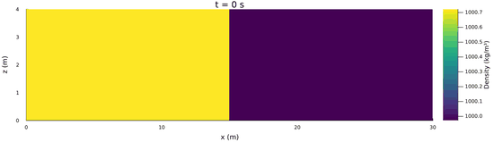
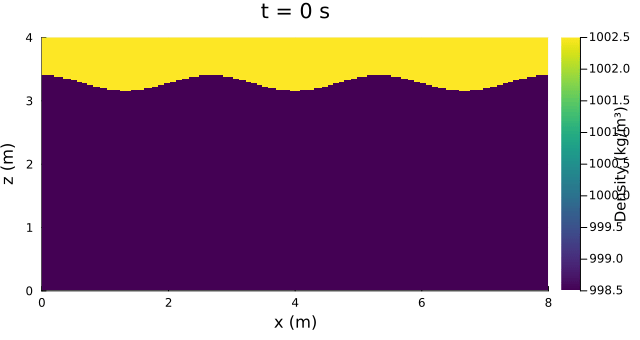
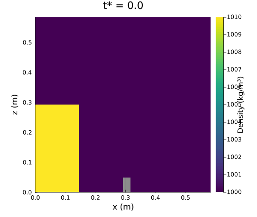
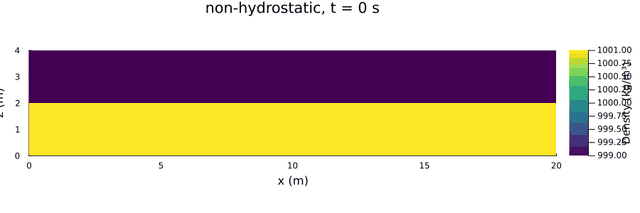

SweTransport2DV
===============

A 2DV (vertical x-z plane) model for density-driven and free-surface flows, written in Julia.
It is meant for problems involving transport, mixing, stratification and waves:
- gravity currents and exchange flows, e.g. the lock exchange;
- stratified shear and its instabilities (Kelvin-Helmholtz, Rayleigh-Taylor);
- buoyant plumes and jets;
- internal and surface waves (internal seiches, dam breaks);
- wind-driven transport and mixing;
- flow through and over rigid and flexible vegetation.

It provides reference solutions for cases without an analytical solution, and it is a
test bed for numerical choices such as advection schemes, time steps, the hydrostatic
approximation and free-surface treatment.

Model
-----

- Free-surface shallow-water equations in the vertical plane with a transported density field
  (Boussinesq, reference density rho0).
- Hydrostatic or non-hydrostatic pressure. The non-hydrostatic correction uses a pressure
  projection, with a spectral (DCT) or sparse solver.
- Semi-implicit free surface (Casulli & Cheng 1992 type).
- Momentum advection: second-order TVD (MUSCL/MC limiter) or first-order upwind.
- Density advection (`transport_advection_scheme`): conservative first-order upwind (default) or
  second-order TVD (flux-limited Lax-Wendroff, MC limiter).
- Variable bed (`bed_level`): a bed level per column on the z-level grid (staircase), e.g. sills and
  obstacles; the non-hydrostatic projection then uses the sparse solver on the wet cells.
- Optional extras:
  - molecular viscosity;
  - mixing-length turbulence, or a k-epsilon closure with buoyancy and vegetation terms (`turbulence_closure`);
  - log-law bed friction with wall functions (`bed_roughness_length`);
  - wind stress and wind-induced mixing;
  - Rayleigh damping and a Froude limiter for numerical stabilisation;
  - vegetation: canopy patches and individual stems, rigid or flexible (quasi-static elastica);
  - a uniform body force (`body_force_x`, channel slope) and an absorbing sponge layer (`sponge_length`, `sponge_rate`).
- Diagnostics: water volume, constituent mass, boundary fluxes, CFL numbers, reduced gravity and
  internal wave speed. Plots and animations are written to `output_barotropic/`.

Experiments
-----------

Each experiment has its own folder under `experiments/`. Where available, the folder holds a
README with a description, settings and figures in its `figures/` subfolder.

| Experiment | Folder | Topic |
|---|---|---|
| [Lock exchange](experiments/lock_exchange/README.md) | `lock_exchange/` | gravity current, front speed, Kelvin-Helmholtz billows, hydrostatic vs. non-hydrostatic |
| [Lock exchange with obstacle](experiments/lock_exchange_obstacle/README.md) | `lock_exchange_obstacle/` | density-stratified dam break with obstacle, variable bed, Boussinesq scaling |
| [Rayleigh-Taylor instability](experiments/rayleigh_taylor/README.md) | `rayleigh_taylor/` | heavy over light fluid, linear growth vs. theory, overturning and mixing |
| [Kelvin-Helmholtz instability](experiments/kelvin_helmholtz/README.md) | `kelvin_helmholtz/` | stratified shear layer, periodic domain, billow merging and mixing |
| Buoyant plumes | `plumes/` | rising and sinking plumes |
| Jet | `jet/` | impulse jet, shear |
| Internal seiche | `internal_seiche/` | two-layer standing internal wave, period |
| Surface dam break | `surface_dam_break/` | barotropic bore and rarefaction, front speed |
| [Wind-driven double gyre](experiments/wind_shear/README.md) | `wind_shear/` | wind stress over a closed two-layer basin, double gyre, hydrostatic vs. non-hydrostatic |
| [Vegetation](experiments/vegetation/README.md) | `vegetation/` | rigid and flexible canopies and stems, emergent and submerged; channel flow, wave damping and gravity currents against references |
| Validation | `validation/` | comparisons with analytical or semi-analytical references |

<a href="experiments/lock_exchange/README.md"></a>

*Lock exchange, non-hydrostatic, 1500 x 200 cells: Kelvin-Helmholtz billows behind the gravity-current
fronts (see the [lock-exchange README](experiments/lock_exchange/README.md)).*

<a href="experiments/rayleigh_taylor/README.md"></a>

*Rayleigh-Taylor instability, non-hydrostatic, 400 x 160 cells: a heavy layer on top of light water overturns
into sinking plumes (see the [Rayleigh-Taylor README](experiments/rayleigh_taylor/README.md)).*

<a href="experiments/lock_exchange_obstacle/README.md"></a>

*Lock exchange with obstacle, non-hydrostatic, 584 x 584 cells over a variable bed: a column of heavy water
collapses, overflows a small obstacle and runs up the far wall, a density-stratified version of the classical dam
break with obstacle (see the [lock-exchange-with-obstacle README](experiments/lock_exchange_obstacle/README.md)).*

<a href="experiments/wind_shear/README.md"></a>

*Wind-driven double gyre, non-hydrostatic, 400 x 160 cells: a wind stress over a closed two-layer basin drives a
clockwise cell in the upper layer and a counter-rotating cell in the lower layer, with an internal seiche on top (see the
[wind-driven double gyre README](experiments/wind_shear/README.md)).*

Folder layout
-------------
- `src/`: Julia package source.
- `test/`: test suite (`runtests.jl`, which includes one `test_*.jl` file per functional area) and technical
  documentation (`TESTS_TECHNICAL_DOCUMENTATION.md`).
- `experiments/`: one folder per experiment (scripts, README, `figures/`), plus `validation/`,
  `benchmarks/`, `common/` and `maintenance/`.
- `analysis/`: Python evaluation tools, e.g. `analysis/lock_exchange/` (bulk reference values and
  evaluation of model runs, see its README).

Install
-------
From this folder:

```pwsh
julia --project=. -e "using Pkg; Pkg.instantiate()"
```

Run tests
---------

```pwsh
julia --project=. -e "using Pkg; Pkg.test()"
```

Technical test documentation:
- `test/TESTS_TECHNICAL_DOCUMENTATION.md`

Run experiments
---------------

```pwsh
julia --project=. experiments/benchmarks/bench_speedup_dx001_vs_dx002.jl
julia --project=. experiments/benchmarks/profile_step_dx002.jl
julia --project=. experiments/lock_exchange/plot_density_hydro_vs_nonhydro_100s.jl
julia --project=. experiments/lock_exchange/run_dx001_dt0005_100s_anim.jl
julia --project=. experiments/lock_exchange/run_dx002_dt001_100s.jl
julia --project=. experiments/lock_exchange/run_dx002_dt001_100s_anim.jl
julia --project=. experiments/rayleigh_taylor/plot_rayleigh_taylor.jl
julia --project=. experiments/rayleigh_taylor/run_reference_dt0005_25s_anim.jl
julia --project=. experiments/rayleigh_taylor/run_fast_dt0004_25s_anim.jl
julia --project=. experiments/plumes/run_rising_plume_dt001_40s_anim.jl
julia --project=. experiments/plumes/run_sinking_plume_dt001_40s_anim.jl
julia --project=. experiments/jet/run_jet_impulse_dt0005_20s_anim.jl
julia --project=. experiments/internal_seiche/run_internal_seiche_dt005_400s_anim.jl
julia --project=. experiments/surface_dam_break/run_surface_dam_break_dt001_60s_anim.jl
julia --project=. experiments/kelvin_helmholtz/plot_kelvin_helmholtz.jl
julia --project=. experiments/kelvin_helmholtz/run_kelvin_helmholtz_dt00025_120s_anim.jl
julia --project=. experiments/wind_shear/plot_wind_shear.jl
julia --project=. experiments/wind_shear/plot_wind_shear_analytic.jl
julia --project=. experiments/vegetation/plot_vegetation_reconfiguration.jl
julia --project=. experiments/vegetation/plot_vegetation_channel.jl
julia --project=. experiments/vegetation/plot_vegetation_patch.jl
julia --project=. experiments/vegetation/run_oscillating_flow_with_flexible_vegetation.jl
julia --project=. experiments/vegetation/plot_vegetation_waves.jl
julia --project=. experiments/vegetation/plot_vegetation_luhar_nepf.jl
julia --project=. experiments/vegetation/plot_vegetation_lock_exchange.jl
julia --project=. experiments/vegetation/plot_vegetation_lock_exchange_canopies.jl
julia --project=. experiments/validation/validate_surface_dam_break_front_speed.jl
julia --project=. experiments/validation/validate_internal_seiche_period.jl
julia --project=. experiments/validation/validate_lock_exchange_front_speed.jl
julia --project=. experiments/validation/validate_wind_shear_transport_mixing.jl
julia --project=. experiments/validation/audit_hydrostatic_continuity_free_surface.jl
julia --project=. experiments/validation/smoke_all_new_cases.jl
```

Free-surface treatment (variable top layer)
-------------------------------------------

By default, the hydrostatic mode (`use_hydrostatic=true`) gives the top layer the thickness dz + eta instead of a fixed dz: its
volume change enters the top-layer budgets and the free surface is a material boundary. This removes a zero-flux inconsistency at
a moving surface that otherwise acts as a spurious density source in the top row. The non-hydrostatic mode keeps the legacy fixed
(dz) grid for this bookkeeping; see the section below for what does and does not move there.

The surface must stay inside the top layer (`top_layer_min_fraction`; the run stops with a clear error otherwise — there is no
layer removal or wetting/drying). Set `ModelConfig(variable_top_layer=false)` explicitly for hydrostatic cases with a large
surface excursion relative to dz, such as the surface dam break or a large-amplitude forced wave; the affected experiment/
validation scripts already do this (see the `variable_top_layer=false` comments there). Force it on for a specific case with
`variable_top_layer=true` (rejected for `use_hydrostatic=false`). Details, the full per-step formulation and limitations: section
13 of `test/TESTS_TECHNICAL_DOCUMENTATION.md`.

Non-hydrostatic free surface
-----------------------------

The non-hydrostatic branch's free surface used to stay pinned at round-off regardless of real internal forcing (an incidental
rigid-lid coupling through the order momentum, the barotropic solve and the non-hydrostatic pressure projection ran in — not a
deliberate choice). This is fixed: eta now responds to genuine internal (baroclinic) forcing in non-hydrostatic mode, exactly as
it already did in hydrostatic mode, with no change to either mode's continuity/kinematic guarantees.

By default this does NOT make free-surface gravity waves dispersive: a pure surface wave (uniform density, so no baroclinic
forcing) still follows the shallow-water relation `T = 2L/sqrt(gH)`, not the full `omega^2 = g*k*tanh(k*H)` relation, because the
barotropic surface force is applied outside the elliptic (non-hydrostatic) solve rather than coupled into it as a Dirichlet
condition. Details: section 14 of `test/TESTS_TECHNICAL_DOCUMENTATION.md`.

Set `ModelConfig(nonhydro_surface_dirichlet=true, pressure_solver_method="sparse")` (non-hydrostatic mode only) to fix this: the
pressure correction's top condition becomes Dirichlet `p'=0` instead of Neumann, and the resulting surface waves are genuinely
dispersive (validated against `omega^2=g*k*tanh(k*H)`, converging under grid refinement). Requires the `sparse` pressure solver (the
spectral one cannot represent a Dirichlet condition) and is implemented for the fixed grid only (not combined with
`variable_top_layer`). It is noticeably more expensive at large grid sizes than the default spectral solver — on this machine, a
1500x200 grid took about 1.9 s to factorize once and about 0.095 s per step for the pressure solve alone, comparable to or exceeding
a full spectral-method step's total cost. Details, the physical derivation, and a second defect found and fixed while validating
this (a "trivial" reference-density pressure contribution that otherwise dominates the correction's magnitude): section 15 of
`test/TESTS_TECHNICAL_DOCUMENTATION.md`.

Archive legacy root outputs (safe cleanup)
------------------------------------------

To keep only per-case subfolders in output_barotropic and archive old root-level files
without deleting them:

```pwsh
julia --project=. experiments/maintenance/archive_legacy_root_outputs.jl
```

This moves root-level files into a timestamped folder:
- output_barotropic/_legacy_root_archive/<timestamp>/

Plotting backend note
---------------------

The plotting code is configured for safer batch/headless execution:
- Uses non-interactive GR workstation defaults when not explicitly overridden.
- Avoids NaN-delimited vector segments in overlays.
- Applies finite color limits and robust y-limits to reduce plotting-range warnings.

Performance notes
-----------------
The port was written with in-place kernels and reusable workspaces in computationally intensive paths:
- Advection and limiter operations in src/physics.jl.
- Step orchestration and major temporaries in src/model.jl.
- Pressure correction solver buffers in src/pressure.jl.

This avoids repeated per-step allocations in hotspot functions and is intended to provide substantial speedup over the original pure NumPy path.

License
-------

MIT, see [LICENSE](LICENSE).
