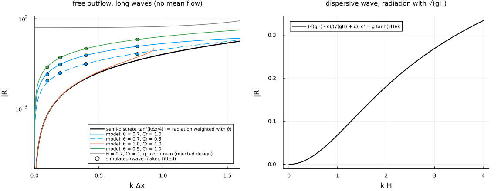
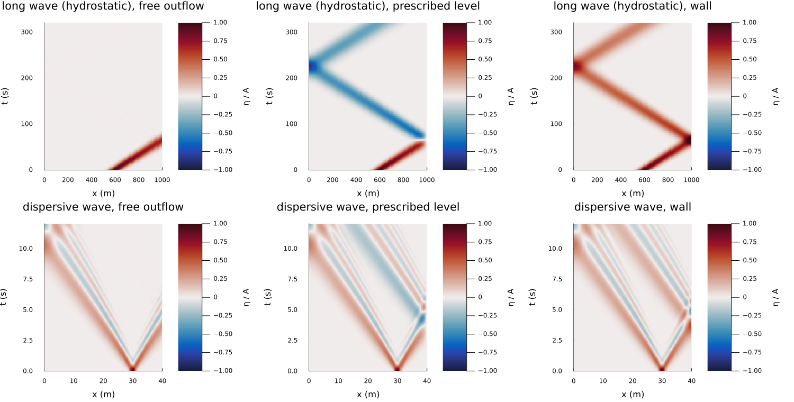
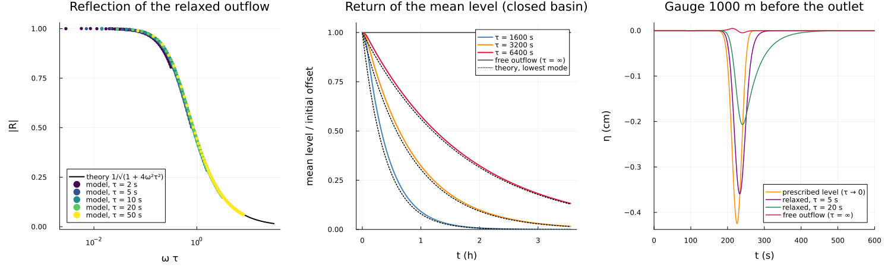
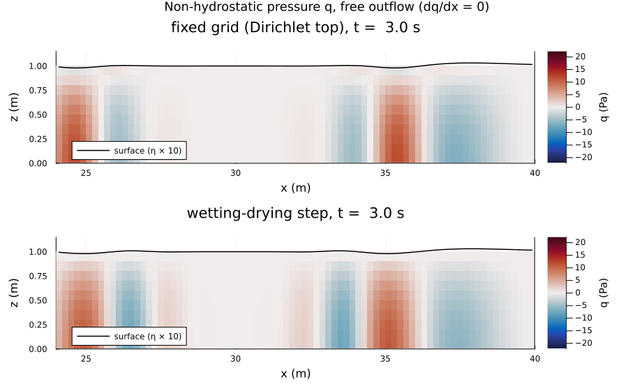
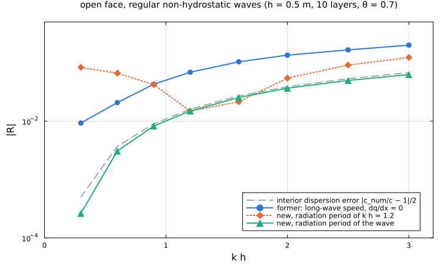
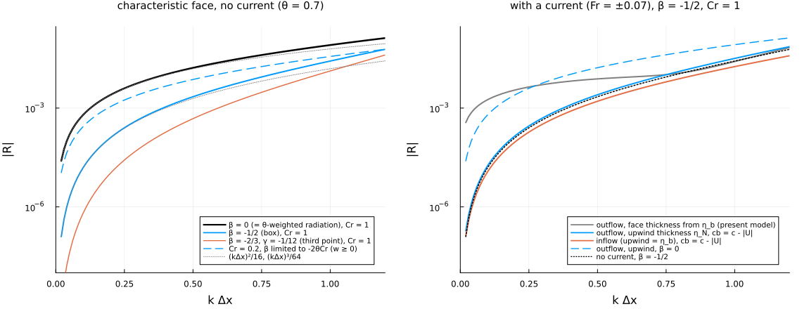
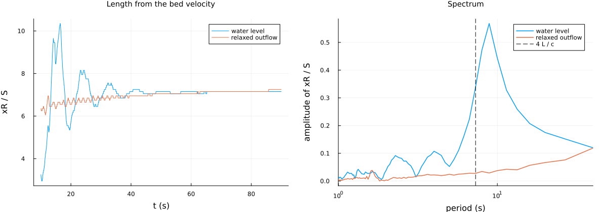

Open and non-reflecting boundaries: numerical method
===================================================

This note describes how SweTransport2DV treats the open ends of a 2DV channel: the inflow at $x=0$, and at $x=L$ the
outflow that lets waves leave (the free outflow, a radiation condition) or relaxes them to a target level. In the
wetting-drying step the left end can be a free face as well (section 7.3). It gives the
discretization, a linear analysis of the reflection, and the tests that confirm it. The scheme is the one in the
repository (`src/model.jl`, `src/wetting_drying.jl`); sections 21, 22, 24, 25 and 28 of
`docs/TESTS_TECHNICAL_DOCUMENTATION.md` hold further results. The figure script for sections 5 and 6 is
`docs/figures/numerics_figures.jl`.

The boundaries work on all three grids of the model: the fixed grid, the variable top layer and the wetting-drying
step with cut cells (`docs/numerics_wetting_drying.md`). They also work in the non-hydrostatic mode.

Contents:
1. What has to be prescribed
2. Reflection of the basic conditions
3. The boundary face
4. Free outflow: radiation condition
5. Analysis of the discrete reflection
6. Relaxed free outflow
7. Non-hydrostatic pressure at the open face (7.1 why a dispersive speed alone does not help, 7.2 radiation of the
   non-hydrostatic pressure, 7.3 the free left face)
8. Characteristic open face: absorbing and generating (design)
9. Inflow
10. Practice and limitations
11. References

1 What has to be prescribed
---------------------------

The long-wave characteristics of the depth-averaged equations are $dx/dt=U\pm c$ with $c=\sqrt{gh}$ and the Riemann
invariants $U\pm2c$; for small amplitude, $u'\pm(g/c)\eta'$. A boundary needs one condition per characteristic that
enters the domain:

| boundary | subcritical (Fr < 1) | supercritical (Fr > 1) |
|---|---|---|
| inflow ($x=0$) | discharge (`left_discharge`) | discharge and level (`left_discharge`, `left_level`) |
| outflow ($x=L$) | level (`right_level`), free (`right_free`) or relaxed (`right_free` + `right_level` + `right_relaxation_time`) | free (`right_free`) |
| free left face ($x=0$; wetting-drying step) | free (`left_free`) or relaxed (`left_free` + `left_level` + `left_relaxation_time`) | free (`left_free`, outflow to the left) |

The model warns once per run if the boundary Froude number is beyond $1\pm0.05$ while the chosen condition
over-specifies the flow (a level at a supercritical outflow, or at a subcritical inflow).

2 Reflection of the basic conditions
------------------------------------

Linear long waves on a mean flow $U$ ($c=\sqrt{gh}$): let $a=(c+U)\eta_+$ and $b=(c-U)\eta_-$ be the discharge
amplitudes of the down- and upstream waves. Then $q'=a-b$ and the head perturbation is $(g/c)(a+b)$. Each end
reflects with a fixed factor:

| end | condition | reflection |
|---|---|---|
| outlet, prescribed level | $\eta'=0$ | $b/a=-(c-U)/(c+U)$; for the level, $R=-1$ at $U=0$ |
| outlet or inlet, prescribed discharge, wall | $q'=0$ | $R=+1$ |
| inlet, prescribed velocity | $u'=0$ | $a/b=(c+U)/(c-U)>1$: a high level at the inlet carries more water in |

A reach with a prescribed velocity at one end and a level at the other has the quarter-wave mode with period $4L/c$ and
the gain per period

$$
G=\frac{c_1+U_1}{c_1-U_1}\cdot\frac{c_2-U_2}{c_2+U_2},\qquad U_2=U_1h_1/h_2 .
$$

A reach with the faster flow at the inlet (behind a step, for example) has $G>1$, and the mode grows. It is computed by
`reach_mode_gain` and checked in `test_validate_reach_mode_grows_with_velocity_inlet`: the estimate is 1.41, the model
gives 1.48. A discharge inlet gives $G=(c_2-U_2)/(c_2+U_2)<1$, so the mode decays. Section 9 draws the practical
consequence.

The point of the open outflow below is to replace $R=-1$ of the prescribed level by $R\approx0$ for outgoing waves.

3 The boundary face
-------------------

All open right-hand conditions share one discretization. The level $\eta_b$ is placed **on the boundary face**
$x=L$, half a cell from the last centre $x_{n_x}$. The face velocity $u_b$ has its own momentum equation:
- **Surface slope** $(\eta_b-\eta_{n_x})/(\Delta x/2)$, with the $\theta$ weighting of the interior:
  $u_b^{n+1}=\hat u_b-g\Delta t\,[\theta s^{n+1}+(1-\theta)s^n]$. The implicit part is a Dirichlet coupling of
  column $n_x$ in the free-surface matrix, with the coefficient $2\theta^2g\Delta t^2H_b/\Delta x^2$ on the diagonal.
- **Implicit vertical column** of the face (viscosity, vertical advection, friction), as at interior faces.
- **Baroclinic pressure gradient and horizontal diffusion** of face $n_x$ (zero gradient).
- **Advection** in an open control volume. Its outer face has the velocity $\tfrac32u_b-\tfrac12u_{n_x}$ (that of a
  ghost cell with the $w$ of the last cell) and carries the zero-gradient flux $u_b$. This keeps the boundary control
  volume divergence-free, like the interior ones.
- **Face bed** (cut cells) extrapolated linearly to $x=L$, since $\eta_b$ is the level at $x=L$.

WHY on the face, not in a ghost cell at $L+\Delta x/2$: a measured or normal-depth level refers to the end of the
domain.

In the free-surface system (`docs/numerics_wetting_drying.md`, section 4) the coupling to a known level only adds
diagonal weight. The matrix stays an M-matrix, and the positivity and conservation theorems hold unchanged.

4 Free outflow: radiation condition
-----------------------------------

**Subcritical outflow.** $\eta_b$ obeys the Sommerfeld/Orlanski radiation condition for the outgoing long wave, with
the speed $c=U+\sqrt{gh}$ of the outgoing characteristic, applied to the deviation from a surface parallel to the bed
(Orlanski 1976):

$$
\frac{d\eta_b}{dt}+c\left(\frac{\eta_b-\eta_{n_x}}{\Delta x/2}-s_{bed}\right)=0,\qquad
s_{bed}=\frac{z_{b,n_x}-z_{b,n_x-1}}{\Delta x}.
$$

$U$ and $h$ are the depth-averaged velocity and the depth of the boundary face at time $n$.

WHY $s_{bed}$: uniform flow over a sloping bed has a surface parallel to the bed, also at the outlet. Without the
term the boundary face would lose its pressure force there, and the normal flow would not be a steady state.

**Time discretization:** backward Euler, implicit in the free-surface solve. With $\mu=c\Delta t/(\Delta x/2)$,

$$
\eta_b^{n+1}=\frac{\eta_b^n+\mu\bigl(\eta_{n_x}^{n+1}+s_{bed}\Delta x/2\bigr)}{1+\mu},
$$

a convex combination, stable for any $\Delta t$. Inserted into the slope of the boundary face:

$$
\frac{\eta_b^{n+1}-\eta_{n_x}^{n+1}}{\Delta x/2}=w\,\frac{\eta_{\mathrm{eff}}-\eta_{n_x}^{n+1}}{\Delta x/2},\qquad
w=\frac{1}{1+\mu},\quad \eta_{\mathrm{eff}}=\eta_b^n+\mu\,s_{bed}\Delta x/2 .
$$

This is the Dirichlet entry of a prescribed level with weight $w\in(0,1]$. The free-surface matrices, the Newton
solve of the wetting-drying step and the non-hydrostatic mode therefore need no change, and positivity is preserved.
`_update_free_outflow_level!` sets $(\eta_{\mathrm{eff}},w)$ before the solve; `_finish_free_outflow_level!` sets
$\eta_b^{n+1}$ after it.

**Supercritical outflow** ($U\ge\sqrt{gh}$): both characteristics leave, and the face level is extrapolated from the
interior, $\eta_b=\tfrac32\eta_{n_x}-\tfrac12\eta_{n_x-1}$ (weight $w=1$).

**Two properties of the formulation:**
- The slope is taken to the last cell **centre**. An outgoing wave then carries its level out, and $\eta_b$ follows it
  with a lag of half a cell. If $\eta_b$ were tied to the level extrapolated to the face, the boundary face would get the
  slope of face $n_x$, move exactly like it, and reflect as a fixed level.
- $\eta_{n_x}$ enters **at the new time level**. With $\eta_{n_x}$ of time $n$ the condition lags by one step, which at
  a gravity-wave Courant number of 1 is a whole cell. The analysis below gives $|R|\approx0.5$ for that variant; the
  measured value was 41 %.

5 Analysis of the discrete reflection
-------------------------------------

Linear 1D equations without mean flow, flat bed, $c_0=\sqrt{gH}$, the interior of the $\theta$ scheme on the C-grid,
and the boundary face of sections 3 and 4.

**Semi-discrete (continuous time).** Interior: $\dot\eta_j=-\frac{H}{\Delta x}(u_{j+1/2}-u_{j-1/2})$ and
$\dot u_{j+1/2}=-\frac{g}{\Delta x}(\eta_{j+1}-\eta_j)$. Modes $e^{i(\kappa j-\omega t)}$ ($\kappa=k\Delta x$) satisfy
$\omega=\frac{2c_0}{\Delta x}\sin\frac{\kappa}{2}$. The right-going wave has $u=(g/c_0)\eta$ and the left-going one
$u=-(g/c_0)\eta$. Write the level as $a$ (incoming) plus $b$ (reflected) at $x=L$, so that
$\eta_{n_x}=ae^{-i\kappa/2}+be^{i\kappa/2}$, $u_b=(g/c_0)(a-b)$, and let $s=\sin(\kappa/2)$, $C=\cos(\kappa/2)$.
- Boundary-face momentum $\dot u_b=-g(\eta_b-\eta_{n_x})/(\Delta x/2)$ gives $\eta_b=\eta_{n_x}+is(a-b)$.
- The radiation condition $\dot\eta_b=-c_0(\eta_b-\eta_{n_x})/(\Delta x/2)$ gives $is\,\eta_b=\eta_b-\eta_{n_x}$, hence
  $\eta_b=a-b$.

Combining, $(1-is)(a-b)=a(C-is)+b(C+is)$, so

$$
R=\frac{b}{a}=\frac{1-\cos(k\Delta x/2)}{1+\cos(k\Delta x/2)}=\tan^2\frac{k\Delta x}{4}\approx\frac{(k\Delta x)^2}{16}.
$$

The spatial discretization of the boundary is **second order** in the reflection: 0.07 % at 60 cells per wavelength,
0.27 % at 30.

**With the $\theta$ scheme.** Per step the mode has the factor $\lambda=e^{-i\omega\Delta t}$; let
$\Theta=\theta\lambda+1-\theta$ and $Cr=c_0\Delta t/\Delta x$. The interior gives the discrete dispersion relation
$(\lambda-1)^2=-4Cr^2\Theta^2\sin^2(\kappa/2)$; for $\theta>\tfrac12$, $\kappa$ is complex (damping). The boundary
equations are

$$
(\lambda-1)u_b=-2Cr\,\Theta\,\frac{g}{c_0}(\eta_b-\eta_{n_x}),\qquad
(\lambda-1)\eta_b=-2Cr\,\lambda\,(\eta_b-\eta_{n_x}),
$$

the second being the backward-Euler radiation condition. Solved for $b/a$ as above (`reflection` in the figure script):

| $\theta$, Cr | $\lvert R\rvert$ at $k\Delta x$ = 0.1 | 0.2 | 0.4 |
|---|---|---|---|
| 1.0, 1.0 | 6.3e-4 | 2.5e-3 | 1.0e-2 |
| 0.7, 1.0 (default $\theta$) | 1.5e-2 | 3.0e-2 | 6.0e-2 |
| 0.7, 0.5 | 7.5e-3 | 1.5e-2 | 3.1e-2 |
| 0.5, 1.0 | 2.5e-2 | 5.0e-2 | 1.0e-1 |

For $\theta<1$, to leading order

$$
|R|\approx\frac{(1-\theta)\,\omega\Delta t}{2}=\frac{1-\theta}{2}\,Cr\,k\Delta x ,
$$

which is first order. It comes from the different time levels of the two boundary equations. The interior and the
face momentum act at $n+\theta$, but the radiation condition samples $\eta_{n_x}$ at $n+1$: a phase shift of
$(1-\theta)\omega\Delta t$ between the boundary level and the incoming wave. At $\theta=1$ the two agree and the
semi-discrete $\tan^2(k\Delta x/4)$ remains.

The analysis was checked by simulating exactly this scheme with a wave maker at the left until periodic, and fitting
the incoming and reflected waves (dots in Figure 1). At $k\Delta x$ = 0.1, 0.2, 0.4 and 0.8 the fitted $|R|$ agrees
with the analysis within 13 %, mostly within 3 % (the larger deviations at the smallest $|R|$, where the fit is least
accurate).
That linear scheme also reproduces the model: in the long-wave pulse of section 22 (100 cells, Cr = 1) the largest
deviation from a reference without boundary is 1.14 % of the amplitude in the scheme and 1.15 % in the model at
$\theta=0.7$, and 0.06 % in both at $\theta=1$.

*Figure 1. Left: reflection coefficient of the free outflow for long waves. Black: semi-discrete $\tan^2(k\Delta x/4)$,
which is also what a radiation condition weighted with the interior $\theta$ gives. Coloured: the model's
discretization (backward-Euler radiation) for several $\theta$ and Courant numbers; dots: simulated. Grey: the rejected
lagged variant. Right: reflection of a dispersive wave by the long-wave radiation speed.*

**Observation.** If the radiation condition were weighted like the interior,
$(\lambda-1)\eta_b=-2Cr\,\Theta\,(\eta_b-\eta_{n_x})$, the analysis gives $|R|=\tan^2(k\Delta x/4)$ for every
$\theta$ and Cr (6.26e-4 against 6.25e-4 at $k\Delta x=0.1$, $\theta=0.7$, Cr = 1). The Dirichlet form of section 4
keeps a positive weight $w=1/(1+\theta\mu)$. At the default $\theta=0.7$ and Cr = 1 it reduces the reflection of long
waves by a factor of 24 at $k\Delta x=0.1$ and 6 at $k\Delta x=0.4$. Implemented as the option
`ModelConfig(radiation_theta=true)` (issue #86; default `false`, which keeps the results of issues #46, #49 and
#54 bit for bit):

$$
\eta_b^{n+1}(1+\theta\mu+r)=\eta_b^n-(1-\theta)\mu\,(\eta_b-\eta_{n_x}-s_{bed}\Delta x/2)^n
+\theta\mu\,(\eta_{n_x}^{n+1}+s_{bed}\Delta x/2)+r\eta_R ,
$$

again the Dirichlet form, with $w=(1+r)/(1+\theta\mu+r)$. Measured with regular waves at $kH=0.3$ (section 7): 0.93 %
backward Euler, 0.51 % $\theta$-weighted, 0.03 % $\theta$-weighted together with the pressure radiation of section 7.

**Dispersive waves.** The radiation speed is the long-wave speed $\sqrt{gH}$. A component with phase speed
$c<\sqrt{gH}$, $c^2=g\tanh(kH)/k$, is reflected by about $(\sqrt{gH}-c)/(\sqrt{gH}+c)$ (Figure 1, right): 2 % at
$kH=0.5$, 7 % at $kH=1$.

**Measured** (`test_open_boundaries.jl`, `experiments/open_boundaries`). The test values are the largest $|\eta|$ left
in the domain at the end of the run, after the reflected wave has travelled back to the middle and been damped by
$\theta$.
- Long Gaussian wave (width 50 m, 4 m depth, Cr = 1, $\theta=0.7$): 0.7 % ($\Delta x=10$ m) and 0.55 % (5 m) of the
  amplitude, on the fixed grid and in the wetting-drying step. A prescribed level or a wall reflects it completely.
- Dispersive wave ($kH\approx1$, non-hydrostatic): 1.34 % (fixed grid, Dirichlet top) and 1.15 % (wetting-drying step).
  A prescribed level reflects 18 % even after the $\theta$ damping.

*Figure 2. x-t diagrams of the surface. Top: long wave; bottom: dispersive wave (fixed grid). Left: free outflow;
middle: prescribed level ($R=-1$); right: wall ($R=+1$).*

6 Relaxed free outflow
----------------------

The free outflow fixes no level. On the fixed grid (depth $H$ at every face) the mean level is then a neutral mode, and
long periods (a tide, a slowly changing target) cannot be imposed. The relaxed outflow adds a nudging term (Chapman
1985; Marchesiello et al. 2001; Blayo & Debreu 2005):

$$
\frac{d\eta_b}{dt}+c\left(\frac{\eta_b-\eta_{n_x}}{\Delta x/2}-s_{bed}\right)=-\frac{\eta_b-\eta_R}{\tau}.
$$

Backward Euler with $r=\Delta t/\tau$:
$\eta_b^{n+1}(1+\mu+r)=\eta_b^n+\mu(\eta_{n_x}^{n+1}+s_{bed}\Delta x/2)+r\eta_R$. This is again the Dirichlet form,
with

$$
w=\frac{1+r}{1+\mu+r},\qquad \eta_{\mathrm{eff}}=\frac{\eta_b^n+\mu s_{bed}\Delta x/2+r\eta_R}{1+r}.
$$

$\tau=\infty$ is the free outflow bit for bit, and $\tau\to0$ the prescribed level. The supercritical branch ignores
$\tau$, since no information enters there.

**Reflection.** For $\eta=e^{i(kx-\omega t)}+R\,e^{i(-kx-\omega t)}$ with $c=\omega/k$, the radiation term cancels for
the incoming wave and doubles for the reflected one: $-2i\omega R=-(1+R)/\tau$. Hence

$$
R=\frac{-1}{1-2i\omega\tau},\qquad |R|=\frac{1}{\sqrt{1+4\omega^2\tau^2}} .
$$

The condition is a low-pass filter: periods much longer than $\tau$ are imposed, shorter ones radiated. For a reflection
below $\varepsilon$ at frequency $\omega$, choose $\tau\gtrsim1/(2\omega\varepsilon)$. A wave with a 5 min period leaves
with 0.7 % at $\tau=1$ h. A tidal period cannot be both imposed and radiated.

**Return of the level.** In a basin of length $L$ closed at $x=0$, the lowest mode has $u_b=-L\eta_t/h$ and
$\eta_x(L)=L\eta_{tt}/(gh)$. The boundary condition becomes $\eta_t+(L/c)\eta_{tt}=-\eta/\tau$, so an offset decays at

$$
\lambda=\frac{1-\sqrt{1-4(L/c)/\tau}}{2L/c}\approx\frac1\tau\quad(\tau\gg L/c).
$$

**Measured.**
- The spectral ratio $|R(\omega)|$ follows the theory over $\omega\tau=0.005\dots10$ (4 km channel, $\tau=2\dots50$ s).
- Against the prescribed-level record filtered with $R(\omega)$, the reflected record differs by 0.4-1.4 % of the
  amplitude; the floor is the radiation error of the free outflow itself.
- The decay rate of a level offset matches $\lambda$ within 0.2 % at $\tau=20L/c$.

*Figure 3. Relaxed outflow. Left: $|R|$ from the spectral ratio of the reflected records against
$1/\sqrt{1+4\omega^2\tau^2}$. Middle: return of a level offset in a closed basin against the lowest mode; the free
outflow keeps the offset. Right: gauge records from the prescribed level ($\tau\to0$) to the free outflow ($\tau=\infty$).*

7 Non-hydrostatic pressure at the open face
-------------------------------------------

The non-hydrostatic pressure $q$ needs a condition on the open face. The model uses $\partial q/\partial x=0$: the
boundary face receives no $q$ correction, so the Poisson problem keeps the boundary conditions of a closed basin. On
the fixed grid both pressure solvers (sparse and spectral) work with it, with the Neumann or the Dirichlet surface
condition.

WHY not $q=0$ on the face: measured with a Gaussian wave of width 1 m in 1 m depth ($kH\approx1$) leaving through the
free outflow, $q=0$ reflects 4.4 % (fixed grid, Dirichlet top) and 10-29 % (wetting-drying step, widths 1-5 m), against
1.34 % and 1.15 % (2-5 %) with $\partial q/\partial x=0$. A Dirichlet value forces the hydrostatic pressure at the
outlet onto a wave whose pressure is not hydrostatic.

The remaining 1.2-1.3 % comes from the long-wave speed of the radiation condition (section 5, Figure 1 right). A discharge
inlet in the non-hydrostatic mode is a prescribed velocity without $q$ correction (also $\partial q/\partial x=0$).

*Figure 4. Non-hydrostatic pressure $q$ near the free outflow while the dispersive wave leaves. $q$ is zero at the
surface, largest at the bed, and has a zero gradient at the open face.*

### 7.1 Why a dispersive radiation speed alone does not help

With $\partial q/\partial x=0$ the boundary face has no non-hydrostatic pressure gradient. Its momentum equation and the
radiation condition with speed $c_r$ then tie the face to the level: $-i\omega u_b=-g\,\partial_x\eta$ and
$-i\omega\eta_b=-c_r\,\partial_x\eta$ give $u_b=(g/c_r)\,\eta_b$. A linear dispersive wave of phase speed $c=\omega/k$ has
the depth-mean velocity $U=(c/H)\,\eta$. With incident amplitude $a$ and reflected $b$ at the face ($\eta_b=a+b$,
$U=(c/H)(a-b)$, continuity of the last half cell), in the limit $\Delta x\to0$

$$
R=\frac{c\,c_r-gH}{c\,c_r+gH}.
$$

The long-wave speed $c_r=\sqrt{gH}$ gives $(c-\sqrt{gH})/(c+\sqrt{gH})$ (the 7-9 % at $kH\approx1$ of section 5), the
phase speed $c_r=c$ twice as much, $(c^2-gH)/(c^2+gH)$, and the "impedance" speed $c_r=gH/c$ zero. Measured (regular
waves, wetting-drying step, Table 1): $c_r=c$ reflects 15.6 % at $kH=1.2$ against 6.9 % with $\sqrt{gH}$, and
$c_r=gH/c$ 5.5 %. That last value is not zero: the face momentum without $q$ also misses the depth structure of the
wave, and the Neumann condition makes the face a wall for the non-hydrostatic pressure, which reflects that part of the
wave whatever $c_r$ is.

### 7.2 Radiation of the non-hydrostatic pressure (issue #86)

`ModelConfig(nonhydro_open_face="radiation")` (wetting-drying step): the open face gets its own non-hydrostatic pressure
$q_{b,k}$ per wet face layer, which radiates like the level:

$$
\frac{dq_b}{dt}+c_r\,\frac{q_b-q_{n_x}}{\Delta x/2}=0,\qquad
q_b^{n+1}(1+\vartheta\mu)=\underbrace{q_b^n-(1-\vartheta)\mu\,(q_b-q_{n_x})^n}_{E}+\vartheta\mu\,q_{n_x}^{n+1},
$$

$\mu=c_r\Delta t/(\Delta x/2)$, $\vartheta=\theta$ with `radiation_theta`, else 1 (backward Euler). The face then
carries the correction flux $-\Delta t/\rho_0\,(q_b-q_{n_x})/(\Delta x/2)$ like an interior face, and the explicit
$(1-\theta)$ part of $q_b^n$ in its momentum predictor. In the pressure system (unknown $\theta^2q$) cell $(k,n_x)$ gains

$$
\frac{a_b}{1+\vartheta\mu}\ \text{on the diagonal},\qquad \frac{a_b\,\theta^2E}{1+\vartheta\mu}\ \text{on the right-hand side},
\qquad a_b=\frac{2h_{f}}{\Delta x^2},
$$

and nothing else: the matrix stays symmetric positive definite, and the sparse Cholesky and the column-line multigrid
(section 37 of the technical documentation) apply unchanged (they agree to $3\cdot10^{-10}$ of the amplitude). The surface
cell keeps $q=0$, so its face layer has $q_b=0$. The water volume is unaffected: the level still follows from the flux
divergence (budget closed to $10^{-14}$ m$^2$).

**Radiation speed.** With the face pressure in place, the face has the full pressure of the wave, and the right speed is
the phase speed $c$ of the wave, for the level and for $q$ alike (Table 1: the long-wave speed now reflects 7.6 % at
$kH=1.2$, the phase speed 1.5 %). `radiation_period` $T$ (s) gives both conditions the absolute phase speed of a
wave of period $T$ on the current $U$: $c_r=\omega/k$ with $(\omega-kU)^2=gk\tanh kh$, $\omega=2\pi/T$ (Newton).
$U$ is the depth-mean face velocity filtered over $T$ (implicit, $U^{n+1}=(U^n+(\Delta t/T)\,U)/(1+\Delta t/T)$), not the
instantaneous one, which contains the orbital velocity of the wave itself. $T=0$ is the long-wave speed $U+\sqrt{gh}$;
$T>0$ requires the non-hydrostatic mode and the pressure radiation (without it, 7.1 shows that the phase speed reflects
more than the long-wave speed).

**Results** (`experiments/open_boundaries/dispersive_radiation.jl`; regular waves of amplitude 2 mm from a velocity
wave maker, depth 0.5 m, 10 layers, 40 cells per wavelength, 100 steps per period, $\theta=0.7$; $|R|$ fitted from the
complex amplitude over the last 3.5 wavelengths before the face, with a complex numerical wave number):

| $kH$ | former: $\sqrt{gH}$, $\partial q/\partial x=0$ | new, period of the wave | new, period of $kH=1.2$ | $\lvert c_{num}/c-1\rvert/2$ |
|---|---|---|---|---|
| 0.3 | 0.93 % | 0.03 % | 8.3 % | 0.05 % |
| 0.6 | 2.07 % | 0.31 % | 6.6 % | 0.37 % |
| 0.9 | 4.29 % | 0.83 % | 4.2 % | 0.90 % |
| 1.2 | 6.87 % | 1.49 % | 1.49 % | 1.60 % |
| 1.6 | 10.4 % | 2.54 % | 2.1 % | 2.70 % |
| 2.0 | 13.5 % | 3.66 % | 5.5 % | 3.87 % |
| 2.5 | 16.6 % | 4.97 % | 9.1 % | 5.34 % |
| 3.0 | 20.0 % | 6.27 % | 12.3 % | 6.77 % |

*Table 1. Reflection of the open face. "New": `radiation_theta=true`, `nonhydro_open_face="radiation"`,
`radiation_period` as stated. Further variants at $kH$ = 0.3, 0.6, 1.2, 2.0 (all $\theta$-weighted, from the
study of issue #86): level radiation with $\sqrt{gH}$ and pressure radiation with $\sqrt{gH}$ 0.75, 2.5, 7.6, 14.3 %;
phase speed but $\partial q/\partial x=0$ 1.2, 4.9, 15.6, 28.7 %; new without $\theta$ weighting 0.92, 0.93, 1.7, 3.8 %.*

The new condition reduces the reflection by a factor of 3 to 30. **What remains is the interior's dispersion error, not
the boundary:** the boundary radiates the linear-theory phase speed, while the model's wave travels with $c_{num}$
(fitted wave number; 3 % faster at $kH=1.2$ with 10 layers; the period error of the non-hydrostatic wetting-drying step
is first order in the thickness of the surface cell, which has $q=0$, `docs/numerics_wetting_drying.md`). A speed
mismatch $\Delta c$ reflects about $\Delta c/(2c)$, and the measured $|R|$ is 0.84 to 0.95 of that from $kH=0.6$ on. Doubling the layers at $kH=2$ halves both (3.66 % to 1.92 %; the dispersion
error 3.87 % to 2.0 %). On a following current of 0.16 m/s the reflection is 0.06, 0.51 and 1.0 % at $kH$ = 0.6, 1.2,
2.0.

The condition is exact for one frequency. Other periods see the mismatch $c(\omega)\neq c_r$: with the period of
$kH=1.2$, long waves ($kH=0.3$) are reflected by 8.3 %, about $(\sqrt{gH}-c_r)/(\sqrt{gH}+c_r)$. Use it for regular
waves or a narrow spectrum (the period of the peak); broad-band absorption would need a rational approximation of the
dispersion relation (Wellens & Borsboom 2020; Borsboom & Jacobsen 2021).

*Figure 5. Reflection of the open face against $kH$ (Table 1). Dashed: half the relative phase-speed error of the
interior, the floor of a boundary that radiates the linear-theory speed.*

### 7.3 The free left face (issue #86)

`set_x_inflow_outflow!(...; left_free=true)` (wetting-drying step) makes face 1 an open face like the right one: it is
the mirror of sections 3, 4, 6 and 7.2.
- **Level:** the radiation condition for the wave travelling in $-x$,
  $d\eta_b/dt+c\,[(\eta_b-\eta_1)/(\Delta x/2)-s_{bed}]=-(\eta_b-\eta_R)/\tau$ with $s_{bed}=(z_{b,1}-z_{b,2})/\Delta x$
  and the speed $c=-U+\sqrt{gh}$ ($U$ positive into the domain), or the phase speed of `radiation_period` on the current
  $-U$; the same Dirichlet form ($w$, $\eta_{\mathrm{eff}}$) couples column 1 in the free-surface system (the matrix
  stays an M-matrix). Supercritical outflow to the left: the level extrapolated to $x=0$. With `left_level` and
  `left_relaxation_time` the level relaxes to `left_level` (relaxed free face).
- **Face momentum:** surface slope $(\eta_1-\eta_b)/(\Delta x/2)$, the baroclinic pressure gradient of face 2, the
  advection in an open control volume with the first cell as ghost cell, its own implicit vertical column; the face bed is
  extrapolated to $x=0$.
- **Pressure:** with `nonhydro_open_face="radiation"` its own radiating $q_b$ per layer (diagonal only).
- The shared code (`_radiation_dirichlet`, `_radiation_speed`) is that of the right face; the right face's backward-Euler
  arithmetic is unchanged (bit for bit).

**Checks** (`test/test_open_boundary_radiation.jl`):
- A symmetric hump (1 cm) in a channel with free faces at both ends stays mirror-symmetric to $8\cdot10^{-16}$ m, with the
  former and the new options: the left face is the exact mirror of the right one.
- A wave packet of $kH=1.2$ (envelope 1.5 wavelengths) leaving through either face leaves the same deviation from a
  three times longer reference channel: 2.17 % of the amplitude with the former condition, 0.68 % with the new options,
  left and right alike.
- A current of 0.16 m/s leaving through a relaxed free left face (velocity inflow at the right) is a steady state to
  round-off ($10^{-16}$).

Not covered yet: generating waves through an open face (an incoming signal prescribed while the outgoing waves radiate),
needed for waves against a current that enters at $x=0$ (#85). Section 8 gives the formulation for it.

8 Characteristic open face: absorbing and generating (issue #86)
----------------------------------------------------------------

**Status: design.** Nothing in this section is implemented yet. The order of the work is in
`docs/plan_issue_86_relaxation_zones.md`. The method follows Borsboom (2023) and Mooiman (2024), adapted from their
collocated finite-volume-element scheme to the staggered 2DV grid of this model.

### 8.1 Two conditions per open face

On the staggered grid an open face has two unknowns of the depth-integrated flow: the face level $\eta_b$ and the face
discharge $Q_b=\sum_k h_{f,k}u_{b,k}$. It therefore needs two equations:
- a **natural condition**: a combination of the model equations that describes the information leaving the domain. It
  is not a boundary condition but part of the interior physics.
- an **essential condition**: the genuine boundary condition, which describes the information entering the domain.

Linearized about a current $U$, with the outward normal $n$, the outward discharge $Q_n$ and the outward velocity
$U_n$, the two characteristic variables are

$$
w_{out}=c_{in}\,\eta+Q_n,\qquad w_{in}=c_{out}\,\eta-Q_n,
$$

with the speeds $c_{out}=U_n+c$ of the outgoing and $c_{in}=c-U_n$ of the incoming characteristic (both positive when
the flow is subcritical). For long waves $c=\sqrt{gh}$; this is Mooiman's diagonalization with the coefficients
$\sqrt{gh}\mp q/h$. $w_{in}$ is zero for an outgoing wave ($Q_n'=c_{out}\eta'$), and $w_{out}$ is zero for an
incoming one.

**Dispersive waves.** For a linear wave on a uniform current the depth-integrated relation $Q'=(U\pm c_i)\,\eta'$, with
$c_i=\sigma/k$ the intrinsic phase speed, holds for any $kh$. With $c_{out}$ and $c_{in}$ set to the absolute phase
speeds of the design period (section 7.2: $(\omega-kU)^2=gk\tanh kh$, solved once with $U_n$ and once with $-U_n$),
the split is exact at that frequency. For a sheared current (Klopman's flume) it is an approximation.

**Velocity form.** With $Q_n=H\bar u_n+U_n\eta$ the two variables become
$w_{in}=c_{i,out}\,\eta-H\bar u_n$ and $w_{out}=c_{i,in}\,\eta+H\bar u_n$, with the intrinsic phase speeds of the
outgoing and incoming design waves ($c$ for long waves). A linear wave has $\bar u'=(c_i/h)\,\eta'$, so in this form the
current drops out of the variables. It enters only through the advection and the continuity flux. The face unknowns of
the model are velocities, so the implementation uses this form, and the natural condition becomes $c_{i,in}$ times
continuity plus $H$ times the velocity form of the face momentum.

**Natural condition** ($c_{in}$ times continuity plus momentum):

$$
\partial_t w_{out}+c_{out}\,\partial_n w_{out}=0 .
$$

**Essential condition**, as a time increment with a drift correction (Borsboom 2023, eq. 3–4):

$$
\Delta w_{in}=\Delta F-\varepsilon\,\bigl(w_{in}^n-w_T\bigr),\qquad \varepsilon=\Delta t/\tau,\quad
w_T=c_{out}\eta_T-Q_{n,T}.
$$

- **Incoming wave** $\Delta F$:
  - Given the level $\eta_{in}(t)$ of the incoming wave: $\Delta F=(c_{out}+c_{in})\,\Delta\eta_{in}$, that is
    $2\sqrt{gh}\,\Delta\eta_{in}$ without current (Mooiman 2024, eq. 17).
  - Given its inward discharge $q_{in}(t)$: $\Delta F=\frac{c_{out}+c_{in}}{c_{in}}\,\Delta q_{in}$ (eq. 22).
  - $\Delta F=0$: a purely absorbing face.
- **Drift correction:** the $\varepsilon$ term keeps $w_{in}$ near the target $w_T$. Without it the increment form leaves
  the mean level as a neutral mode, which is Mooiman's missing integration constant.

**Why this solves the trade-off of section 6.** The relaxation of section 6 acts on $\eta_b$ and reflects
$1/\sqrt{1+4\omega^2\tau^2}$. With $\tau=10$ s at $T=1.44$ s that is 1.1 %, as large as the radiation error itself.
The correction here acts on $w_{in}$, which an outgoing linear wave does not change. So it reflects nothing at the
design frequency, whatever $\varepsilon$ is. For the same reason an incoming signal can be imposed without reflecting
the outgoing waves.

**One free condition per face.** The mean state is not fixed by the face alone; it lies on the line
$c_{out}\bar\eta-\bar Q_n=w_T$. The target must therefore contain the discharge that actually passes. Example: with
$Q_T=0$ and the 0.08 m²/s of Klopman's flume, the mean level at the face would end up
$\bar Q_n/c_{out}\approx0.08/2.4\approx3$ cm above $\eta_T$. With $(\eta_T,Q_T)$ at both faces consistent with the
friction slope, the mean flow is exact.

### 8.2 The present open face is the simplest discretization

On the staggered grid, write the natural condition at the right face as $c_{in}$ times the continuity over the half
cell between centre $N=n_x$ and the face, plus the face momentum:

$$
c_{in}\Bigl[\frac{d}{dt}\bigl(\beta\eta_b+(1-\beta)\eta_N\bigr)+\frac{Q_b-Q_{b-1}}{\Delta x}\Bigr]
+\Bigl[\frac{dQ_b}{dt}+gH\,\frac{\eta_b-\eta_N}{\Delta x/2}+\dots\Bigr]=0 .
$$

The continuity of cell $N$ is solved anyway, $d\eta_N/dt=-(Q_b-Q_{b-1})/\Delta x$, so this reduces to

$$
\frac{dQ_b}{dt}+gH\,\frac{\eta_b-\eta_N}{\Delta x/2}+\dots=-c_{in}\,\beta\,\frac{d}{dt}(\eta_b-\eta_N) ,
$$

the face momentum with one extra term. The dots stand for the other terms of the face momentum (advection, friction,
vertical exchange, baroclinic gradient).
- **$\beta=0$:** the natural condition is the face momentum of section 3. Linear, frictionless and without current, the
  essential condition with $\Delta F=0$ and $\varepsilon=0$, combined with it, gives exactly the $\theta$-weighted radiation condition of
  section 5 (`radiation_theta=true`).
- **Backward-Euler radiation** (the default) is not this increment form. That is why it reflects to first order.
- **The relaxation of section 6** acts on $\eta_b$ instead of $w_{in}$.

So the present face is the characteristic pair with the simplest natural condition. What the characteristic form adds
is (a) the incoming signal $\Delta F$, (b) the drift correction on $w_{in}$ instead of $\eta_b$, and (c) the free
weight $\beta$.

### 8.3 The weight $\beta$ (box form)

The linear analysis of section 5 (flat bed, no current, the $\theta$ scheme on the C-grid) with this natural condition
and the increment-form essential condition gives, in the semi-discrete limit with $s=\sin(k\Delta x/2)$,
$|R|\approx\tfrac12(\tfrac12+\beta)\,s^2$ to leading order. For $\beta=0$ that is $\tan^2(k\Delta x/4)$ of section 5.
**$\beta=-\tfrac12$ cancels it**, leaving $|R|\approx(k\Delta x)^3/64$, third order. With $c_{in}=c_{out}=c$ the
boundary level then obeys

$$
\frac{d}{dt}\,\frac{\eta_b+\eta_N}{2}+c\,\frac{\eta_b-\eta_N}{\Delta x/2}=\frac{\Delta F}{c\,\Delta t},
$$

a box scheme. The time derivative is taken at the centre of the half cell, where the slope is centred.

| $k\Delta x$ | 0.1 | 0.2 | 0.4 | 0.8 |
|---|---|---|---|---|
| $\beta=0$ (= `radiation_theta=true`) | 6.3e-4 | 2.5e-3 | 1.0e-2 | 4.7e-2 |
| $\beta=-\tfrac12$ | 1.6e-5 | 1.3e-4 | 1.1e-3 | 1.1e-2 |

*Table 2. $|R|$ of the characteristic face, $\theta=0.7$, Cr = 1, from the discrete analysis. The values hardly
depend on $\theta$ and Cr (checked for $\theta$ = 0.5, 0.7, 1 and Cr = 0.5, 1, 2).*

A simulation of the same linear scheme (wall at $x=0$, a right-going Gaussian pulse of 12 cells half-width, $\theta=0.7$)
confirms this: the reflected pulse is 25 to 45 times smaller with $\beta=-\tfrac12$ at Cr = 0.1 to 2. The scheme is
stable at all those Courant numbers. Its only eigenvalue of modulus 1 is the neutral mean level, which $\varepsilon>0$
removes.

Borsboom's coefficients (3/8, 3/4, −1/8 for the natural condition; 11/24, 7/12, −1/24 for the essential condition) belong
to the collocated FVE scheme with its consistent mass matrix and do not apply here. The principle carries over: match the
boundary stencil to the interior scheme by Fourier analysis (Vichnevetsky 1987; Trefethen 1982).

**Normal-mode analysis with a current** (`characteristic_reflection` in `docs/figures/numerics_figures.jl`; Gustafsson,
Kreiss & Sundström 1972). The interior has a current $U$:
- an upwind level in the continuity flux, as the face thicknesses of the wetting-drying step;
- first-order upwind momentum advection;
- all terms $\theta$-weighted. The model's advection is explicit, so this is an approximation.

Every mode that the face can reflect is included: for inflow through the face, a second, spurious mode of the upwind
advection is reflected too. Without current and with $\beta=0$ it reproduces the analysis of section 5 to the last digit.

*Figure 6. Reflection of the characteristic face (linear, $\theta=0.7$). Left: without current. Right: with a current
of Froude number ±0.07, Klopman's flume.*

Results ($\theta=0.7$, Cr = 1; $|R|$ at $k\Delta x$ = 0.1, 0.2, 0.4):
- **$\theta$ weighting of the $\beta$ term:** none is needed. The term is a time difference, and $|R|$ for
  $\beta=-\tfrac12$ is the same for $\theta$ = 0.5, 0.7, 1 and Cr = 0.5, 1, 2 to within 15 % at $k\Delta x\le0.4$.
- **A third point.** A term $\gamma\,\eta_{N-1}$ in the time derivative,
  $\beta\eta_b+\gamma\eta_{N-1}+(1-\beta-\gamma)\eta_N$, is optimal at $\beta=-\tfrac23$, $\gamma=-\tfrac1{12}$. That is
  fourth order: 6.6e-7, 1.1e-5, 1.8e-4, against 1.6e-5, 1.3e-4, 1.1e-3 for the box form.
  **Not adopted.** The box form already reflects about $10^{-4}$ at the resolution of #85 ($k\Delta x\approx0.16$), far
  below the floor of the interior dispersion (1.5 %, section 7.2). The third point would also couple $Q_b$ positively to
  $\eta_{N-1}$, which weakens the M-matrix at small Courant numbers.
- **The face thickness (a finding about the present model).** The open face takes its layer thicknesses from the face
  level $\eta_b$ (section 3), also when the flow leaves through it. The interior faces take the upwind cell. For outflow
  that mismatch reflects to **first order**, $|R|\approx0.27\,Fr\,k\Delta x$, whatever $\beta$, $\theta$ and Cr are:
  1.8e-3, 3.5e-3, 6.5e-3 at Fr = 0.07 with $\beta=-\tfrac12$. With the upwind cell $\eta_N$ for outflow (and $\eta_b$ for
  inflow, where it is upwind) this drops to 1.8e-5, 1.4e-4, 1.2e-3. The same term is expected in the present free outflow
  ($\beta=0$); for Klopman's flume it is about 0.3 %. The characteristic face uses the upwind level. Whether the present
  outflow should change too is decided after a model test (step 3), because the face thickness also enters the steady
  normal flow over a sloping bed.
- **The coefficient of the $\beta$ term with a current:** best is $c-|U_n|$, the speed of the slower characteristic
  ($c_{in}$ for outflow, $c_{out}$ for inflow). The table gives $|R|$ at $k\Delta x$ = 0.1, 0.2, 0.4.

  | Fr (+ out, − in) | $\beta=0$ | $\beta=-\tfrac12$, coefficient $c$ | $\beta=-\tfrac12$, coefficient $c-\lvert U_n\rvert$ |
  |---|---|---|---|
  | +0.07 | 6.3e-4, 2.5e-3, 1.1e-2 | 4.8e-5, 2.4e-4, 1.5e-3 | 1.8e-5, 1.4e-4, 1.2e-3 |
  | −0.07 | 4.7e-4, 1.9e-3, 7.8e-3 | 3.5e-5, 1.7e-4, 1.0e-3 | 1.2e-5, 9.4e-5, 7.9e-4 |
  | +0.20 | 6.3e-4, 2.5e-3, 1.1e-2 | 1.3e-4, 5.5e-4, 2.8e-3 | 3.2e-5, 1.9e-4, 1.5e-3 |
  | −0.20 | 2.8e-4, 1.1e-3, 4.6e-3 | 5.6e-5, 2.3e-4, 1.1e-3 | 1.3e-5, 6.6e-5, 4.4e-4 |

  The box form keeps its gain with a current in either direction. That includes the inflow through an absorbing face,
  which is the opposing case of #85.
- **Box form for $q_b$:** not analysed, since the analysis has no non-hydrostatic interior. Its expected gain is small:
  the second-order error of the $q$ radiation is about $(k\Delta x)^2/16\approx1.5\cdot10^{-3}$ at $k\Delta x=0.16$, an
  order below the dispersion floor. In the pressure system the box form only adds diagonal weight,
  $a_b/(\tfrac12+\vartheta\mu)>0$, so it is safe to try. It is tested as a variant in the model in step 3.

### 8.4 Coupling in the free-surface solve

Right face, $D=\eta_b-\eta_N$, $\varphi=\theta g\Delta t\,H_f/(\Delta x/2)$ (m/s; $H_f$ the
effective depth of the implicit column, as in section 3), $\hat Q_b$ the depth-integrated predictor, and
$c_\beta=c-|U_n|$ the coefficient of the $\beta$ term (section 8.3; $c_{in}$ for outflow). The face discharge and the
essential condition are

$$
Q_b^{n+1}=\hat Q_b+c_\beta\beta D^n-(\varphi+c_\beta\beta)\,D^{n+1},\qquad
c_{out}(\eta_b^{n+1}-\eta_b^n)-(Q_b^{n+1}-Q_b^n)=G ,
$$

with $G=\Delta F-\varepsilon(w_{in}^n-w_T)$. In the velocity form of 8.1, $c_{out}$ becomes $c_{i,out}$ and $Q_b$
becomes $H\bar u_b$; linearly the two are the same. Eliminating $\eta_b^{n+1}$ gives the Dirichlet form of section 4:

$$
Q_b^{n+1}=\hat Q_b+c_\beta\beta D^n+\varphi\,w\,(\eta_N^{n+1}-\eta_{\mathrm{eff}}),\qquad
w=\frac{(\varphi+c_\beta\beta)\,c_{out}}{\varphi\,(c_{out}+\varphi+c_\beta\beta)},
$$

$$
\eta_{\mathrm{eff}}=\eta_b^n+\frac{\hat Q_b-Q_b^n+c_\beta\beta D^n+G}{c_{out}} .
$$

The explicit flux $c_\beta\beta D^n$ goes into the predictor of the face, and $\eta_b^{n+1}$ follows after the solve
from the essential condition. The free-surface matrix, the Newton iteration and the non-hydrostatic mode keep their
structure.
- **$\beta=0$:** $w=1/(1+\varphi/c_{out})$, the weight of the $\theta$-weighted radiation (with $c_r=c$). The
  difference is that $\eta_{\mathrm{eff}}$ now contains every explicit tendency of the face (advection, friction,
  vertical exchange), because the essential condition is written for $Q_b$, not for $\eta_b$. The results therefore
  are not bit for bit those of section 5, and the scheme is a new option.
- **M-matrix.** The boundary adds $a_b=w\cdot2\,\mathrm{coeff}\,H_f$ to the diagonal of column $N$. For
  $\beta=-\tfrac12$, $w<0$ when $\varphi<c_\beta/2$ (about $2\theta Cr<\tfrac12$). Then
  $a_b=\theta Cr\,(2\theta Cr-\tfrac12)/(\tfrac12+2\theta Cr)\ge-0.05$ (no current). While the boundary column is wet
  ($p_N=1$), the row stays strictly diagonally dominant, so $P+T$ stays an M-matrix and the positivity and conservation
  of the wetting-drying step hold.
- **Dry boundary column.** A column that can fall dry needs $w\ge0$, i.e. $\beta$ limited to
  $\beta_{\mathrm{eff}}=\max(\beta,-\varphi/c_\beta)$. That costs accuracy at small Courant numbers ($|R|$ at
  $k\Delta x=0.2$: 1.8e-3 at Cr = 0.1 and 4.2e-4 at Cr = 0.3, against 1.3e-4 unlimited; still below the 2.5e-3 of
  $\beta=0$). Rule:
  - the full $\beta$ is used when the boundary column is at least `open_face_wet_depth` deep at time $n$ (a named
    parameter, m);
  - otherwise $\beta_{\mathrm{eff}}$;
  - safeguard: if a Newton iterate nevertheless finds the boundary row not diagonally dominant
    ($p_N+a_N+a_b\le a_N$), the solve is repeated with $\beta_{\mathrm{eff}}$.

  The flume of #85 (0.5 m deep, never dry) always runs with the full $\beta$.

### 8.5 The 2DV parts

- **Layers.** The natural condition is depth-integrated, while the face keeps one momentum equation per layer
  (friction, vertical exchange, baroclinic gradient). The $\beta$ term acts like a pressure gradient and is distributed
  like the surface slope, $\Delta u_{b,k}\propto r_k/H_f$, so that its depth integral is exact.
- **Non-hydrostatic pressure.** $q_b$ keeps its radiation (section 7.2). For generation, the deviation from the
  incoming wave radiates,
  $q-q_{in}$ with $q_{in}(z,t)=\rho_0 g\,\eta_{in}(t)\,\bigl(\cosh k(z+h)/\cosh kh-1\bigr)$, where $k$ is the
  incoming wave number of the design period. $q_{in}$ is evaluated at the face and at centre $N$, so that the half-cell
  phase is exact.
- **Face thickness.** The layer thicknesses of the open face come from the upwind level: $\eta_N$ for outflow and $\eta_b$
  for inflow (section 8.3). The face bed stays extrapolated (section 3).
- **Regimes.** Supercritical outflow: all equations of the interior, no condition (the level extrapolated, as now).
  Supercritical inflow (both characteristics entering) is not supported.
- **Left face.** The mirror image, with $n=-1$: $Q_n=-Q_1$, $U_n=-U_1$, and $D=\eta_b-\eta_1$.

### 8.6 Proposed options

The defaults keep the present results bit for bit.
- `ModelConfig(open_face_scheme="radiation")`: the present scheme. `"characteristic"` is this section. It requires the
  wetting-drying step.
- `ModelConfig(open_face_beta=-0.5)`: the weight $\beta$ (dimensionless).
- `ModelConfig(open_face_wet_depth)` (m): below this depth of the boundary column, $\beta$ is limited (section 8.4).
- `set_x_inflow_outflow!`, per face:
  - the incoming wave `right_incoming_level=t -> eta_in(t)` (m) or `right_incoming_discharge=t -> q_in(t)` (m²/s);
  - the target `right_level` (m) and `right_target_discharge` (m²/s) for $w_T$;
  - `right_relaxation_time` (s) for $\varepsilon=\Delta t/\tau$.

  The same with `left_` for the left face.
- The non-hydrostatic incoming pressure uses `radiation_period` as the period of the design wave.

9 Inflow
--------

**Discharge** (`left_discharge=q`, constant or a function of time `t -> q(t)` in the wetting-drying step). The profile
is a shape. Every step it is scaled so that $\sum_k\Delta Z_ku_k=q$ with the face layer thicknesses that the step
uses: the variable top layer $\Delta z+\eta_1$, or the cut face layers. WHY: a fixed velocity profile carries a
transport that changes with the inlet level (10 % of $q$ at the backwater level of the sloped channel).

**Supercritical inflow** (`left_level`). The prescribed level replaces the level of the first cell in the face
thicknesses, so the inflow gets its depth and, through the discharge scaling, its velocity. On the fixed grid every
face has the depth $H$, so `left_level` would have no effect and is rejected.

**Reflection at the inflow.** A discharge inlet is a $q'=0$ condition: it reflects incoming waves with $R=+1$, so it
is not absorbing. Combined with a level outlet it damps the reach mode of section 2 ($G<1$). A prescribed velocity can
amplify it ($G>1$ when the inlet flow is faster than the outlet flow). The model warns once when a velocity inlet
stands against a fixed level with `reach_mode_gain` above 1.1. It also warns once when the advective Courant number
exceeds `advective_courant_warning` (0.8): a growing reach mode first shows up as a jet that reaches the Courant limit
of the explicit advection.

*Figure 7. Backward-facing step (docs section 28) with a discharge inlet. Left: length of the recirculation over time
with a fixed outlet level, where the quarter-wave mode of the reach, excited by the start, swings and decays over
about 40 s, and with the relaxed outflow, which absorbs it. Right: spectra; the peak lies near the period $4L/c$.*

10 Practice and limitations
---------------------------

Practice:
- Subcritical channel with a known outlet level and waves that should leave: the relaxed outflow, with
  $\tau\gtrsim1/(2\omega\varepsilon)$ for the shortest period $2\pi/\omega$ that must leave with reflection below
  $\varepsilon$.
- No level known: the free outflow, on the variable top layer or in the wetting-drying step (not on the fixed grid,
  see below).
- Inflow: a discharge, ramped from rest (`left_discharge=t -> q(t)`), not a velocity, against a fixed level.
- Non-hydrostatic waves that should leave (wetting-drying step): `radiation_theta=true`,
  `nonhydro_open_face="radiation"` and `radiation_period` = the wave period (regular waves) or the peak period
  (section 7.2). Resolve the waves vertically well enough: the remaining reflection is half the interior's phase-speed
  error.

Limitations:
- **First-order reflection at $\theta<1$** (section 5): $|R|\approx\frac{1-\theta}{2}Cr\,k\Delta x$, about 1.5 % at 60
  cells per wavelength with the default $\theta=0.7$ and Cr = 1. The $\theta$-weighted condition
  (`radiation_theta=true`) makes it second order; it is an option, the default keeps the former results.
- **Long-wave speed:** dispersive components are reflected by $(\sqrt{gH}-c)/(\sqrt{gH}+c)$, unless the face radiates
  its non-hydrostatic pressure with the phase speed of a design period (section 7.2).
- **One frequency:** the phase-speed condition is exact for the design period only; other periods are reflected by
  about $|c-c_r|/(c+c_r)$ (8 % for long waves at the period of $kH=1.2$). The pressure radiation is implemented in the
  wetting-drying step only.
- **Mean flow:** the analysis of section 5 is without mean flow. The model uses $c=U+\sqrt{gh}$ of time $n$; the
  steady normal flow is exact (a steady state to round-off over a real bed slope). With the pressure radiation the
  reflection on a following current of 0.16 m/s (Froude number 0.07) was measured (section 7.2); a current entering
  through the open face (waves leaving against it) has not been tested.
- **Neutral level on the fixed grid:** with a free outflow and no level prescribed anywhere, the mean level is a
  neutral mode there. Use the relaxed outflow, the variable top layer or the wetting-drying step.
- **The left end** is open only as a free face in the wetting-drying step (`left_free`, section 7.3); a discharge or
  velocity inlet is reflective ($R=+1$ with a discharge). Neither end can yet impose an incoming wave while letting the
  outgoing ones radiate. Section 8 gives the design for that; it is not implemented yet.
- **Steady non-uniform outflow:** the free outflow pulls the outlet towards the bed-parallel continuation of the last
  cell. For a backwater curve at the outlet, prescribe the level.

11 References
-------------

- Borsboom, M. (2023), Numerical implementation of (absorbing) boundary conditions in 1D (and in 2D), e-mail of
  14 December 2023 to F. Platzek (unpublished note).
- Blayo, E. & Debreu, L. (2005), Revisiting open boundary conditions from the point of view of characteristic
  variables, Ocean Modelling 9, 231-252.
- Casulli, V. & Cattani, E. (1994), Stability, accuracy and efficiency of a semi-implicit method for three-dimensional
  shallow water flow, Comput. Math. Appl. 27(4), 99-112.
- Chapman, D. C. (1985), Numerical treatment of cross-shelf open boundaries in a barotropic coastal ocean model,
  J. Phys. Oceanogr. 15, 1060-1075.
- Chow, V. T. (1959), Open-Channel Hydraulics, McGraw-Hill.
- Gustafsson, B., Kreiss, H.-O. & Sundström, A. (1972), Stability theory of difference approximations for mixed initial
  boundary value problems. II, Math. Comp. 26, 649-686.
- Marchesiello, P., McWilliams, J. C. & Shchepetkin, A. (2001), Open boundary conditions for long-term integration of
  regional oceanic models, Ocean Modelling 3, 1-20.
- Borsboom, M. & Jacobsen, N. G. (2021), A generating-absorbing boundary condition for dispersive waves, Int. J. Numer.
  Meth. Fluids 93, 2443-2467.
- Mooiman, J. (2024), SMART numerics: essential boundary condition at the left side of the domain, Deltares memo 001,
  19 June 2024 (unpublished).
- Orlanski, I. (1976), A simple boundary condition for unbounded hyperbolic flows, J. Comput. Phys. 21, 251-269.
- Trefethen, L. N. (1982), Group velocity in finite difference schemes, SIAM Review 24, 113-136.
- Vichnevetsky, R. (1987), Wave propagation analysis of difference schemes for hyperbolic equations: a review, Int. J.
  Numer. Meth. Fluids 7, 409-452.
- Wellens, P. & Borsboom, M. (2020), A generating and absorbing boundary condition for dispersive waves in detailed
  simulations of free-surface flow interaction with marine structures, Computers & Fluids 200, 104387.

Equation numbers of the references were not checked.
