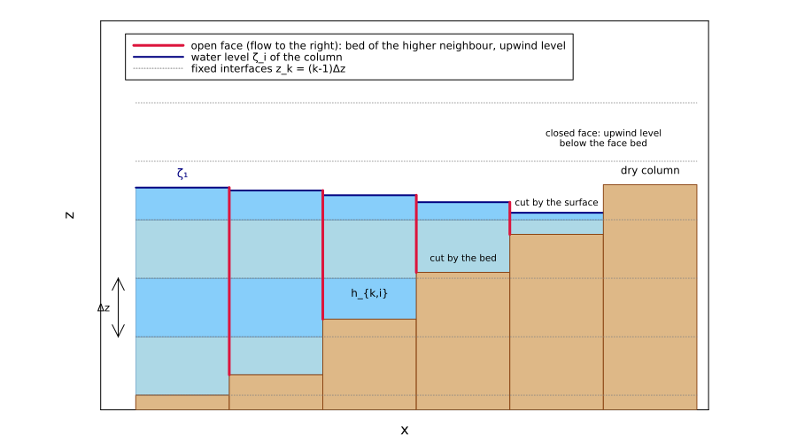
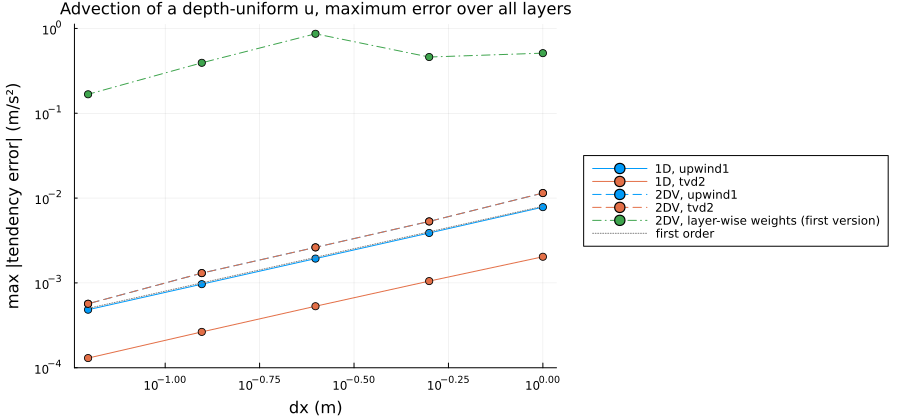
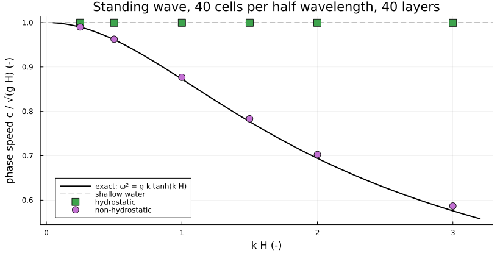
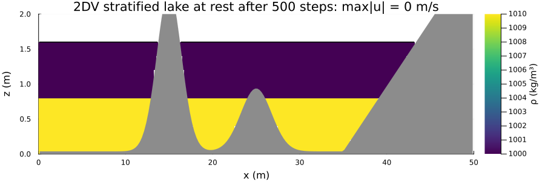
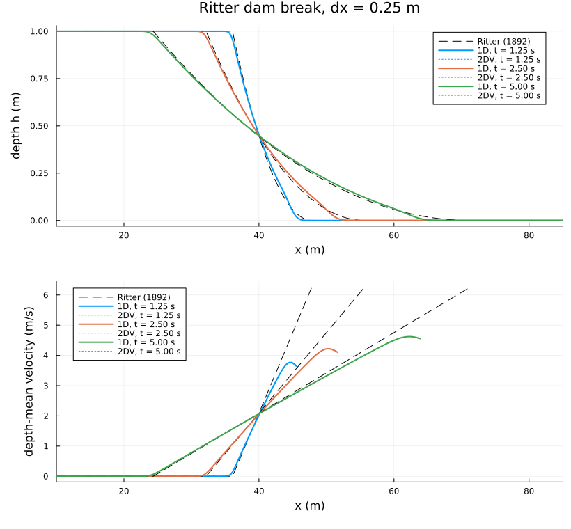
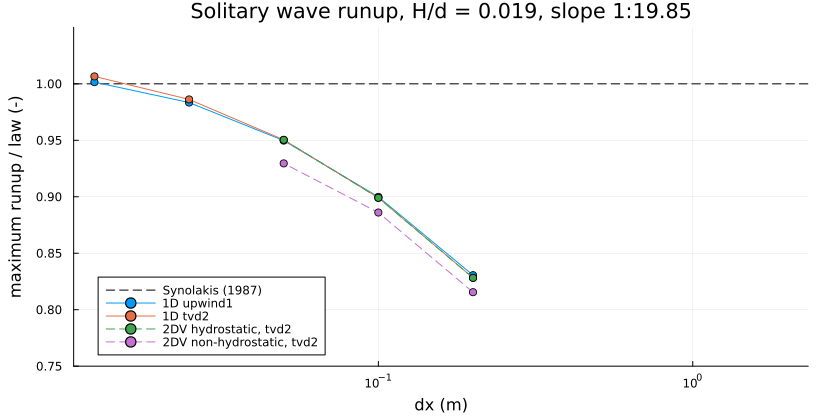
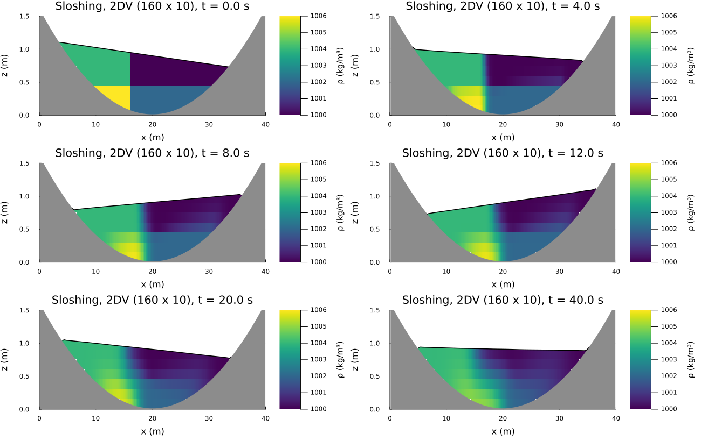

Wetting and drying on a z-level grid: numerical method
======================================================

This note describes the wetting-drying time step of SweTransport2DV (`ModelConfig(wetting_drying=true)`,
`src/wetting_drying.jl`) with the analysis behind it. It covers the scheme as it is in the repository; the design
history is in `docs/plan_issue_31_wetting_drying.md` and in section 18 of `docs/TESTS_TECHNICAL_DOCUMENTATION.md`. The
full positivity proof is in `docs/depth_positivity.md`; section 4 below gives its structure.

Contents:
1. Equations and grid
2. Cut-cell geometry
3. The time step
4. Free surface: volume formulation and positivity
5. Momentum advection on cut layers
6. Vertical fluxes and constituent transport
7. Non-hydrostatic pressure
8. Exact lake at rest, also stratified
9. Accuracy: what converges at which order
10. Time-step conditions
11. Limitations
12. References

1 Equations and grid
--------------------

The model solves the 2DV (x-z) Boussinesq equations with a free surface $\zeta(x,t)=H+\eta$ over a bed $z_b(x)$,
hydrostatic or non-hydrostatic:

$$
\partial_t u + \partial_x(uu) + \partial_z(wu) = -g\,\partial_x\eta - \frac{1}{\rho_0}\partial_x p' - \frac{1}{\rho_0}\partial_x q
+ \partial_z(\nu_v\,\partial_z u) + F_x,
\qquad \partial_x u + \partial_z w = 0,
$$

$$
\partial_t \eta + \partial_x \int_{z_b}^{\zeta} u\,dz = 0,\qquad
p'(z) = g\int_z^{\zeta}(\rho-\rho_0)\,dz',
$$

with $q$ the non-hydrostatic pressure (zero in hydrostatic mode) and $\rho$ transported conservatively. Units: $u,w$ in
m/s, $\eta,\zeta,z_b$ in m above the grid bottom ($\zeta$) or relative to the grid top $H$ ($\eta$), $p',q$ in Pa,
$\nu_v$ in m²/s.

The grid is a staggered C-grid with $n_x$ columns of width $\Delta x$ and $n_z$ layers on **fixed** interfaces
$z_k=(k-1)\Delta z$, $k=1,\dots,n_z+1$; the top layer is open above, so the surface may rise above $H$. $u$ lives on
the vertical faces $x_{i+1/2}$, $w$ on the layer interfaces, $\eta,\rho,q$ at the cell centres. With $n_z=1$ the same
code is the 1D depth-averaged model.

2 Cut-cell geometry
-------------------

*Figure 1. Cells cut by the bed and by the surface. A face carries water between the bed of the higher neighbour and
the level of the upwind column; it is closed when that depth is below `dry_depth_threshold`.*

**Cells.** Column $i$ has one bed level $z_{b,i}\ge 0$ (any value, not tied to the interfaces) and the level
$\zeta_i=H+\eta_i$. Layer $k$ holds

$$
h_{k,i}=\max\bigl(0,\ \min(z_{k+1},\zeta_i)-\max(z_k,z_{b,i})\bigr),\qquad
\sum_k h_{k,i}=V_i(\eta_i):=\max(0,\ H+\eta_i-z_{b,i}).
$$

A dry column has $\zeta_i=z_{b,i}$. It is stored as the smallest floating-point $\eta$ with $\mathrm{fl}(H+\eta)\ge z_b$,
so every computed depth is exactly non-negative (IEEE subtraction: $\mathrm{fl}(a-b)\ge 0\iff a\ge b$).

**Faces** (Stelling & Duinmeijer 2003). Face $f=i+1/2$ uses
- the bed of the higher neighbour, $z_{b,f}=\max(z_{b,i},z_{b,i+1})$;
- the level of the upwind column at time $n$, by the sign of $\sum_k u_{k,f}$; for zero flow the higher level;
- $h_{k,f}$ by the same formula as the cells. The face is closed ($h_{k,f}=0$) if $\zeta_f-z_{b,f}\le$
  `dry_depth_threshold` ($10^{-6}$ m by default).

WHY upwind levels: they make the face depth the depth of the water that actually flows through it, so a column cannot
pass on more water than it has (section 4), and a jet over a step sees its own depth, not the tailwater depth.

At a boundary face whose level is known (water level, free outflow, supercritical inflow) the face bed is
extrapolated linearly to $x=0$ or $L$. The level of such a face is the level at the end of the domain, so its depth must
be measured from the bed at the same position.

**Layers that open.** A face layer that opens when the upwind level rises past its lower interface takes the velocity
of the nearest open layer below (or above, if the face opens from the bed upwards). Without that it would carry the
$u=0$ of the time it was closed and lag behind the flow for many steps.

3 The time step
---------------

One step from $t^n$ to $t^{n+1}$ (`_step_forward_wetting_drying!`), with the $\theta$ weighting of the free surface
(Casulli & Cattani 1994; $\theta\in[\tfrac12,1]$, default 0.7):

1. Cell and face thicknesses at time $n$; newly opened face layers get their velocity (section 2).
2. Baroclinic pressure $p'$ at the nominal layer centres (section 8).
3. Momentum predictor $\hat u$ on the wet face layers. It contains
   - advection (section 5) and the explicit part $-(1-\theta)g\,\partial_x\eta^n$;
   - baroclinic pressure, body force and damping;
   - with `implicit_vertical_terms=true`: vertical viscosity, vertical advection and bed friction in one tridiagonal
     column matrix $A$ per face (backward Euler, Casulli & Cheng 1992).
4. Free surface: the mildly nonlinear volume system of section 4, Newton's method.
5. $u^{n+1}=\hat u-\theta g\Delta t\,\partial_x\eta^{n+1}\,r$ on the wet face layers ($r=A^{-1}\Delta Z$ is the column
   response, $r\equiv1$ without implicit vertical terms).
6. Non-hydrostatic mode: projection for $q$, then steps 4-5 again (section 7).
7. $\eta^{n+1}$ from the flux divergence with the $\theta$ fluxes $q_{k,f}=h_{k,f}(\theta u^{n+1}+(1-\theta)u^n)$.
   The volume is conserved to round-off.
8. Vertical fluxes $W$ through the fixed interfaces from the layer continuity, integrated up from the bed.
9. Constituent transport with the same fluxes and the new cell volumes (section 6); turbulence closure if selected.

4 Free surface: volume formulation and positivity
-------------------------------------------------

**System.** Let $H_f=\sum_k h_{k,f}\,r_{k,f}$ be the effective depth of face $f$ (the water depth without implicit
vertical terms) and $\hat U_f=\sum_k h_{k,f}(\theta\hat u_{k,f}+(1-\theta)u^n_{k,f})$ the predicted transport. Inserting
step 5 into the continuity of column $i$ gives (Casulli 2009)

$$
F(\eta):=V(\eta)+T\eta-b=0,\qquad
(T\eta)_i=a_{i+1/2}(\eta_i-\eta_{i+1})+a_{i-1/2}(\eta_i-\eta_{i-1}),
$$

$$
a_f=\frac{\theta^2 g\,\Delta t^2 H_f}{\Delta x^2}\ \ge 0,\qquad
b_i=V_i(\eta^n_i)-\frac{\Delta t}{\Delta x}\bigl(\hat U_{i+1/2}-\hat U_{i-1/2}\bigr).
$$

The unknown is the column **volume** $V_i(\eta_i)=\max(0,H+\eta_i-z_{b,i})$, not the level. That is what makes the
scheme positive without limiters.

**Properties.**
- (T) $T$ is symmetric, has non-positive off-diagonals and zero row sums: a positive semidefinite Z-matrix.
- (M) $D+T$ with a non-negative diagonal $D$ that is positive in at least one column of every connected component is a
  non-singular M-matrix, $(D+T)^{-1}\ge0$ (Varga 2000; Berman & Plemmons 1994).
- (V) Each $V_i$ is convex, non-decreasing and piecewise linear. With $p_i=1$ for $H+\eta_i\ge z_{b,i}$, else 0, and
  $P=\mathrm{diag}(p_i)$: $V(y)\ge V(x)+P(x)(y-x)$.

**Theorem 1 (positivity and conservation, any $\Delta t$).** If $\eta^\ast$ solves $F(\eta^\ast)=0$ and $u^{n+1}$ is
formed with it (step 5), then the depth from the flux divergence (step 7) is
$V_i^{n+1}=b_i-(T\eta^\ast)_i=V_i(\eta_i^\ast)\ge0$. The sum $\sum_iV_i\Delta x$ changes only by the boundary fluxes.

*Proof:* the divergence of the corrected transports is exactly $\frac{\Delta t}{\Delta x}(\hat U_{i+1/2}-\hat U_{i-1/2})+(T\eta^\ast)_i$.
The positivity is a property of the solution, not of a corrected or limited velocity: the final velocities satisfy the
discrete momentum equations that produced the surface.

**Theorem 2 (Newton, Brugnano & Casulli 2008).** The iteration
$(P(\eta^m)+T)(\eta^{m+1}-\eta^m)=-F(\eta^m)$, $\eta^0=\eta^n$, is well defined and reaches $F=0$ in at most $n_x+1$
steps. This holds under one condition (C): every connected group of columns with an open face has $\sum b_i>0$. (C)
fails only if a prescribed boundary outflow removes more than the water connected to it within one step; then no
non-negative solution exists at all.

*Proof outline* (full proof: `docs/depth_positivity.md`):
1. At $m=0$ all $p_i=1$, so $I+T$ is an M-matrix.
2. For $m\ge1$, (V) gives $F(\eta^m)\ge0$.
3. A singular $P+T$ would need a component that is completely dry in the iterate. Summing $F$ over it gives
   $-\sum b_i\ge0$, which contradicts (C).
4. With the non-negative inverse, the iterates decrease monotonically, so each $p_i$ can switch from 1 to 0 at most
   once.
5. An unchanged $P$ means that the last step was on one linear piece of every $V_i$, i.e. exact.

Remarks:
- Without drying within the step, $P(\eta^1)=I$ and one iteration suffices. This is the linear semi-implicit scheme of
  Casulli & Cheng (1992), and it is what happens in all validation cases. The nonlinear iteration acts only where a
  column would be drained below its bed: 2-4 iterations at advective Courant numbers of 6 in the positivity tests.
- A lake at rest gives $F(\eta^n)=0$ exactly, so no iteration is made and nothing changes by round-off.
- Implicit vertical terms keep the structure: $A$ is in flux form ($\mathbf 1^\top A=\Delta Z^\top$), so
  $H_f=\Delta Z^\top A^{-1}\Delta Z>0$. With Chezy friction (a Sherman-Morrison rank-one row)
  $H_f=H/(1+\Delta t\,c_f|U^n|/H)>0$.
- Boundary levels (prescribed level, free outflow) enter as a Dirichlet coupling of the last column. They only add
  diagonal weight, so (M) and Theorem 1 still hold (see `docs/numerics_open_boundaries.md`).

**Floating point.** The iteration stops at $|F_i|\le10^{-13}s_i$, with $s_i$ the sum of the magnitudes in $F_i$. The
computed depth is then $\ge-(|F_i|+2\gamma_{2n_z+8}S_i)$ (Higham 2002, summation bound; $S_i$ is the magnitude of the
terms of the column).
- A depth below zero within this bound is set exactly dry; the added volume is recorded in `wetdry.clamped_volume`. It
  is zero in all validation cases and $\le3\cdot10^{-16}$ m² in the large-step tests.
- A larger negative depth stops the run with a `DomainError`.

5 Momentum advection on cut layers
----------------------------------

**Form.** Momentum-conservative upwind advection of Stelling & Duinmeijer (2003), per layer, with the face discharges
$q_{k,f}=h_{k,f}u_{k,f}$ and the interface fluxes $W$ of time $n$:

$$
\frac{du_{k,f}}{dt}=\frac{a_L(u^\ast_L-u)-a_R(u^\ast_R-u)}{\Delta x}
+\frac{\bar W_{\mathrm{bot}}(u^\ast_{\mathrm{bot}}-u)-\bar W_{\mathrm{top}}(u^\ast_{\mathrm{top}}-u)}{\bar h_k}.
$$

$u^\ast$ is the value upwinded by the sign of each flux. With `upwind1` it is the upwind velocity; on an outflow side
$u^\ast=u$, so only inflow sides contribute, with non-negative coefficients. With `tvd2` it is the flux-limited
Lax-Wendroff value $u^\ast=u_{up}+\tfrac12(1-c)\,s_{up}$, with the MC slope $s$ (van Leer 1977) and the Courant number
$c$ of the flux. `tvd2` is used only where the whole stencil (faces $f-2..f+2$, layers $k-2..k+2$) is open;
next to a closed face a mixed first/second-order stencil halves the tendency.

**Why the factor $1-c$.** The step is a single forward-Euler step. Where the solution is smooth, the MC slope is
Fromm's, and for linear advection with $C=a\Delta t/\Delta x$ the amplification factor is

$$
G(\theta)=1-C\left[(1-e^{-i\theta})+\frac{1-c}{4}\left(e^{i\theta}-1-e^{-i\theta}+e^{-2i\theta}\right)\right].
$$

Without the factor ($c=0$, the plain MUSCL value) $|G|>1$ for every $C>0$: 1.15 per step for a $4.6\Delta x$ wave at
$C=0.6$. The limiter stops this only at extrema. In a weakly stratified layer of the splitter-plate case (issue #42, fixed in #66)
such a wave grew until the run failed. With $c=C$ (Fromm's scheme) $|G|\le1$ for $C\le1$ (Sweby 1984; LeVeque 2002,
ch. 6).

**Cap.** With $C=\Delta t\sum(\text{inflow coefficients})$ the tendency is scaled by $1/C$ where $C>1$. For `upwind1`
the update is then a convex combination of neighbouring velocities, so thin layers at a wetting front cannot become
unstable. The cap only acts where the advective Courant number of a layer exceeds 1.

**Advective velocities on cut layers.** Hydrostatic theory keeps a depth-uniform velocity depth-uniform
($u_t=-uu_x-g\zeta_x$ in every layer). The coefficients must therefore give every layer the same tendency when $u$ is
depth-uniform, also where the surface cuts a layer thinly. The scheme uses

$$
a_C=\frac{\bar q_{k,C}}{\tilde h_{k,C}}\cdot\frac{\tilde H_C}{\bar H_f},\qquad
\tilde h_{k,C}=\tfrac12(h_{k,f'}+h_{k,f''}),\quad \tilde H_C=\sum_k\tilde h_{k,C},\quad \bar H_f=\sum_k\bar h_k,
$$

with $C$ the upwind cell, $f',f''$ its faces and $\bar q_{k,C}$ the cell discharge.
- The first factor is the layer velocity in the cell.
- The second is the column factor that makes the 1D scheme of Stelling & Duinmeijer momentum conservative.
- For one layer this is exactly their 1D weight; for a depth-uniform $u$ every layer gets the 1D advective velocity.

*Why not the layer-wise weight* $\bar q_{k,C}/\bar h_k$: with upwinded face thicknesses,
$\bar q_{k,C}/\bar h_k\approx u\,r_k$ with $r_k-1\approx-\Delta x\,\partial_xh_k/h_k$. For full layers
$\partial_xh_k=0$. For the layer that the surface cuts, $\partial_xh_k=\partial_x\zeta$, so the relative error is
$\Delta x|\zeta_x|/h_k$. That is O(1) wherever the cut layer is thinner than the surface drop over one cell, i.e. at
every interface crossing, on every grid: the error does not converge. The chosen weights give up exact per-layer
momentum conservation in thin cut layers and keep it for the column.

**Inflow through a layer that ends.** If the far face of the inflow cell is closed for layer $k$ (its upwind level is
below the layer), the water entering the layer there comes up from the nearest open layer below. Its velocity is then
the upwind value; there is no inflow if all layers below are closed.

**Manufactured solution** (`test_verify_wd_advection_depth_uniform_mms_*`). A depth-uniform
$u(x)=1+2\tanh((x-50)/15)$ m/s, which changes sign, under a surface that crosses six interfaces ($\Delta z=0.1$ m),
with $W$ from the discrete layer continuity. The exact tendency is $-uu_x$ in every layer. Maximum error over all
layers (m/s²; $|uu_x|\le0.27$):

| $\Delta x$ (m) | 1 | 0.5 | 0.25 | 0.125 | 0.0625 |
|---|---|---|---|---|---|
| 1D `upwind1` | 7.8e-3 | 3.9e-3 | 1.9e-3 | 9.7e-4 | 4.8e-4 |
| 2DV `upwind1` and `tvd2` | 1.2e-2 | 5.3e-3 | 2.6e-3 | 1.3e-3 | 5.7e-4 |
| 1D `tvd2` | 2.0e-3 | 1.1e-3 | 5.4e-4 | 2.7e-4 | 1.4e-4 |

*Figure 2. Maximum tendency error of the advection operator for the manufactured depth-uniform flow. The green curve is
the layer-wise weight above, shown for comparison; it does not converge.*

2DV `tvd2` is first order in the maximum norm, because it falls back to first order at the faces where layers end. Its
mean error is second order. In the Ritter dam break (12 layers, $t=5$ s) the spread of the layer velocities is
0.0013 m/s (`upwind1`) and 0.0028 m/s (`tvd2`), and it converges at first order.

6 Vertical fluxes and constituent transport
-------------------------------------------

**Vertical fluxes.** After step 7 the new thicknesses are known. $W$ through each fixed interface follows from the
layer continuity, $W_{k+1}=W_k-\frac{1}{\Delta x}(q_{k,i+1/2}-q_{k,i-1/2})-\frac{h_{k,i}^{n+1}-h_{k,i}^n}{\Delta t}$,
integrated upwards from $W_1=0$ at the bed. The volume change of a cut cell is part of $W$, so $(W_{k+1}-W_k)/h$ is not
a strain rate in a thin cut cell (relevant for turbulence production, which uses $-\partial_xu$ instead).

**Transport.** $\rho$ (and any constituent) is transported with the same $q$ and $W$ and the cell volumes of $n$ and
$n+1$, in increment form:

$$
\rho^{n+1}=\rho^n+\frac{D}{h^{n+1}},\qquad D=(h\rho)^{n+1}-h^{n+1}\rho^n .
$$

WHY the increment: $(h\rho)/h$ changes $\rho$ by round-off even without flow, which drove an internal motion of
$5\cdot10^{-9}$ m/s in a stratified lake at rest. The face values are
- `upwind1`, or
- `tvd2`: the flux-limited Lax-Wendroff value with the Courant number of the cut cell, $|q|\Delta t/(\Delta x\,h_{up})$.

Empty cells ($h<10^{-12}$ m) pass their increment to the thickest cell of the column.

The update is conservative for any $\Delta t$. It is monotone only if no cell loses more than its old volume in a step,
which thin cut cells can violate at any $\Delta t$. Values outside the initial bounds (widened by inflow values) are
therefore clipped, and the clipped mass is redistributed over the cells that have room for it (slack-weighted), so the
mass stays exact. The bounds are enforced, not proven.

7 Non-hydrostatic pressure
--------------------------

Pressure split $p=p_{\mathrm{hydrostatic}}+q$ (Casulli 1999; Casulli & Zanolli 2002).
1. Predict $w^\ast$ at the interfaces between two wet cells (first-order upwind advection, capped).
2. Solve a Poisson problem for $q$ on the wet cells **below the surface cell** of each column. $q=0$ in the surface
   cell (dynamic surface condition) and in empty cells. Every such cell satisfies its continuity with
   $u=u_{fs}-\frac{\theta\Delta t}{\rho_0}\partial_xq$ and $w=w^\ast-\frac{\theta\Delta t}{\rho_0}\partial_zq$
   ($\partial_z$ over $\tfrac12(h_{k-1}+h_k)$, $w=0$ at the bed). The matrix is symmetric positive definite; it is
   assembled on the current wet domain and factorized by sparse Cholesky every step.
3. Add $-\frac{\theta\Delta t}{\rho_0}\partial_xq$ to the predictor $\hat u$ and **repeat the free-surface solve**.

WHY the repeated solve instead of correcting $u$ directly (Casulli 1999): a direct correction changes the column
transports after the positive solve and voids Theorem 1. With the repeated solve the final velocities come from the
positive solve again. The price is that the continuity of the cells below the surface holds only approximately: the two
solves differ by a depth-uniform change of the surface gradient. $w$ then follows from the exact layer continuity
(section 6).

Accuracy: $q=0$ in the surface cell is first order in its thickness. For a standing wave at $kH=\pi/2$ against
$\omega^2=gk\tanh kH$, the period error is 1.75 %, 0.89 % and 0.45 % on 40 x 20, 80 x 40 and 160 x 80 cells. The phase
speed is within 1.9 % up to $kH=3$.

*Figure 3. Phase speed of standing waves, non-hydrostatic and hydrostatic, against the linear dispersion relation.*

8 Exact lake at rest, also stratified
-------------------------------------

Over an arbitrary bed (beach, island, submerged bump, no bed level on an interface), still water stays exactly still:
$u=0$ and $\eta$ unchanged to the last bit over 500 steps, in 1D, 2DV and 2DV with a two-layer stratification. Three
choices make this hold:
- The free-surface residual is exactly zero (section 4), so the solve is not entered.
- $p'$ is evaluated at the **nominal** layer centres $z_k+\Delta z/2$, with the layers above the surface extrapolated
  with the surface-layer density. A horizontally uniform stratification then gives bit-identical $p'$ in neighbouring
  columns whatever their bed, so its gradient is exactly zero. Centres of the cut cells would differ between columns
  with different beds.
- The density increment is exactly zero without flow (section 6).

*Figure 4. Stratified lake at rest over a beach, an island and a bump: velocity and level change are exactly zero.*

9 Accuracy: what converges at which order
-----------------------------------------

**Ritter dam break on a dry bed** (Ritter 1892). The depth converges at first order: L1 error 2.1, 1.4, 0.9, 0.6 and
0.3 % for $\Delta x=1\dots1/16$ m (`upwind1`). `tvd2` halves the depth error and the lag of the front. 2DV with 12 layers
gives the depth of 1D to the printed digits.

*Figure 5. Ritter dam break, 1D and 2DV against the exact solution. The tip of the rarefaction lags by numerical
diffusion; the depth-mean velocity at the front is limited by the vanishing depth.*

**Runup.**
- Carrier & Greenspan (1958) standing wave on a 1:20 beach: shoreline within 14.6 mm ($\Delta x=0.1$ m) and 9.2 mm
  (0.05 m) of a 0.1 m runup amplitude.
- Synolakis (1987) solitary wave: maximum runup 0.80, 0.89, 0.94, 0.98 and 1.00 of the runup law for
  $\Delta x=0.2\dots0.0125$ m, the same for both schemes.

*Figure 6. Solitary-wave runup against the law of Synolakis (1987): first order, the same for `upwind1` and `tvd2`.*

**Conservation.** Sloshing over two beaches with two water masses (1D and 2DV): water volume and constituent mass change
by at most $7\cdot10^{-16}$ relative over 40 s, the depth is never negative, the density stays within its bounds.

*Figure 7. Sloshing basin: two shorelines move by about 3 m while the heavier water undercuts the lighter.*

**Why the front is first order with both schemes.**
- The depth has a kink at the front (linear on a beach, quadratic in the Ritter rarefaction), so any limited
  reconstruction clips there.
- The flow reverses at maximum runup and rundown.
- Each column has one bed level, so the shoreline moves cell by cell, with a staircase error of order
  $\Delta x\tan\beta$ in elevation.

The domain-integrated errors are hardly affected (O($\Delta x$) errors over an O($\Delta x$) region of small depth);
the front position and the runup converge at first order.

10 Time-step conditions
-----------------------

| property | condition |
|---|---|
| depth $\ge0$, volume conservation | none (Theorems 1 and 2), only (C) for prescribed outflow |
| gravity waves | none (semi-implicit, $\theta\ge\tfrac12$) |
| mean flow with explicit advection | $\mathrm{Fr}\le(2\theta-1)/(2(1-\theta))$ (von Neumann; $\mathrm{Fr}\le2/3$ at $\theta=0.7$); the model warns above it |
| momentum advection | stable (capped); accurate for $\lvert u\rvert\Delta t/\Delta x\lesssim1$; the model warns above 0.8 |
| constituent transport | conservative for any $\Delta t$; monotone only without over-drained cells, bounds enforced |

11 Limitations
--------------

- **First order at the wet/dry front** with both schemes (section 9). A sloping bed within each column (sub-grid
  bathymetry, Casulli 2009: $V_i(\eta)$ piecewise quadratic, still convex and non-decreasing, so Theorems 1 and 2 carry
  over) would move the shoreline continuously.
- In 2DV, exact per-layer momentum conservation is given up in thinly cut layers (section 5).
- The non-hydrostatic continuity below the surface cell holds only approximately (section 7).
- Not available with wetting and drying: `periodic_x`, vegetation, wind stress, the mixing-length model.

12 References
-------------

- Berman, A. & Plemmons, R. J. (1994), Nonnegative Matrices in the Mathematical Sciences, SIAM.
- Brugnano, L. & Casulli, V. (2008), Iterative solution of piecewise linear systems, SIAM J. Sci. Comput. 30, 463-472.
- Carrier, G. F. & Greenspan, H. P. (1958), Water waves of finite amplitude on a sloping beach, J. Fluid Mech. 4, 97-109.
- Casulli, V. (1999), A semi-implicit finite difference method for non-hydrostatic, free-surface flows, Int. J. Numer.
  Methods Fluids 30, 425-440.
- Casulli, V. (2009), A high-resolution wetting and drying algorithm for free-surface hydrodynamics, Int. J. Numer.
  Methods Fluids 60, 391-408.
- Casulli, V. & Cattani, E. (1994), Stability, accuracy and efficiency of a semi-implicit method for three-dimensional
  shallow water flow, Comput. Math. Appl. 27(4), 99-112.
- Casulli, V. & Cheng, R. T. (1992), Semi-implicit finite difference methods for three-dimensional shallow water flow,
  Int. J. Numer. Methods Fluids 15, 629-648.
- Casulli, V. & Zanolli, P. (2002), Semi-implicit numerical modeling of nonhydrostatic free-surface flows for
  environmental problems, Math. Comput. Model. 36, 1131-1149.
- Higham, N. J. (2002), Accuracy and Stability of Numerical Algorithms, 2nd ed., SIAM.
- LeVeque, R. J. (2002), Finite Volume Methods for Hyperbolic Problems, Cambridge University Press.
- Ritter, A. (1892), Die Fortpflanzung der Wasserwellen, Z. Ver. Deutsch. Ing. 36, 947-954.
- Stelling, G. S. & Duinmeijer, S. P. A. (2003), A staggered conservative scheme for every Froude number in rapidly
  varied shallow water flows, Int. J. Numer. Methods Fluids 43, 1329-1354.
- Sweby, P. K. (1984), High resolution schemes using flux limiters for hyperbolic conservation laws, SIAM J. Numer.
  Anal. 21, 995-1011.
- Synolakis, C. E. (1987), The runup of solitary waves, J. Fluid Mech. 185, 523-545.
- van Leer, B. (1977), Towards the ultimate conservative difference scheme IV, J. Comput. Phys. 23, 276-299.
- Varga, R. S. (2000), Matrix Iterative Analysis, 2nd ed., Springer.

Equation numbers of the references were not checked.
