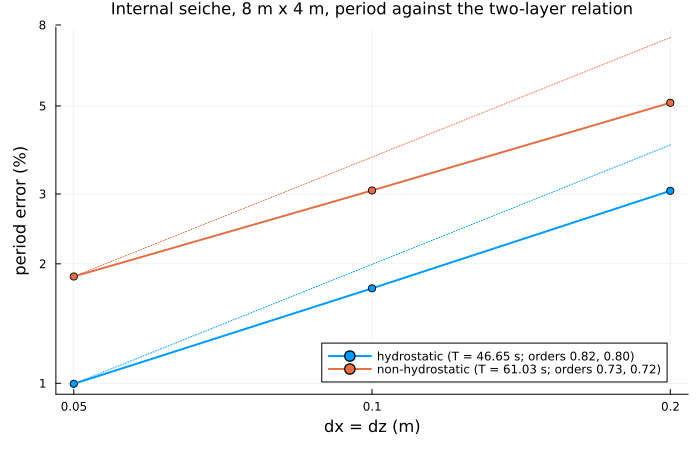
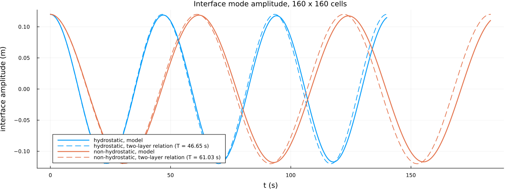
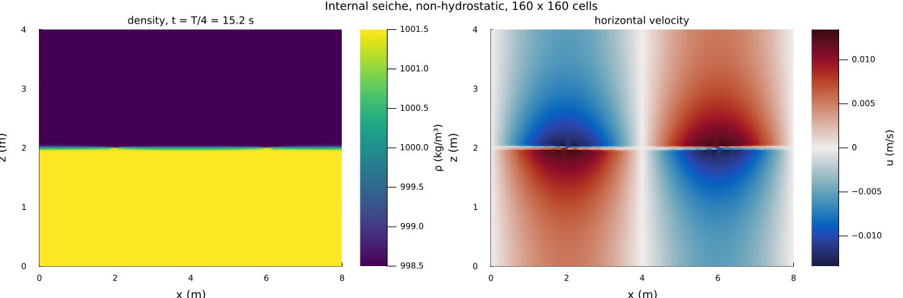
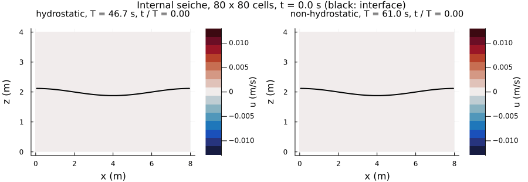
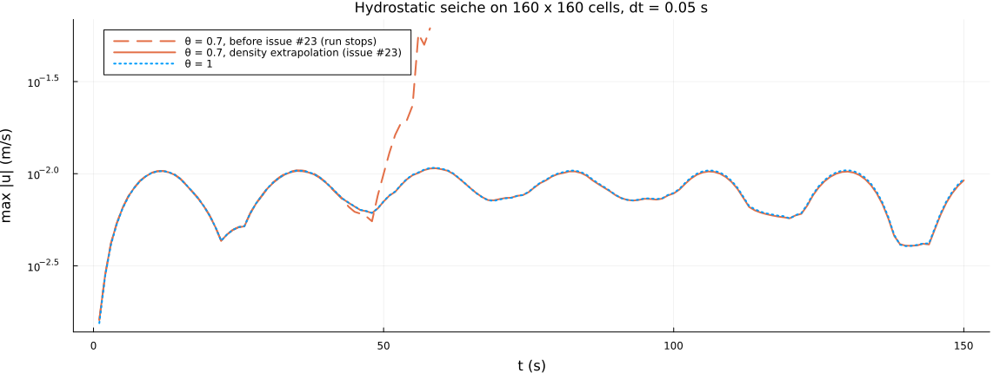

Internal seiche
===============

Issue #23: the period of an internal standing wave in a closed basin against two-layer theory, hydrostatic and
non-hydrostatic, on three grids. The case is also a test (`test/test_internal_seiche.jl`), which replaces the former
`experiments/validation/validate_internal_seiche_period.jl` (one grid, hydrostatic, with damping and the Froude limiter
on, against the long-wave period).

| Mode | Reference period | Period error, 40², 80², 160² cells | Order |
|---|---|---|---|
| hydrostatic | 46.65 s | +3.06 %, +1.74 %, +1.00 % | 0.8 |
| non-hydrostatic | 61.03 s | +5.09 %, +3.06 %, +1.86 % | 0.7 |

```pwsh
julia --project=. experiments/internal_seiche/plot_internal_seiche.jl   # about 2 min, figures and animation
```

Output goes to `output_barotropic/internal_seiche_figures/`; the figures below are copies in `figures/`.
`run_internal_seiche_dt005_400s_anim.jl` is an older long run (30 m basin, mode 1) with animations.

Case
----

- 8 m x 4 m closed basin, 998.5 kg/m³ over 1001.5 kg/m³, interface at mid-depth, displaced by 0.12 m as cos(2 pi x / L):
  one full wavelength in the basin (mode 2), k h = 1.57, so the wave is not long.
- tvd2 momentum and density advection, no Rayleigh damping, no Froude limiter, theta = 0.7, dt = 0.05 s on all grids.
- Grids 40 x 40, 80 x 80, 160 x 160 (dx = dz = 0.2, 0.1, 0.05 m); the initial interface is cell-averaged, so the
  displacement is represented exactly on every grid.
- Interface height of a column: the depth of the heavy fluid; its cos(k x) component gives the mode amplitude; the
  period follows from the zero crossings over three periods.

Reference
---------

Two layers with a free surface (`two_layer_internal_wave`; Gill 1982, ch. 6):

    (C_u C_l + 1) omega^4 - (g k (C_u + C_l) + g' k C_u) omega^2 + g g' k^2 = 0,   C = coth(k h),

g' = g Δρ/ρ0 = 0.0294 m/s², T = 61.03 s; hydrostatic c^4 - (g H + g' h_l) c^2 + g g' h_u h_l = 0, T = 46.65 s. The
rigid-lid values of the issue (61.0 s, 46.6 s) differ by O(g'/g). The surface moves in counter-phase with the interface;
the ratio is -0.00150 hydrostatic and -0.00060 non-hydrostatic.

Results
-------



Both periods converge at about first order, from above: the interface spreads over about one cell, and a continuous
stratification has a lower frequency than a sharp interface. The amplitude kept per period is 0.98-0.99.





Horizontal velocity and interface (black) over about two periods, hydrostatic and non-hydrostatic on the same clock (80 x 80
cells for the file size): the non-hydrostatic seiche is 31 % slower and its flow is concentrated near the interface.



At a quarter period the interface is level and the velocity is largest. The non-hydrostatic flow is concentrated near
the interface (it decays as cosh over the 2 m layers, k h = 1.57); the hydrostatic flow would be uniform in each layer.

The surface ratio is -0.00150 in both modes with the default Neumann top condition of the non-hydrostatic pressure (the
hydrostatic response, docs section 15); with `nonhydro_surface_dirichlet=true` it is -0.00065 on 80 x 80, converging to
the non-hydrostatic -0.00060. The period does not change.

Stability of hydrostatic internal waves (theta < 1)
---------------------------------------------------



Before this issue the hydrostatic run on 160 x 160 cells grew from about 45 s and stopped at 58 s at theta = 0.7. The
momentum step takes the density of time n, the transport moves it with theta u^{n+1} + (1 - theta) u^n (issue #34); for
an internal wave of frequency omega this coupling has |lambda|^2 = 1 + (1 - theta) (omega dt)^2, weakly unstable for every
theta < 1 and fastest for short hydrostatic internal waves, which numerical diffusion no longer damps on fine grids.
The baroclinic pressure of the predictor now takes the density extrapolated to n + 2 (1 - theta)
(`baroclinic_extrapolation_weight`): stable up to an internal Courant number of about 0.36 at theta = 0.7, at the cost
of a damping of about pi (1 - theta) omega dt per period (0.6 % here). theta = 1 is unchanged. Details:
docs/TESTS_TECHNICAL_DOCUMENTATION.md, section 34. The "before" curve is the same script run against the package before
the change (see the header of `plot_internal_seiche.jl`).

References
----------

- Gill (1982), Atmosphere-Ocean Dynamics, Academic Press, ch. 6
- Cushman-Roisin & Beckers (2011), Introduction to Geophysical Fluid Dynamics, Academic Press, ch. 12-13
- Casulli & Cattani (1994), Comput. Math. Appl. 27, 99-112 (theta scheme)
