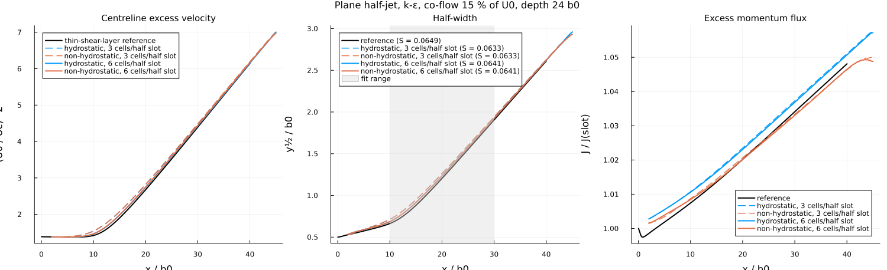
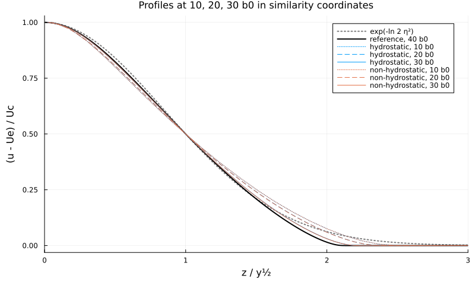
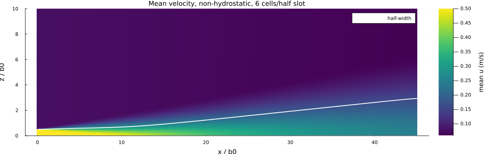
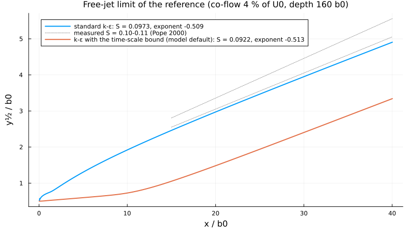

Turbulent plane jet
===================

Issue #25: a turbulent plane jet with k-epsilon against similarity theory and measurements. `plane_jet.jl` runs the
case of `test/test_plane_jet.jl` on two grids, hydrostatic and non-hydrostatic, and compares it with the
thin-shear-layer solution of the same k-epsilon jet (`plane_jet_thin_shear_layer`). `run_jet_impulse_dt0005_20s_anim.jl`
(a velocity impulse in still water) is kept as a demonstration only: it has no reference.

    julia --project=. experiments/jet/plane_jet.jl            # runs (about 1 h, the fine non-hydrostatic one 47 min) and figures
    julia --project=. experiments/jet/plane_jet.jl figures    # figures from the saved runs

Output in `output_barotropic/plane_jet/`; the figures here are copies.

Why a half-jet in a co-flow
---------------------------

A plane jet entrains ambient water from both sides. In the 2DV channel there are no lateral boundaries to supply it, only
the bed, the surface and the outflow:
- a jet at mid-depth attached to the bed within seconds (Coanda effect);
- a half-jet on the frictionless bed (which is then the symmetry plane of the jet) with no inflow outside the slot drives a
  recirculation cell the size of the channel (the confined jet of Craya and Curtet), unlike a free jet;
- a weak co-flow needs a very deep channel and long runs, and still recirculated on the finer grid.

So the jet is a half-jet in a co-flow of 15 % of the slot velocity, enough to feed the entrainment, and the reference is
the same jet in the same channel computed with the thin-shear-layer equations and the same k-epsilon model. The free-jet
limit of that reference (weak co-flow, deep channel) is compared with the measured spreading rate.

Case
----

- Slot b0 = 0.05 m (the half slot, 0.025 m, on the bed), U0 = 0.5 m/s (Reynolds number 25000), co-flow 0.075 m/s.
- Channel 1.2 m deep (24 b0), 2.25 m long (45 b0); relaxed free outflow.
- k-epsilon, inflow turbulence intensity 5 % with a length scale of 0.1 b0 (per-layer inlet k and eps, issue #42).
- Grids with 3 and 6 cells across the half slot (dz = b0/6, b0/12, dx = 2 dz); 150 s, mean over the last 30 s.
- Centreline excess Uc = u(0) - Ue, half-width y½ and excess momentum flux J = 2 ∫ u (u - Ue) dz, with the free stream
  Ue taken at the jet edge (3 y½): the non-hydrostatic outer flow is not uniform.

Results
-------

| Run | Uc at 10, 20, 30 b0 | y½ | J | S | Decay exponent |
|---|---|---|---|---|---|
| reference | | | | 0.0649 | -0.525 |
| hydrostatic, 3 cells | -4.0, -2.5, -0.9 % | +7.5, +4.7, +1.8 % | +0.3 % | 0.0633 | -0.522 |
| non-hydrostatic, 3 cells | -4.1, -2.7, -1.1 % | +7.6, +4.8, +1.9 % | ±0.1 % | 0.0633 | -0.522 |
| hydrostatic, 6 cells | -1.5, -1.2, -0.4 % | +3.6, +2.4, +1.0 % | +0.3 % | 0.0641 | -0.526 |
| non-hydrostatic, 6 cells | -1.6, -1.4, -0.6 % | +3.6, +2.5, +1.0 % | ±0.1 % | 0.0641 | -0.527 |

The model converges to the reference; hydrostatic and non-hydrostatic agree within 0.2 %, as expected for a slender
jet. The centreline excess decays as x^(-1/2), and J follows the momentum integral of the confined jet: it rises by a
few per cent because the free stream decelerates as the jet entrains.

**Free-jet limit and the measured spreading rate.** With a weak co-flow (4 % of U0) in a deep channel (160 b0) the
reference is close to a free jet: standard k-epsilon spreads at S = 0.097, the centreline excess decays as x^(-0.51),
within the measured 0.10-0.11 and -1/2 (Pope 2000, ch. 5). The model uses the time-scale bound of Durbin (1996) by
default; in a plane jet it is active ((k/eps) |du/dz| ≈ 3.3 > 2.72), lowers the eddy viscosity and gives S = 0.092,
with a longer initial region:

The co-flow of the model case lowers the spreading rate further, to 0.065.

**Cost.** The non-hydrostatic runs take 4.5 times the hydrostatic ones (6 cells: 47 min against 9 min); 70 % of the time
is the non-hydrostatic correction with a new sparse Cholesky factorization every step (issue #71).

References
----------

- Pope (2000), Turbulent Flows, Cambridge University Press, ch. 5 (free shear flows) and ch. 10 (k-epsilon)
- Launder & Spalding (1974), Comput. Methods Appl. Mech. Eng. 3, 269-289
- Durbin (1996), Int. J. Heat Fluid Flow 17, 89-90 (time-scale bound)
- Craya & Curtet (1955), C. R. Acad. Sci. Paris 241, 621-622 (confined jets)
