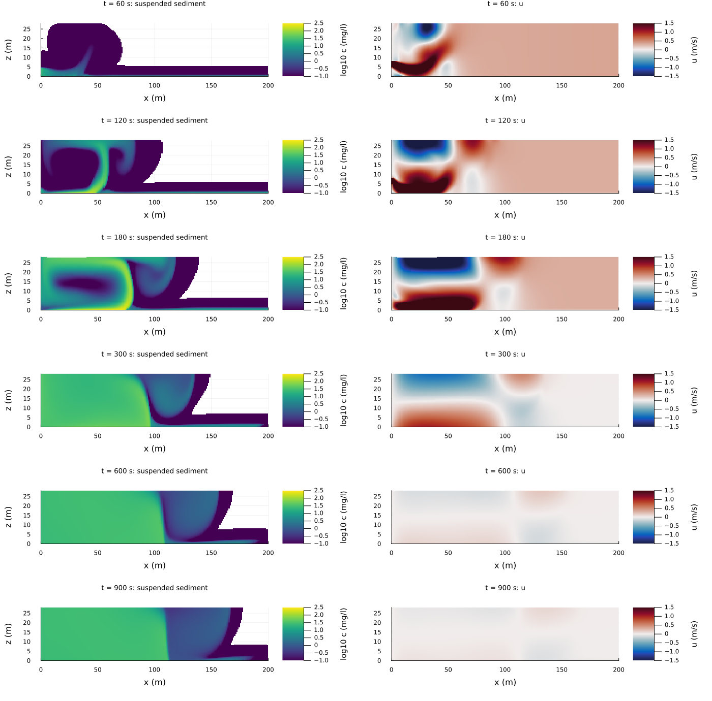
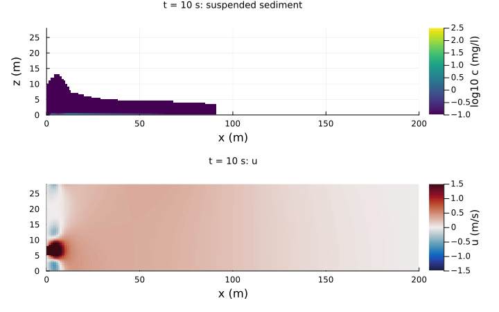
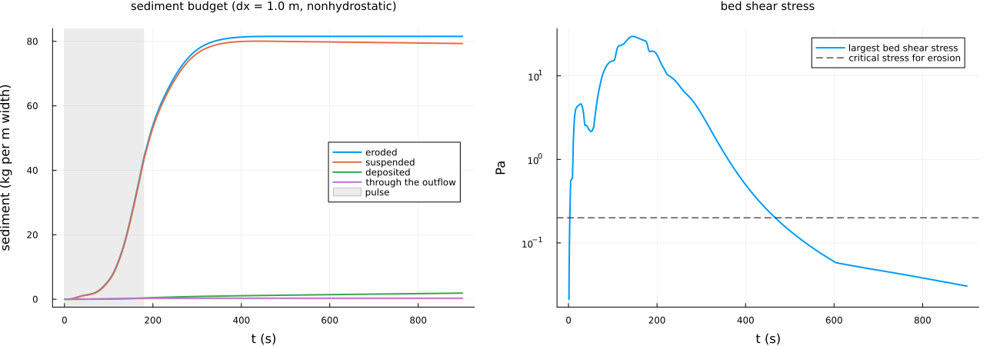
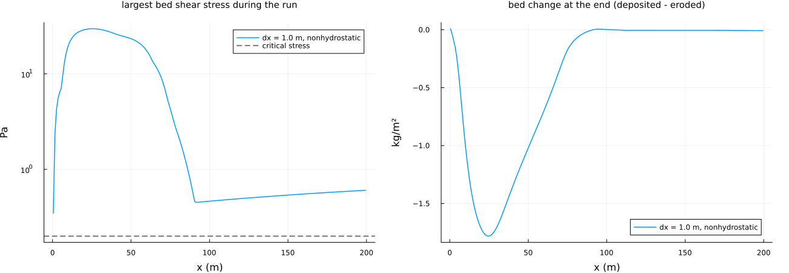
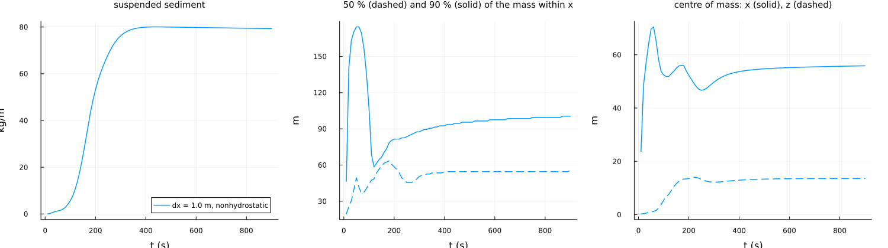

Jet pulse eroding a mud bed (issue #64)
=======================================

A pipe in the left wall of a basin discharges a pulse; where the jet reaches the bed it erodes the mud, and the
suspended sediment spreads as a plume. Uses the suspended cohesive sediment of the wetting-drying step
(`attach_sediment!`, `src/sediment.jl`). Equations and tests: section 31 of
[docs/TESTS_TECHNICAL_DOCUMENTATION.md](../../docs/TESTS_TECHNICAL_DOCUMENTATION.md).

Set-up
------

| | value |
|---|---|
| basin | 200 m long, 28 m deep, flat mud bed (z0 = 2e-4 m) |
| pipe | 3 m diameter in the left wall, lower edge 5 m above the bed; 2DV slot from 5 m to 8 m at 3 m/s (9 m²/s per metre of width) |
| pulse | 3 min: 5 s ramp up, 170 s at full discharge, 5 s ramp down; clean water, pipe turbulence of 5 % intensity |
| outflow | relaxed outflow at the right end (τ = 20 s); water entering there is clean |
| mud | settling velocity 0.5 mm/s, critical stress for erosion 0.2 Pa, erosion parameter 1e-4 kg/m²/s, particles 2650 kg/m³, unlimited bed, coupled to the density |
| closure | k-epsilon (equilibrium wall function), non-hydrostatic |
| grid | dx = 1 m, 56 layers of 0.5 m, advective Courant number 0.5; 15 min |

The mud parameters are typical of a soft mud bed (Winterwerp & van Kesteren 2004); the issue gives none.

**2DV representation of the pipe.** The slot stands for the 120 m³/s of the issue spread over a basin width of 13 m
(9 m²/s per metre). In 2DV the whole discharge has to leave through the basin: during the pulse a through-flow of
0.32 m/s over the full depth and a level rise of about q/sqrt(gH) = 0.54 m that leaves through the relaxed outflow. In
the real basin the jet spreads sideways and this through-flow does not exist.

**Why non-hydrostatic, why dx = 1 m.** The offset jet attaches to the bed by the low pressure between jet and bed (Coanda
effect), which the hydrostatic model does not have. In a run with a 6 m pipe at 2 m/s for 3 min the hydrostatic jet did
not attach and eroded a tenth of the non-hydrostatic one, and dx = 1 m and 0.5 m agreed within 10 % in the eroded mass
and the peak stress.

Results
-------



The jet leaves the pipe at 5-8 m, bends down and attaches to the bed within about 20 m (t = 60 s): a wall jet of more
than 1.5 m/s just above the bed that runs to 70-80 m and lifts there with the eroded mud (t = 120 and 180 s, up to
259 mg/l at the end of the pulse), under a return current in the upper half. After the pulse two counter-rotating cells
remain in the first 100 m (near the bed up to 1 m/s at t = 300 s); they mix the mud over the whole depth and keep eroding
while the bed stays above the critical stress, and decay within about 10 min (0.12 m/s at 900 s). At 900 s the plume
fills the first 110 m with about 30 mg/l, behind a sharp front; 90 % of the suspended mass lies within 100 m of the pipe.





Over 15 min 82 kg per metre of width is eroded, 44 kg during the pulse and 37 kg after it, under the near-bed branch of
the cells. 79 kg is still in suspension at 15 min, 1.9 kg has settled back (at 0.5 mm/s the mud sinks only 0.45 m in
15 min), and 0.3 kg has left through the outflow. The largest bed shear stress, 29.7 Pa, occurs at t = 145 s and
x = 26 m. The budget closes to 3e-12 kg/m.



The bed shear stress exceeds 10 Pa over the first 68 m. Of the net erosion, 63 kg/m comes from the first 50 m (at most
1.8 kg/m² at x = 25 m, about 3.6 mm of mud at a dry density of 500 kg/m³), 16 kg/m from 50-150 m and 0.3 kg/m from the
last 50 m, where only the through-flow of the pulse acts (0.5-0.6 Pa).



Suspended mass, the distances from the pipe within which half and 90 % of it lie, and its centre of mass: the plume
grows during the pulse and the first minutes after it and then stays (half of it within 56 m of the pipe, 90 % within
100 m at 15 min); its centre of mass rises to mid-depth.

Limitations
-----------

- 2DV: the jet cannot spread sideways (its momentum per metre of width is that of a 13 m wide basin), so the wall jet and
  the recirculation cells reach further than they would in the real basin, and the discharge of the pulse has to leave
  through the basin (above).
- One mud fraction, no flocculation, no consolidation, unlimited erodible bed; the mud parameters are assumed.

Running
-------

```
julia --project experiments/jet_sediment/jet_sediment.jl runs        # about 5 min on an idle machine
julia --project experiments/jet_sediment/jet_sediment.jl figures
julia --project experiments/jet_sediment/jet_sediment.jl animation
```

Single run: `run <dx_m> <nonhydrostatic|hydrostatic>`. Output in `output_barotropic/jet_sediment/` and
`output_barotropic/jet_sediment_figures/`.
