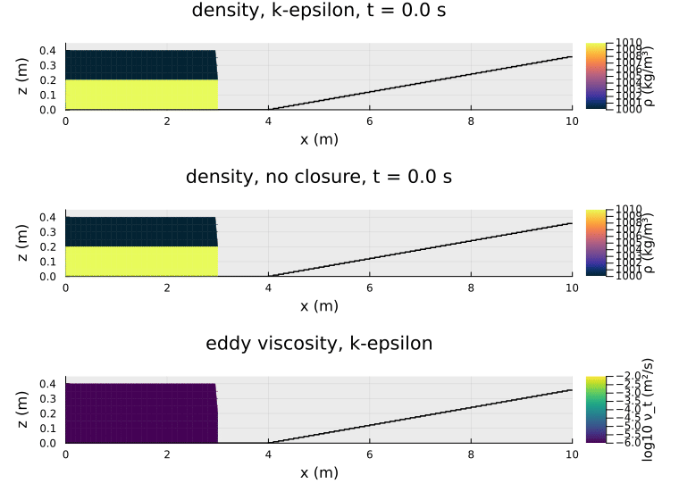
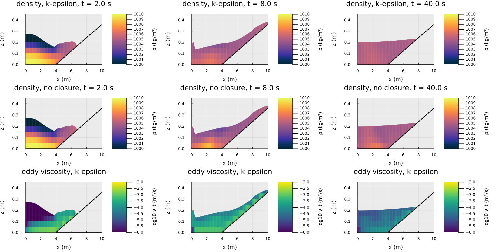
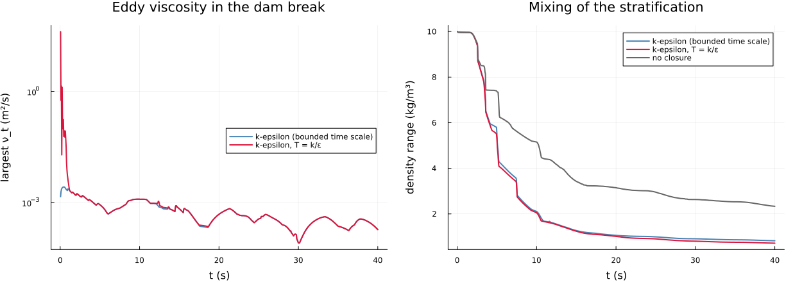
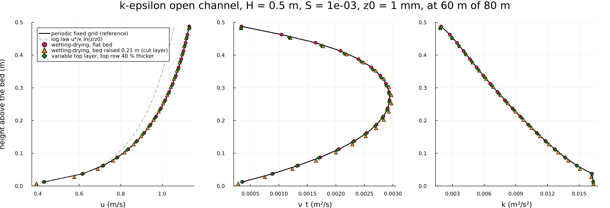

k-epsilon with wetting and drying (issue #30)
=============================================

The k-epsilon closure on the cut cells of the wetting-drying step and with the variable top layer: a stratified dam break
onto a dry slope, the realizability bound on the turbulence time scale, and open channels against the periodic fixed
grid.

Theory and implementation: [docs/TESTS_TECHNICAL_DOCUMENTATION.md](../../docs/TESTS_TECHNICAL_DOCUMENTATION.md), sections
17 and 27; tests in `test/test_turbulence.jl`.

Run: `julia --project experiments/k_epsilon_wetting_drying/plot_k_epsilon_wetting_drying.jl [product ...]` (products:
`dambreak bound channels`, default all; about 5 min for all).

Stratified dam break onto a dry slope
-------------------------------------

A 10 m basin, a 0.4 m column of water left of x = 3 m (1010 kg/m³ in the lowest 0.2 m, 1000 kg/m³ above), a bed rising at
6 % from x = 4 m, z0 = 1 mm, dx = 0.1 m, dz = 0.05 m, hydrostatic, 40 s. The cells are drawn cut at the bed and at the free
surface; layers thinner than 1 mm are not drawn.

- The wave runs up the slope, reflects and sloshes; the shoreline moves to 7.65 m. Volume and density mass are conserved
  to round-off (test, hydrostatic and non-hydrostatic), and k and eps stay positive.
- The eddy viscosity is largest near the bed behind the front and in the run-up, up to 2.6·10⁻³ m²/s.
- The closure mixes more than the run without one, as it should: a density range of 0.8 kg/m³ is left after 40 s, against
  2.3 kg/m³. But the run without a closure also loses three quarters of its stratification, by the overturning flow and
  by numerical mixing. This coarse grid does not separate the two, so the mixing here is not a validated result.

Realizability bound
-------------------

Largest eddy viscosity and density range over time. With T = k/eps the front reaches ν_t = 41 m²/s in the second step:
the shear at the front raises k by four orders of magnitude while eps lags behind. The time-scale bound of Durbin (1996)
keeps it at 2.6·10⁻³ m²/s.
- The peak lasts about a second. After that the two runs agree, and the mixing differs little (0.8 and 0.7 kg/m³). Here
  the bound removes an unphysical peak but does not change the end state.
- The bound is inactive in equilibrium shear flow, so the channels below and the canopy results do not change.

Open channels
-------------

H = 0.5 m, slope 10⁻³, z0 = 1 mm, 20 layers, 80 m reach, inlet discharge of the periodic equilibrium, outlet at the normal
depth; profiles at 60 m.
- The wetting-drying channel lies on the periodic fixed-grid channel, within 10⁻⁴ in velocity, k and ν_t.
- On a bed that cuts a layer (lowest wet cell 0.015 m instead of 0.025 m) the lowest point sits lower, while the depth-mean
  velocity and the bed stress stay the same.
- The variable top layer, with a top row 40 % thicker than the others, agrees as well: velocity 6·10⁻⁵, ν_t 0.3 %.
- The velocity lies above the log law in the upper part of the flow: the wake of a channel, as in section 17 of the docs.

Limits
------

- **Thin cells.** A cell of 10-50 µm that has just got wet can briefly hold a density far from its neighbours (within the
  initial bounds, mass exact), with and without a closure. Such cells carry almost no volume; they are left out of the
  drawing and of the density range.
- **Horizontal terms.** The wetting-drying step has no horizontal eddy viscosity, and k and eps have no horizontal
  diffusion.
- **Advection.** k and eps are advected first-order upwind, as on the fixed grid.
