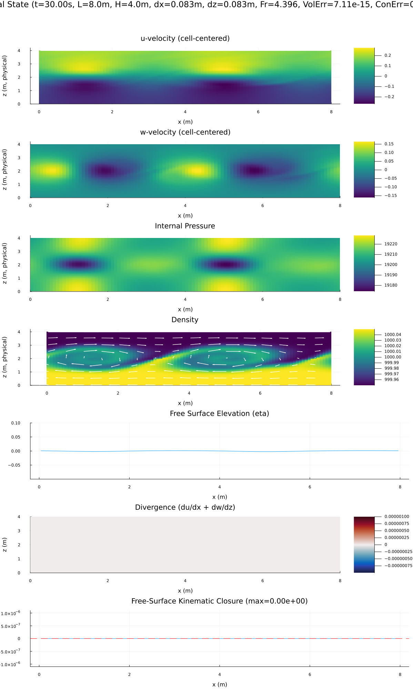
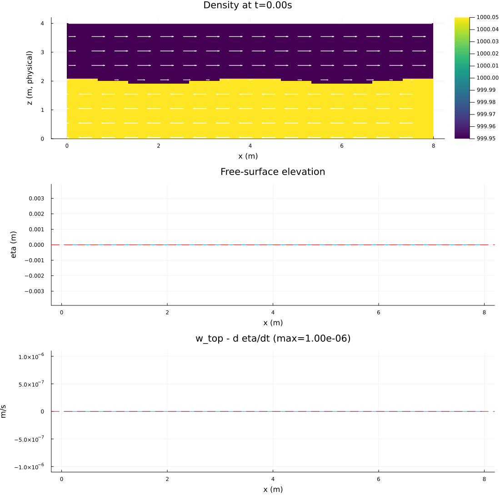

# Kelvin–Helmholtz shear-layer experiment

Run the full-resolution case from the repository root with:

```sh
julia --project=. experiments/kelvin_helmholtz/run_kelvin_helmholtz_dt001_30s_anim.jl
```

The configured run uses an 800×400 grid over an 8 m × 4 m domain (dx=dz=0.01 m) for 120 s. The lateral domain is
periodic, so the imposed shear and perturbed interface continue smoothly across the x seam. Momentum advection uses
`tvd2`; density transport uses the `upwind1` default, not `tvd2`. The Froude limiter is disabled because the prescribed
shear starts above its usual 0.9 threshold; applying it would scale down the instability-driving velocity jump. The
spectral pressure solver uses periodic Fourier modes in x and the existing cosine transform in z.

The following lower-resolution 30-second preview is included for review; it is not the full configured run:




