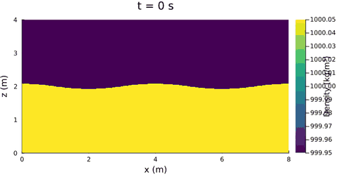
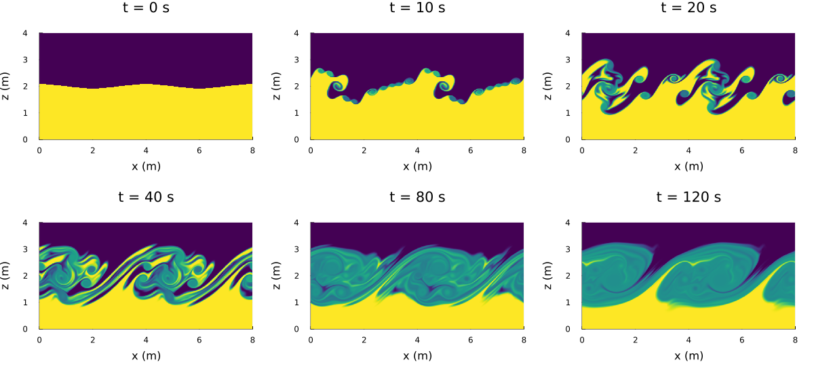
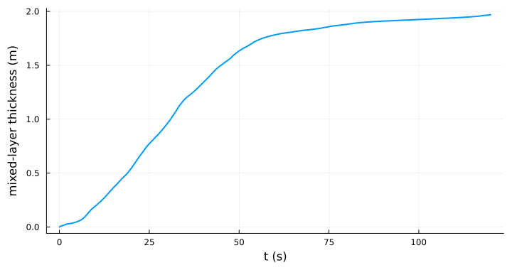
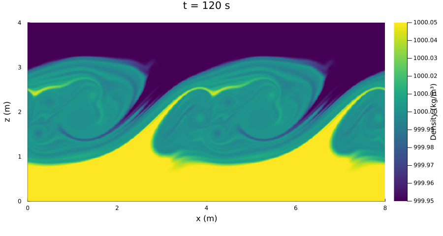
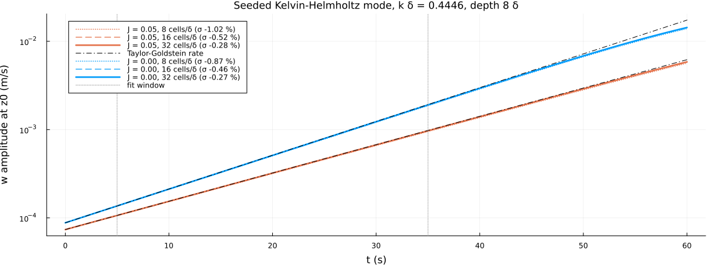
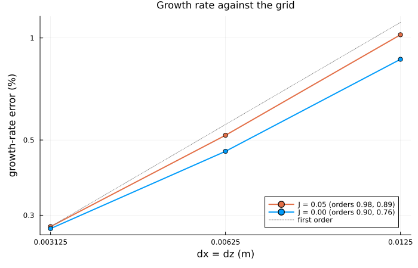
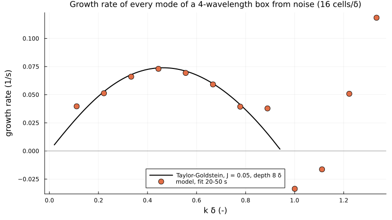
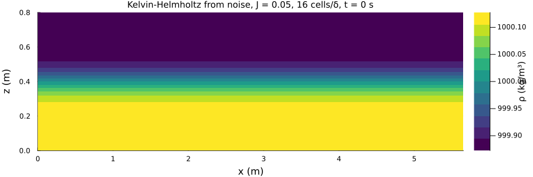
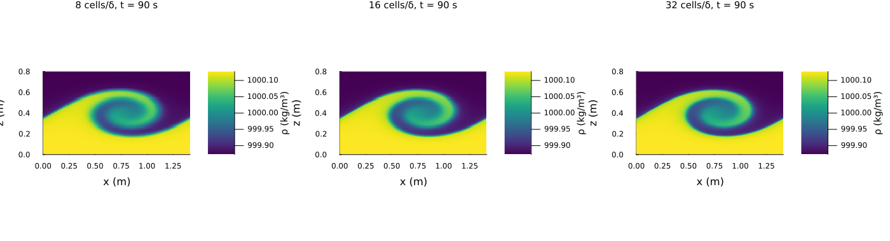
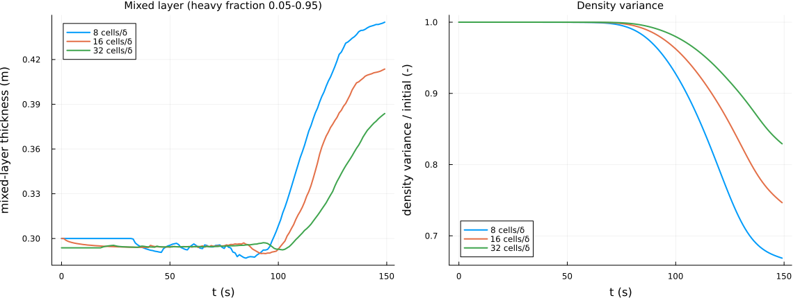

Kelvin-Helmholtz instability
============================

Two parts: the showcase run below (roll-up, merging and mixing at one resolution; its shear layer is two cells thick, so
its wavelength is set by the grid), and the growth rate of a resolved shear layer against stability theory on three
grids (issue #22, [below](#growth-rate-of-a-resolved-shear-layer-issue-22)).

Two layers of slightly different density slide past each other in opposite directions. The velocity jump
across the interface is unstable: waves on the interface roll up into billows, the billows merge and break
down, and the layers mix. For a thin shear layer the growth rate of a wave with wavenumber k is about
sigma = k (u_top - u_bottom) / 2 (Kelvin 1871; Helmholtz 1868; Chandrasekhar 1981). The density difference
stabilises only if the Richardson number g' delta / (u_top - u_bottom)^2 exceeds about 1/4 (delta: shear-layer
thickness); here it is far below.

Setup
-----

- 8 m x 4 m domain, periodic in x (the shear and the interface continue across the x seam), free surface on top;
- light water (999.95 kg/m³, u = +0.2 m/s) above heavy water (1000.05 kg/m³, u = -0.2 m/s), interface at
  mid-depth, tanh shear profile two cells thick;
- interface displaced by 0.08 m with two wavelengths in the domain (lambda = 4 m, k = 1.57 1/m,
  sigma ~ 0.31 1/s);
- 800 x 400 cells (dx = dz = 0.01 m), dt = 0.0025 s, 120 s;
- non-hydrostatic, `tvd2` momentum and density advection, Rayleigh damping 0.001 1/s;
- no Froude limiter. The imposed shear starts at Fr = 0.2/sqrt(g' H) = 3.2, far above the limiter threshold 0.9;
  limiting it would scale down the velocity jump that drives the instability;
- the spectral pressure solver uses Fourier modes in x and a cosine transform in z.

The CFL number |u| dt/dx + |w| dt/dz stays at or below 0.24, half the monotonicity limit of `tvd2` transport.
The density stays within the two layer values.

Results
-------

- **10 s:** short billows roll up along the whole interface. Their wavelength (about 0.5 m) is set by the
  thickness of the initial shear layer, which is two cells (grid-dependent), not by the seeded 4 m wave.
- **20 s:** the short billows merge into the two seeded billows.
- **40 s:** the billows break down into small-scale turbulent structures and mix the layers.
- **80-120 s:** a mixed layer about 2 m thick, with two large rolled-up structures that keep circulating.

The largest velocities (about 0.5 m/s, more than the imposed ±0.2 m/s) occur in the vortex cores. The
circulation of the shear layer is concentrated into vortices of about 0.1 m radius.

**Mixed-layer thickness** (area of water with heavy-water fraction between 0.05 and 0.95, divided by the domain
length): 0.20 m at 10 s, 0.55 m at 20 s, 0.96 m at 30 s, 1.34 m at 40 s, 1.78 m at 60 s and 1.97 m at 120 s. The
growth levels off after about 60 s, when the mixed layer fills the middle half of the depth.

Scripts
-------

- `plot_kelvin_helmholtz.jl`: the figures above (GIF, final density, snapshots, mixed-layer thickness) and an
  `.npz` file with the mixed-layer series and the final density. Output in
  `output_barotropic/kelvin_helmholtz_figures/`; the figures here are copies (the GIF reduced to every third
  frame and 480 px width). Run time about 50 min:

      julia --project=. experiments/kelvin_helmholtz/plot_kelvin_helmholtz.jl

- `run_kelvin_helmholtz_dt00025_120s_anim.jl`: 120 s production run with the built-in `run!` outputs
  (final-state plot, animation every 1 s, pressure and buoyancy diagnostics) in
  `output_barotropic/kelvin_helmholtz/`. Run time about 50 min.
- `cases.jl`: case parameters and model settings shared by both scripts.

References
----------

- Helmholtz (1868), Monatsberichte der Königlichen Preussischen Akademie der Wissenschaften zu Berlin, 215-228
- Kelvin (1871), Philosophical Magazine 42, 362-377
- Chandrasekhar (1981), *Hydrodynamic and Hydromagnetic Stability*, Dover, ch. XI

Growth rate of a resolved shear layer (issue #22)
-------------------------------------------------

The linear growth of a tanh shear layer of physical thickness against the Taylor-Goldstein mode
(`kelvin_helmholtz_tanh_mode`), the case of `test/test_kelvin_helmholtz.jl`.

| Grid (cells per δ) | Growth rate error, J = 0.05 | J = 0 |
|---|---|---|
| 8 (113 x 64) | -1.02 % | -0.87 % |
| 16 (226 x 128) | -0.52 % | -0.46 % |
| 32 (452 x 256) | -0.28 % | -0.27 % |

    julia --project=. experiments/kelvin_helmholtz/plot_growth_rate.jl            # all parts, about 15 min
    julia --project=. experiments/kelvin_helmholtz/plot_growth_rate.jl growth     # one part: growth, spectrum, mixing, seam

Output in `output_barotropic/kelvin_helmholtz_growth/`; the figures here are copies.

**Case.** Shear layer u = U tanh((z - z0)/δ) with δ = 0.1 m, U = 0.05 m/s, and a tanh density profile of the same
thickness, Δρ = 0.255 kg/m³: bulk Richardson number J = g Δρ δ / (2 ρ0 U²) = 0.05 (and J = 0 as a control). Depth 0.8 m
(8 δ), periodic box of one wavelength with k δ = 0.4446 (1.41 m, the most unstable wavelength of Michalke 1964).
Non-hydrostatic, tvd2, no viscosity, damping or limiter, U dt/dx = 0.2. `initialize_shear_layer_mode!` adds the
eigenfunction of the mode (1 mm interface displacement), so the mode grows at its rate from the start.

**Reference.** The Taylor-Goldstein equation for these profiles between the same walls, solved by shooting: σ = 0.07382
1/s at J = 0.05 and 0.08808 1/s at J = 0. Unbounded and unstratified it gives Michalke's 0.1897 U/δ.

The rate converges at first order from below: the numerical diffusion widens the shear layer, and a thicker layer
grows more slowly.

**Wavelength.** A box of four wavelengths (16 cells per δ) is started with divergence-free noise in the modes 1-12. The
rates of the modes 2-7 follow the theory within 3 %:

Mode 1 has not left the transient of the noise start in the fit window; the modes 8, 11 and 12 are driven by harmonics
of the dominant modes (mode 8 = 2 x mode 4; 11 and 12 lie above the neutral wavenumber k δ ≈ 0.95); 9 and 10 decay.
The dominant mode is 5 and 4 (the fastest) until about 100 s, then 3 when the billows merge:

**Roll-up and mixing** on the three grids (one wavelength, J = 0.05):

The billow has the same shape on the three grids. The mixing is not: the mixed layer (heavy fraction 0.05-0.95) grows
from 0.30 m to 0.445, 0.414 and 0.384 m at 150 s, the density variance falls to 0.67, 0.75 and 0.83 of its initial
value. The model has no viscosity or diffusivity here, so the mixing is numerical and decreases with refinement; a
converged mixing rate needs a physical diffusivity (or a turbulence closure) resolved by the grid.

**Seam.** The same run with the initial state shifted by half a wavelength (the billow forms across the periodic seam)
agrees with the interior run after shifting back to 5e-8, 1.4e-6, 1.4e-5 and 4.8e-5 of Δρ at 40, 70, 100 and 130 s: round-off,
amplified by the roll-up.

References: Michalke (1964), J. Fluid Mech. 19, 543-556; Hazel (1972), J. Fluid Mech. 51, 39-61; Miles (1961) and
Howard (1961), J. Fluid Mech. 10, 496-508 and 509-512; Drazin & Reid (2004), Hydrodynamic Stability.
