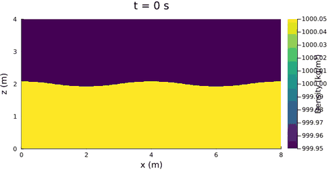
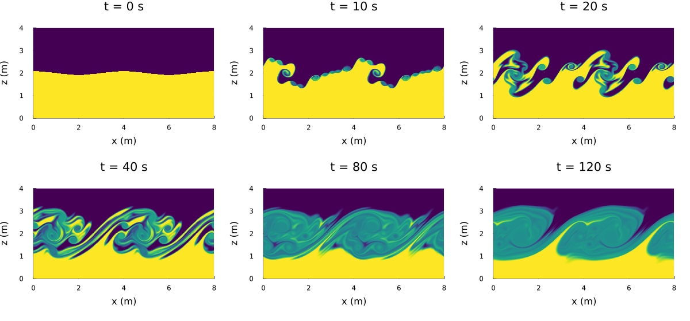
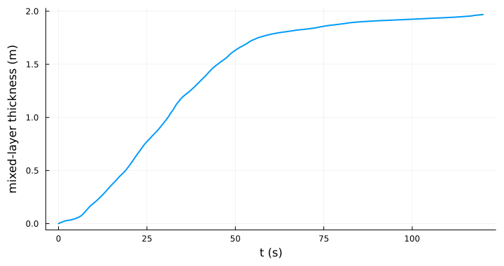
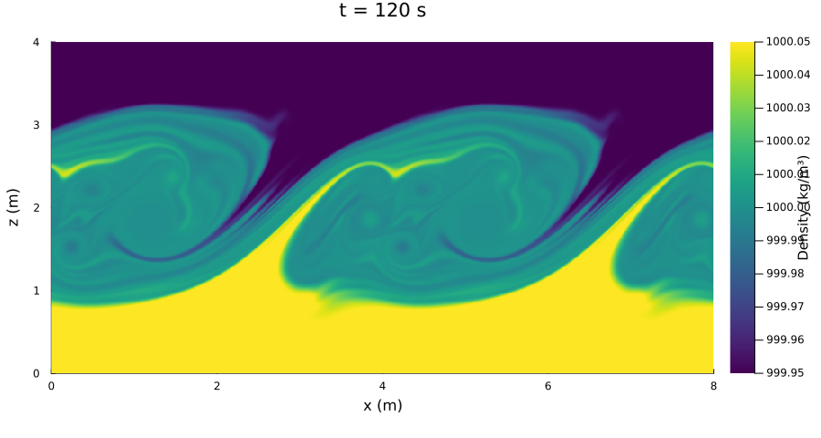

Kelvin-Helmholtz instability
============================

Two layers of slightly different density slide past each other in opposite directions. The velocity jump
across the interface is unstable: waves on the interface roll up into billows, the billows merge and break
down, and the layers mix. For a thin shear layer the growth rate of a wave with wavenumber k is about
sigma = k (u_top - u_bottom) / 2 (Kelvin 1871; Helmholtz 1868; Chandrasekhar 1981). The density difference
stabilises only if the Richardson number g' delta / (u_top - u_bottom)^2 exceeds about 1/4 (delta: shear-layer
thickness); here it is far below.

Setup
-----

- 8 m x 4 m domain, periodic in x (the shear and the interface continue across the x seam), free surface on top;
- light water (999.95 kg/m³, u = +0.2 m/s) above heavy water (1000.05 kg/m³, u = -0.2 m/s), interface at
  mid-depth, tanh shear profile two cells thick;
- interface displaced by 0.08 m with two wavelengths in the domain (lambda = 4 m, k = 1.57 1/m,
  sigma ~ 0.31 1/s);
- 800 x 400 cells (dx = dz = 0.01 m), dt = 0.0025 s, 120 s;
- non-hydrostatic, `tvd2` momentum and density advection, Rayleigh damping 0.001 1/s;
- no Froude limiter. The imposed shear starts at Fr = 0.2/sqrt(g' H) = 3.2, far above the limiter threshold 0.9;
  limiting it would scale down the velocity jump that drives the instability;
- the spectral pressure solver uses Fourier modes in x and a cosine transform in z.

The CFL number |u| dt/dx + |w| dt/dz stays at or below 0.24, half the monotonicity limit of `tvd2` transport.
The density stays within the two layer values.

Results
-------

- **10 s:** short billows roll up along the whole interface. Their wavelength (about 0.5 m) is set by the
  thickness of the initial shear layer, which is two cells (grid-dependent), not by the seeded 4 m wave.
- **20 s:** the short billows merge into the two seeded billows.
- **40 s:** the billows break down into small-scale turbulent structures and mix the layers.
- **80-120 s:** a mixed layer about 2 m thick, with two large rolled-up structures that keep circulating.

The largest velocities (about 0.5 m/s, more than the imposed ±0.2 m/s) occur in the vortex cores. The
circulation of the shear layer is concentrated into vortices of about 0.1 m radius.

**Mixed-layer thickness** (area of water with heavy-water fraction between 0.05 and 0.95, divided by the domain
length): 0.20 m at 10 s, 0.55 m at 20 s, 0.96 m at 30 s, 1.34 m at 40 s, 1.78 m at 60 s and 1.97 m at 120 s. The
growth levels off after about 60 s, when the mixed layer fills the middle half of the depth.

Scripts
-------

- `plot_kelvin_helmholtz.jl`: the figures above (GIF, final density, snapshots, mixed-layer thickness) and an
  `.npz` file with the mixed-layer series and the final density. Output in
  `output_barotropic/kelvin_helmholtz_figures/`; the figures here are copies (the GIF reduced to every third
  frame and 480 px width). Run time about 50 min:

      julia --project=. experiments/kelvin_helmholtz/plot_kelvin_helmholtz.jl

- `run_kelvin_helmholtz_dt00025_120s_anim.jl`: 120 s production run with the built-in `run!` outputs
  (final-state plot, animation every 1 s, pressure and buoyancy diagnostics) in
  `output_barotropic/kelvin_helmholtz/`. Run time about 50 min.
- `cases.jl`: case parameters and model settings shared by both scripts.

References
----------

- Helmholtz (1868), Monatsberichte der Königlichen Preussischen Akademie der Wissenschaften zu Berlin, 215-228
- Kelvin (1871), Philosophical Magazine 42, 362-377
- Chandrasekhar (1981), *Hydrodynamic and Hydromagnetic Stability*, Dover, ch. XI
