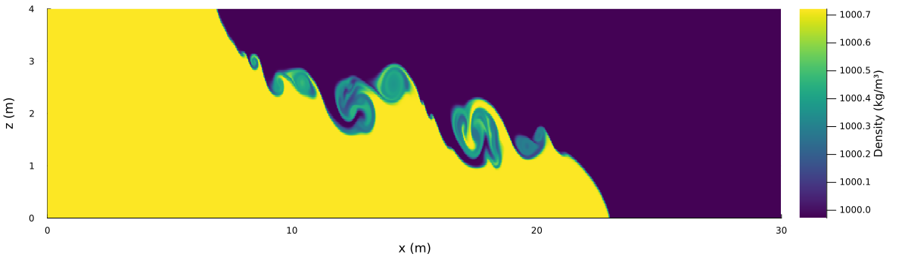
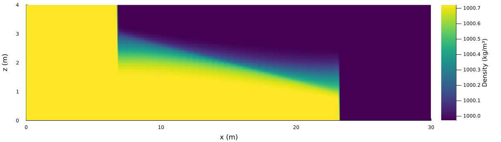
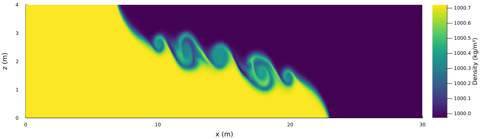

Lock exchange
=============

A gravity current after the removal of a gate between heavy and light water in a
closed channel. The heavy water runs along the bottom and the light water along the
top in opposite directions. The front speed is set by the reduced gravity
g' = g (rho1 - rho2)/rho0 and the depth H: U = Fr sqrt(g' H) with Fr ~ 0.5 (Benjamin 1968).
In non-hydrostatic runs, Kelvin-Helmholtz billows form on the interface between the two layers.

Example
-------

Density 100 s after the removal of the gate between heavy (yellow) and light
(purple) water:
- 30 m x 4 m channel, gate at 15 m, rho1 = 1000.722 kg/m3, rho2 = 999.972 kg/m3;
- `tvd2` momentum and density advection;
- inviscid (nu = 0), Rayleigh damping r = 0.002 1/s;
- Froude limiter at 0.9: it rescales the velocity field when max|u| > 0.9 sqrt(g' H) = 0.154 m/s. In the
  non-hydrostatic runs it is active from about 37 s on, in 16 of 100 one-second samples, and caps the
  velocity in the billows;
- non-hydrostatic: 1500 x 200 grid (dx = dz = 0.02 m), dt = 0.01 s;
- hydrostatic: 600 x 80 grid (dx = dz = 0.05 m), dt = 0.01 s. No billows develop that would need the
  finer grid. The front speed is 2 % above the 1500 x 200 result (0.959 vs. 0.939 U).

Script: `plot_density_hydro_vs_nonhydro_100s.jl`.

**Non-hydrostatic:** Kelvin-Helmholtz billows on the interface behind the front.

**Hydrostatic:** no billows. The fronts are steep and near-vertical, with a sloping,
diffuse interface between them.

**Density transport scheme.** The same non-hydrostatic run with first-order upwind (`upwind1`)
density transport. The interfaces are smeared and the fine structure inside the billows is lost:
the area of mixed water (heavy-water fraction between 0.05 and 0.95) is 13.1 m² against 6.6 m²
with `tvd2`. The fronts move by less than 0.1 m.

| t = 100 s | heavy front (bottom) | light front (top) | mean front speed |
|---|---|---|---|
| non-hydrostatic, `tvd2` transport | 22.95 m | 6.95 m | 0.933 U |
| non-hydrostatic, `upwind1` transport | 22.89 m | 6.99 m | 0.927 U |
| hydrostatic, `tvd2` transport | 23.23 m | 6.78 m | 0.959 U |

U = 0.5 sqrt(g' H) = 0.0858 m/s; the mean speed is the average front displacement from the gate divided by 100 s
(it includes the initial acceleration).

**Free surface.** Earlier non-hydrostatic figures had a thin line of heavy water along the whole surface ahead of
the light front, and light water above the heavy reservoir. The density transport on the fixed grid of the
non-hydrostatic mode had a spurious source in the top row. The fix (top-row advective form, technical
documentation sections 4 and 13) left the interior unchanged: the mean density difference below the surface is
1 % of the contrast and the fronts did not move.

Scripts
-------

- `plot_density_hydro_vs_nonhydro_100s.jl`: the example above (density plots, animations, `.npz` fields) and the
  comparison cases (`upwind1` momentum or transport). Case names are `<mode>_<momentum>_<transport>`, e.g.
  `julia --project=. experiments/lock_exchange/plot_density_hydro_vs_nonhydro_100s.jl anim nonhydro_tvd2_tvd2`.
  Run time: about 9 min per non-hydrostatic case and 1 min per hydrostatic case. The GIF here is a reduced copy
  (560 px wide, every third frame).
- `run_dx002_dt001_100s.jl`, `run_dx002_dt001_100s_anim.jl` (1500 x 200, 100 s) and `run_dx001_dt0005_100s_anim.jl`
  (3000 x 400, 100 s): production runs with the built-in `run!` outputs (final-state plot, animation every 1 s,
  pressure and buoyancy diagnostics) in `output_barotropic/lock_exchange/`.
- `cases.jl`: model settings shared by all scripts.
- `../validation/validate_lock_exchange_front_speed.jl`: front speed compared with theory.
- `../../analysis/lock_exchange/`: Python tools for the bulk reference values and for evaluating
  model runs (front positions, Froude number, nose angle, time-step limits).

Time step
---------

The default keeps U dt/min(dx, dz) <= 0.05. Hydrostatic runs must also keep |w| dt/dz <= 0.5,
because the diagnosed vertical velocity grows with the vertical resolution
(|w| ~ 0.25 U H/dz; 2.5-5 m/s on the 1500 x 200 grid). Larger steps produce spikes and spurious
mixing behind the fronts and, on fine grids, slow the fronts down. On 1500 x 200 this requires
dt = 0.002 s; on 600 x 80 dt = 0.01 s is enough (the largest vertical CFL number in the run is 0.42).
See `time_step_bounds` in `../../analysis/lock_exchange/lock_exchange.py`.
