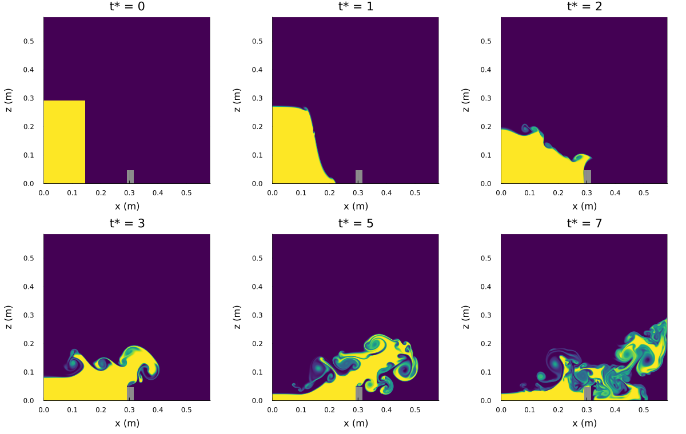
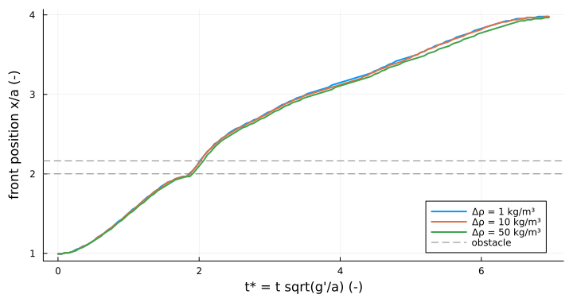
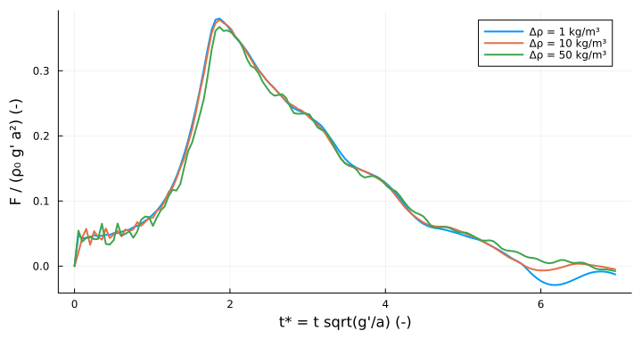

Lock exchange with obstacle
===========================

A density-stratified version of the classical dam break with an obstacle (issue #3). In the
original two-phase case a water column collapses in air, hits a small obstacle, is thrown over it
and hits the opposite wall (Martin & Moyce 1952; Koshizuka & Oka 1996; Ubbink 1997; Robert et al.).
Here the column is heavy water and the rest of the tank is filled with light water up to a free
surface. The column collapses under the reduced gravity g' = g (rho_heavy - rho_light)/rho0 and
the light water has to flow back over it: the result is a gravity current that runs into the
obstacle, overflows it, and climbs the far wall. The obstacle is part of the bed (`bed_level`, a
bed level per column; see the plan in `docs/plan_issue_3_lock_exchange_obstacle.md`).

Setup
-----

Geometry of Robert et al. (section 3.1 and Figure 2 of the paper), a = 0.146 m, d = 0.024 m:

| | |
|---|---|
| tank | 4a x 4a = 0.584 m x 0.584 m, closed walls, free surface on top |
| heavy column | a wide, 2a high, at the left wall |
| obstacle | d wide, 2d high, on the bed at x = 2a ... 2a + d (0.292-0.316 m) |
| densities | light water 1000 kg/m³ (= rho0); heavy water 1000 + drho |
| documented case | drho = 10 kg/m³, 584 x 584 cells (1 mm), dt = 0.00075 s |
| density sweep | drho = 1, 10, 50 kg/m³ on 292 x 292 cells (2 mm) |

Settings (`cases.jl`):
- non-hydrostatic; sparse pressure solver, because the bed has solid cells;
- `tvd2` momentum and density advection;
- free-slip walls, as in the reference case;
- nu = 1e-6 m²/s; no Rayleigh damping, no Froude limiter.
- The time step scales with the cell size and with 1/sqrt(drho), so all runs have similar CFL numbers. The largest
  |u| dt/dx + |w| dt/dz is 0.30-0.47, below the `tvd2` limit 0.5.
- The results are compared in dimensionless time t* = t sqrt(g'/a). The time scale sqrt(a/g') is 1.22 s for 10 kg/m³
  (3.86 s for 1 kg/m³, 0.55 s for 50 kg/m³). The original's 0.6 s (in full gravity) corresponds to t* = 4.9.
- Simulated time: t* = 7 (8.5 s for 10 kg/m³), see Limitations.

Results
-------

- **t* = 1:** the column collapses; the heavy water forms a nose that runs towards the obstacle.
- **t* = 1.9:** the front reaches the obstacle. Part of the current is lifted over it, while the light water flows
  back above the current. Kelvin-Helmholtz billows form on the interface.
- **t* = 3-5:** the current continues behind the obstacle as a turbulent head; the column behind it has drained to a
  thin layer.
- **t* = 6.3:** the front reaches the far wall (x = 3.9a); by t* = 7 the heavy water climbs the wall.

Compared with the two-phase original, the flow is a gravity current rather than a free jet. The light water has to make
room, so there is no tongue thrown over the obstacle through air, and the time scale is sqrt(a/g') instead of
sqrt(a/g).

**Density difference and Boussinesq scaling.** The model is Boussinesq, so in dimensionless form all three density
differences are the same flow, apart from the Reynolds number and the coupling to the free surface. The front positions
and the horizontal pressure force on the obstacle collapse when plotted against t*:

| drho (kg/m³) | front at obstacle (t*) | front at 3.9a (t*) | peak force F/(rho0 g' a²) | peak force (N/m) |
|---|---|---|---|---|
| 1 | 1.87 | 6.30 | 0.380 at t* = 1.87 | 0.080 |
| 10 | 1.92 | 6.30 | 0.378 at t* = 1.87 | 0.79 |
| 50 | 1.92 | 6.50 | 0.367 at t* = 1.87 | 3.8 |
| 10 (1 mm grid) | 1.89 | 6.27 | 0.386 at t* = 1.89 | |

The dimensionless results agree within about 3 %, and the finer grid confirms them. The largest deviations are for
50 kg/m³ (a slightly slower front, small early force oscillations from free-surface waves).

How large the density difference can be: the solver itself has no limit. The pressure solves are direct, and all three
runs are stable at the same CFL numbers. The limit is physical: the Boussinesq approximation neglects terms of relative
size drho/rho0. It is generally accepted up to a few per cent, so 50 kg/m³ (5 %) is at its edge. For a real
(non-Boussinesq) fluid the heavy and the light current would no longer be symmetric. The documented case uses
10 kg/m³ (1 %).

Limitations
-----------

From t* ~ 7.5 the model is no longer reliable. The light water displaced by the splash at the right wall is pushed up
to the free surface, and in the top cell of the fixed grid of the non-hydrostatic mode it is forced sideways into a thin
jet along the surface (|u| up to 0.6 m/s, against a physical velocity scale of sqrt(2 g' 2a) ~ 0.24 m/s). From t* ~ 9
kinetic energy grows without potential energy being released and the run eventually blows up. This happens for all
density differences and grid sizes, and also without the obstacle. The runs therefore stop at t* = 7.

Investigating this problem led to the Lax-Wendroff time correction of the `tvd2` momentum advection, which removed an
earlier and stronger energy source (technical documentation, section 3). The remaining surface problem is left for a
separate issue; the most likely remedy is to extend the variable-thickness top layer to the non-hydrostatic mode.
Energy diagnostic used: kinetic energy 0.5 rho0 sum(u_c² + w_c²) dx dz against the released potential energy
g sum((rho - rho0) z) dx dz (initial minus current), both over the wet cells.

Scripts
-------

- `plot_lock_exchange_obstacle.jl sweep`: drho = 1, 10, 50 kg/m³ on 2 mm, front and force figures (about 2 min per run).
- `plot_lock_exchange_obstacle.jl documented`: drho = 10 kg/m³ on 1 mm, GIF, snapshots and final density
  (about 20 min).
- `cases.jl`: geometry, settings, time step, initial condition and diagnostics (front position, obstacle force).

Output goes to `output_barotropic/lock_exchange_obstacle_figures/`; the figures here are copies.

References
----------

- Martin & Moyce (1952), Phil. Trans. R. Soc. Lond. A 244, 312-324
- Koshizuka & Oka (1996), Nucl. Sci. Eng. 123, 421-434
- Ubbink (1997), Numerical prediction of two fluid systems with sharp interfaces, PhD thesis, Imperial College London
- Robert, Leroyer, Wackers, Visonneau & Queutey, Time-Splitting Procedure for the Resolution of the Volume Fraction for
  Unsteady Flows, LHEEA, École Centrale de Nantes (the paper linked in issue #3)
- Benjamin (1968), J. Fluid Mech. 31, 209-248
