Flow over obstacles (issue #47)
==============================

Steady, frictionless, hydrostatic flow over a bump and over a broad-crested weir, sub-, trans- and supercritical, with a
hydraulic jump. Runs in 1D (wetting-drying step with one layer) and 2DV (8 or 16 layers); the obstacles are real bed
levels (cut cells). Theory and implementation: [docs/TESTS_TECHNICAL_DOCUMENTATION.md](../../docs/TESTS_TECHNICAL_DOCUMENTATION.md),
section 23; tests in `test/test_obstacles.jl`.

Run: `julia --project experiments/obstacles/plot_obstacles.jl [product ...]` (products: `profiles convergence sections
weir shock tracer`, default all; about 10 min for all).

Cases
-----

**SWASHES bump** (Delestre et al. 2013, section 3.1.1). 25 m channel with the bed 0.2 - 0.05 (x - 10)² for 8 < x < 12 m.
The exact solutions are in `src/reference_solutions.jl` (`bump_flow_depth`, `hydraulic_jump_position`):

| case | q (m²/s) | boundaries | exact solution |
|---|---|---|---|
| subcritical | 4.42 | discharge in, level 2 m out | Bernoulli, subcritical everywhere |
| transcritical | 1.53 | discharge in, free outflow | critical depth (q²/g)^(1/3) at the crest, supercritical downstream |
| shock | 0.18 | discharge in, level 0.33 m out | transcritical, hydraulic jump at x = 11.666 m (Bélanger conjugate depths) |

**Broad-crested weir.** Trapezoid of height 0.5 m (crest 18-22 m, 3 m ramps) in a 40 m channel, q = 1 m²/s, and
tailwater depths from 0.85 to 1.4 m:
- free flow: critical depth on the crest, upstream energy head H = 3/2 h_c above the crest, i.e. the weir law
  q = (2/3)^(3/2) sqrt(g) H^(3/2), independent of the tailwater;
- submerged flow: once the tailwater energy exceeds that head, the flow is subcritical everywhere and the upstream
  energy equals the tailwater energy.

**Tracer.** The inflow carries the density 1000.001 kg/m³ (`set_x_inflow_outflow!(...; left_rho)`; its buoyancy is
negligible). The front passes the bump with the steady flow.

Results
-------

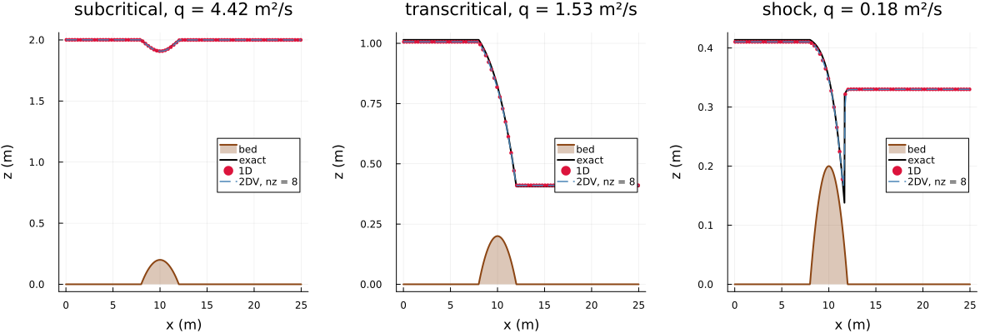

1D and 2DV lie on the exact solutions in all three regimes (nx = 250).

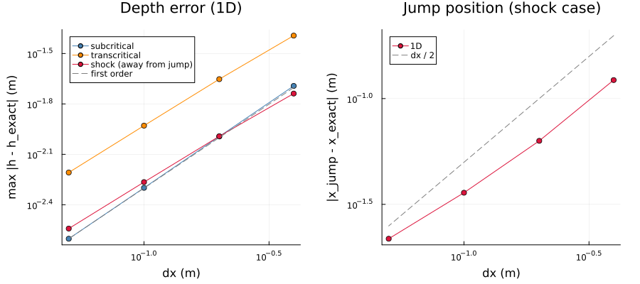

First-order convergence of the depth: the error halves with dx. In the shock case it is measured at least 0.5 m away
from the jump, and the error of the jump position falls below dx/2.

| nx (dx) | subcritical | transcritical | shock, away from the jump | jump position |
|---|---|---|---|---|
| 125 (0.2 m) | 9.0 mm | 22 mm | 10 mm | 52 mm |
| 250 (0.1 m) | 4.5 mm | 12 mm | 5.4 mm | 17 mm |
| 500 (0.05 m) | 2.2 mm | 6.1 mm | 2.9 mm | 12 mm |

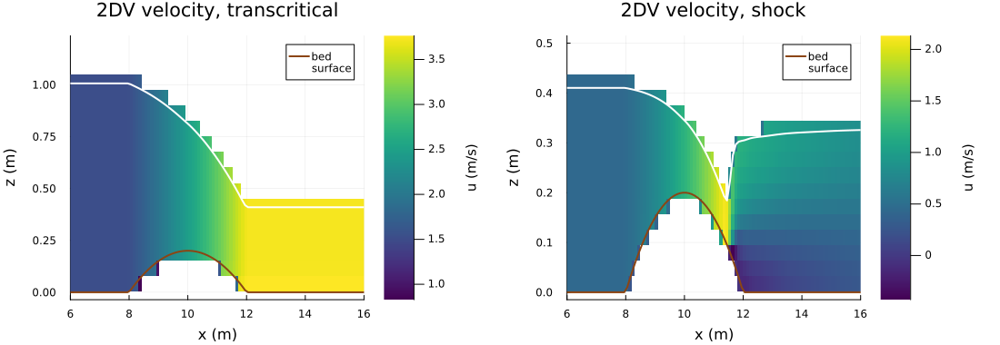

2DV velocity sections (16 layers). The transcritical flow accelerates over the crest. Under the jump of the shock case
the hydrostatic model forms a roller with backflow at the bed. With nu = 1e-4 m²/s it does not become steady (the
discharge varies by 3 %); with nu = 1e-3 m²/s it does, and the jump then sits about 0.15 m upstream of the
depth-averaged one. The cut cells are drawn at full height.

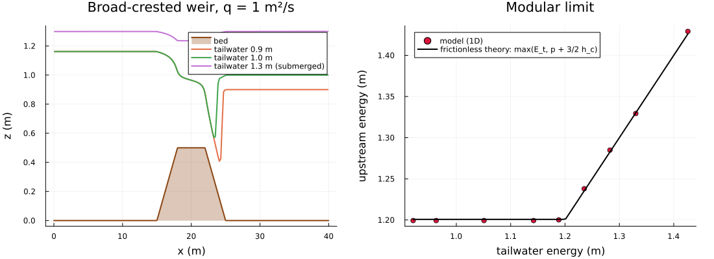

The broad-crested weir:
- free flow: the weir law gives the discharge from the model head within 1.25 % at dx = 0.4 m and 0.45 % at 0.2 m, and
  the upstream energy is the same for every free-flow tailwater (modular flow);
- above the modular limit (tailwater energy above 3/2 h_c + p) the upstream energy follows the tailwater energy, as in
  frictionless theory.

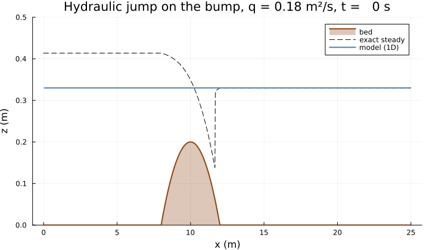

The jump forms on the downstream slope of the bump: the lake at the outlet level is pushed downstream until the
supercritical stream from the crest meets the tailwater at the conjugate depths.

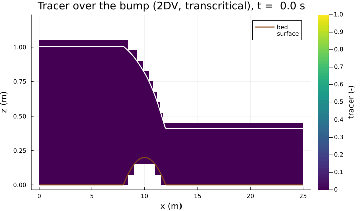

A tracer front over the bump (2DV, transcritical). The transport stays within [0, 1] (monotone, `tvd2`). Its content
changes every step exactly by the boundary fluxes (`test_verify_tracer_through_bump_monotone_and_conserved`).

Recirculation behind a step and a weir (issue #50)
--------------------------------------------------

Run: `julia --project experiments/obstacles/plot_recirculation.jl [product ...]` (products: `step grids boundary weir
animation`, default all; about 5 h one after the other, they can run in parallel). Theory, the full tables and the
explanation of the hydrostatic blow-up: [docs/TESTS_TECHNICAL_DOCUMENTATION.md](../../docs/TESTS_TECHNICAL_DOCUMENTATION.md),
section 28; tests in `test/test_recirculation.jl`.

Backward-facing step ST1 of Nakagawa & Nezu (1987) as simulated by Luo et al. (2023): S = 2 cm, depth 6 cm, Re = 4380,
k-epsilon, wetting-drying step with cut cells, 90 s. The reference is the LES value 6.15 S; the measured table of 1987
is not public.

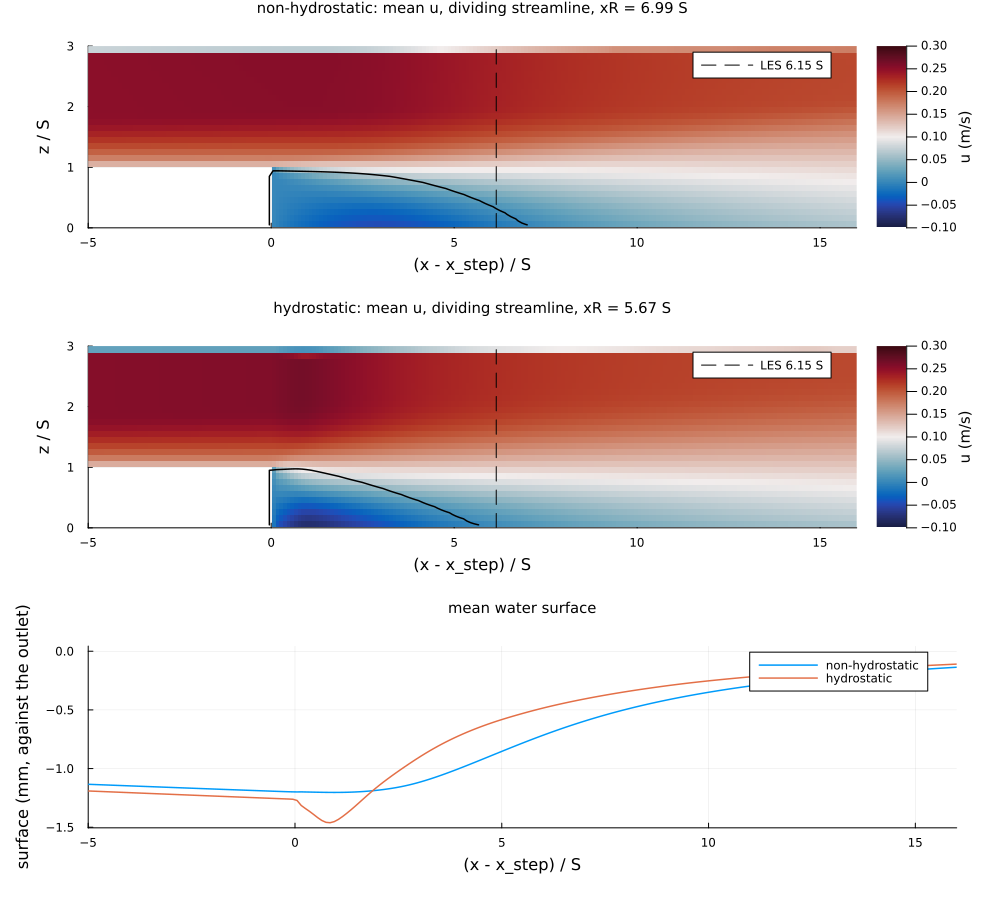

At S/10 the non-hydrostatic run gives xR = 6.99 S, steady (std 0.10 S). The hydrostatic run gives 5.67 S but does not
settle (std 1.3 S), and its surface dips behind the step.

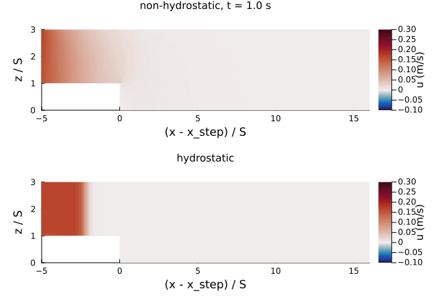

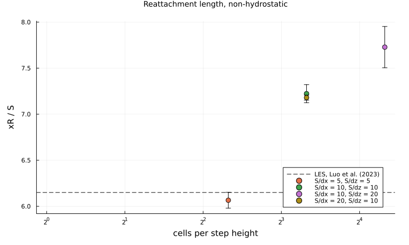

| grid (dx, dz) | xR / S | std |
|---|---|---|
| S/5, S/5 | 6.16 | 0.05 |
| S/10, S/10 | 6.99 | 0.10 |
| S/10, S/20 | 7.41 | 0.22 |
| S/20, S/10 | 6.94 | 0.03 |

The length depends on dz more than on dx and moves away from the LES. The agreement of the coarse grid (6.16 S) is a
cancellation of errors; xR is within 20 % of the LES.

These grids have the bed on a layer interface. Shifted against the layers, so that the lowest wet cell is shaved, the
step at S/10 gives 7.02 S (a quarter of a layer), 7.11 S (half), 7.37 S (three quarters), but 12.47 S and no steady
state with a cell of 10 % of dz. The weir goes from 5.29 S to 4.15 S at half a layer. The suspect is the bed cell of
k-epsilon: its k and eps come from the local velocity, so k goes to zero at reattachment, and eps follows the thickness
of the cell (section 28).

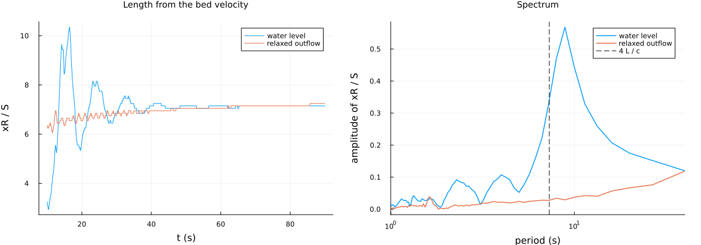

An impulsive start excites the quarter-wave mode of the reach (7.3 s). With a fixed level at the outlet xR swings from
2.9 to 10 S and settles after about 40 s; the relaxed outflow (issue #54) removes this.

Hydrostatic runs with a fixed level can blow up. The swing of the discharge lifts the jet to the Courant limit of the
explicit advection (0.625 m/s at this time step). A prescribed velocity at the inlet even feeds the mode (about 1.4 per
period, in the non-hydrostatic mode as well); a prescribed discharge damps it. Use a ramped discharge
(`left_discharge=t -> q(t)`) or the relaxed outflow. The model warns of both (issue #61).

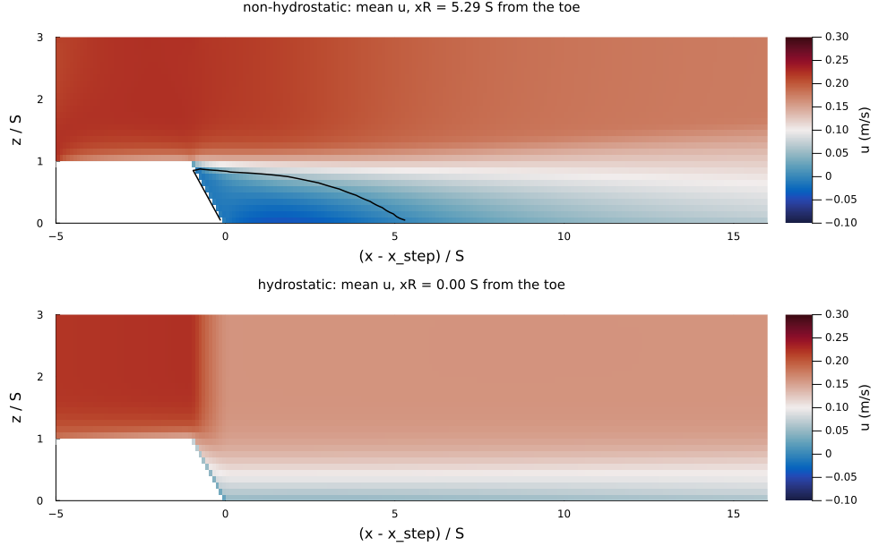

A trapezoidal weir of height S with a 1:1 downstream face (no reference): non-hydrostatic xR = 5.29 S from the toe
(see above for the shifted bed); hydrostatic: no reverse flow at all.

Limits
------

- The cases of issue #47 are hydrostatic only. The sharp-crested (thin-plate) weir of issue #47 needs the non-hydrostatic pressure (a curved
  nappe); the open boundaries of the non-hydrostatic mode now exist (issue #49), the weir case is still to be set up.
- A prescribed inflow density (`left_rho`) exists only in the wetting-drying step; the transport of the other modes has
  no flux through the outer faces.
- Frictionless with an open outlet: a lake carrying the discharge is a steady state as well. The transcritical case
  therefore starts with water only upstream of the crest, so that the crest takes control.
