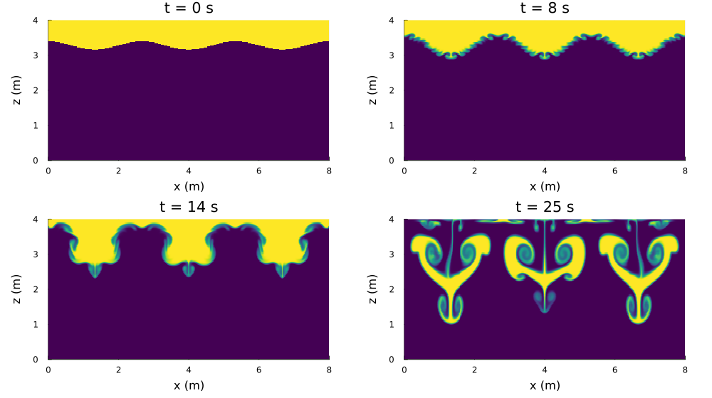
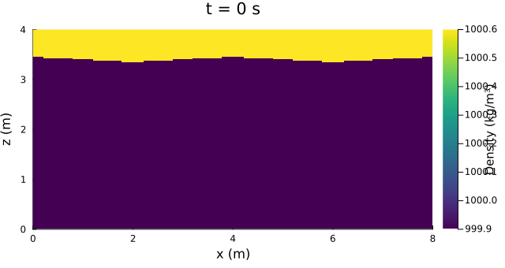
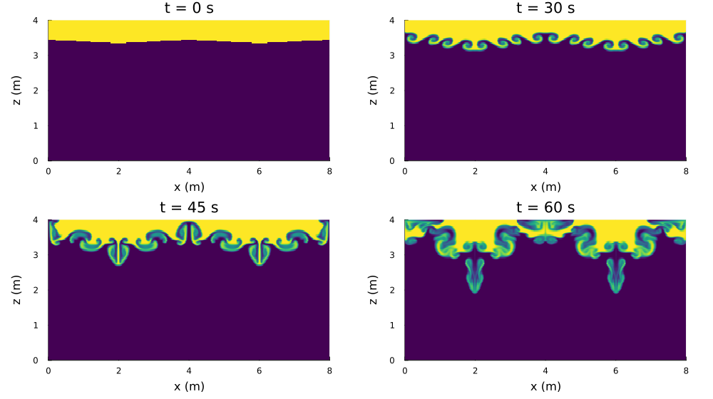
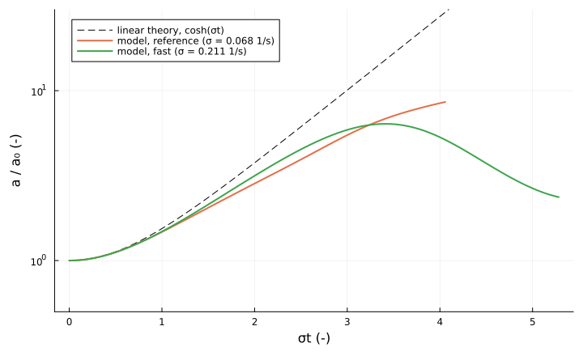

Rayleigh-Taylor instability
===========================

A layer of heavy water on top of light water is unstable: a small wave on the interface grows,
heavy fluid falls in spikes and light fluid rises in bubbles, and the layers overturn and mix.
For small amplitudes the interface displacement grows exponentially at a rate set by the density
difference and the wavelength (Rayleigh 1883; Taylor 1950). The experiment checks the non-hydrostatic
model against this linear growth and shows the nonlinear overturning.

Setup
-----

An 8 m x 4 m closed basin with a free surface. A thin heavy layer (density rho_top, thickness h1) lies on
top of a light layer (rho_bottom, h2). The interface is displaced by a0 cos(k x) with k = 2 pi m / L, and the
water starts at rest.

| | reference | fast |
|---|---|---|
| rho_top / rho_bottom (kg/m³) | 1000.60 / 999.90 | 1002.50 / 998.50 |
| Atwood number (rho_top - rho_bottom)/(rho_top + rho_bottom) | 3.5e-4 | 2.0e-3 |
| interface height, h1 (m) | 3.40, 0.60 | 3.28, 0.72 |
| perturbation a0 (m), wavelengths m in the basin | 0.04, 2 | 0.12, 3 |
| linear growth rate sigma (1/s), e-folding time | 0.068, 15 s | 0.211, 4.7 s |
| simulated time (figures) | 60 s | 25 s |
| time step | 0.005 s | 0.004 s |

Common settings (`cases.jl`):
- 400 x 160 cells (dx = 0.02 m, dz = 0.025 m);
- non-hydrostatic pressure, spectral pressure solver. The instability is a non-hydrostatic process:
  in the hydrostatic limit the growth rate increases without bound with k;
- `tvd2` momentum and density advection. `tvd2` transport keeps the interface sharp; the linear growth is
  almost the same with `upwind1`;
- viscosity nu = 1e-6 m²/s, no turbulence model;
- no Rayleigh damping and no Froude limiter. The limiter would only act above Fr = 0.9; the runs reach 0.70.
- The CFL number |u| dt/dx + |w| dt/dz stays at or below 0.12, below the monotonicity limit 0.5 of `tvd2` transport.

Results
-------

**Fast case:** the interface wave steepens into three heavy spikes. Kelvin-Helmholtz rolls form on their
flanks, and after about 15 s the spikes break up into mushroom-shaped plumes that sink below mid-depth.

**Reference case:** with the smaller density difference the mode grows slowly. Short-wave disturbances from the
staircase-shaped initial interface roll up first along the whole interface (t = 30 s). The two-wavelength mode
takes over by about 45 s, and two plumes sink by 60 s.

**Growth against linear theory.** Inviscid linear theory for two layers between rigid horizontal boundaries
(Chandrasekhar 1961, ch. X) gives

    sigma^2 = g k (rho_top - rho_bottom) / (rho_top coth(k h1) + rho_bottom coth(k h2)),

and an interface released from rest grows as a(t) = a0 cosh(sigma t). The free surface acts as a rigid lid for
this internal mode (its displacement is at most about 1e-3 m). The model amplitude a(t) is the cos(k x) component of the
interface height, taken from the heavy-fluid thickness of each column (`interface_mode_amplitude` in `cases.jl`).
Plotted against sigma t, both cases should fall on the same curve.

- Early growth follows the theory: a/a0 = 0.0433/0.0434 m at 5 s in the reference case.
- The model then falls gradually behind: -5 % at sigma t = 1, about -25 % at sigma t = 2 (reference case).
  There are two causes. The numerical interface is smeared over a few cells, which lowers the growth rate. And
  the motion becomes nonlinear once k a reaches about 0.2-0.3, at sigma t of about 2 in the reference case and from
  the start in the fast case (k a0 = 0.28).
- The fast case saturates at sigma t = 3.4 (a = 0.77 m at 16 s) when the spikes break up. After that, a no longer
  describes a single interface.

The test `test_validate_rayleigh_taylor_linear_growth_rate` (test/test_nonhydrostatic.jl) checks the linear rate
with a smaller perturbation (k a0 = 0.05) on 200 x 80 cells. The fitted rate is 0.84 sigma there and 0.87 sigma on
400 x 160 cells: it converges slowly as the interface gets sharper.

**Note on the free surface.** Earlier runs of this experiment were affected by a model defect: on the fixed grid
used by the non-hydrostatic mode, the top row of the density field had a spurious source rho·eta_t·dt/dz per time
step. In these runs it reached 1 kg/m³ per step, more than the density contrast, and it made light patches in the
top layer. It also lowered the growth rate to about 0.6 sigma. The top row is now advanced in advective form
(`_density_top_row_advective_form!`, technical documentation sections 4 and 13).

Scripts
-------

- `plot_rayleigh_taylor.jl`: the figures above (GIFs, snapshot panels, growth plot) and `.npz` files with the
  amplitude series and final density. Output in `output_barotropic/rayleigh_taylor_figures/`; the figures here are
  copies. Run time about 1.5 min (reference) and 45 s (fast):

      julia --project=. experiments/rayleigh_taylor/plot_rayleigh_taylor.jl [reference] [fast]

- `run_reference_dt0005_25s_anim.jl`, `run_fast_dt0004_25s_anim.jl`: 25 s production runs with the built-in
  `run!` outputs (final-state plot, animation, pressure and buoyancy diagnostics).
- `cases.jl`: case parameters, model settings, linear growth rate and amplitude diagnostic, shared by all scripts.

References
----------

- Rayleigh (1883), Proc. London Math. Soc. 14, 170-177, doi:10.1112/plms/s1-14.1.170
- Taylor (1950), Proc. R. Soc. Lond. A 201, 192-196, doi:10.1098/rspa.1950.0052
- Sharp (1984), Physica D 12, 3-18, doi:10.1016/0167-2789(84)90510-4
- Chandrasekhar (1961), *Hydrodynamic and Hydromagnetic Stability*, Oxford, ch. X
