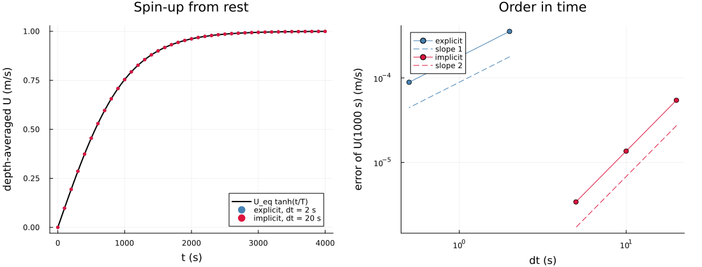
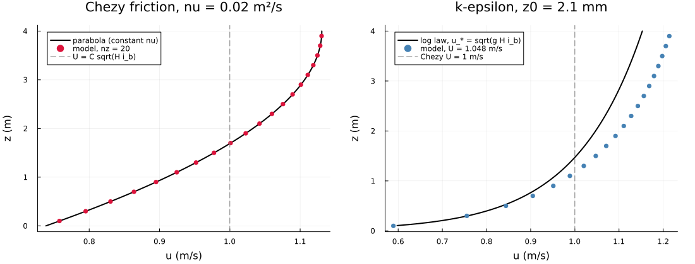
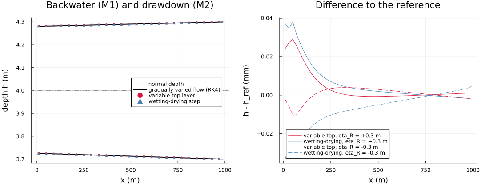
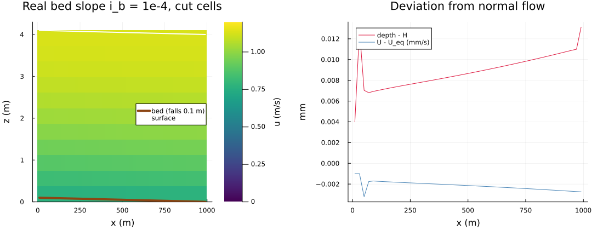
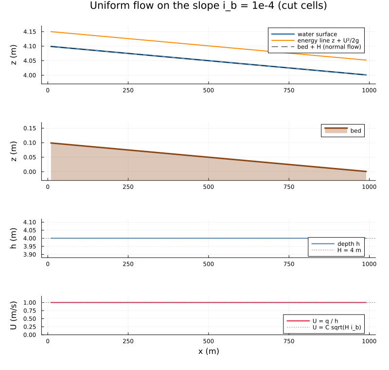
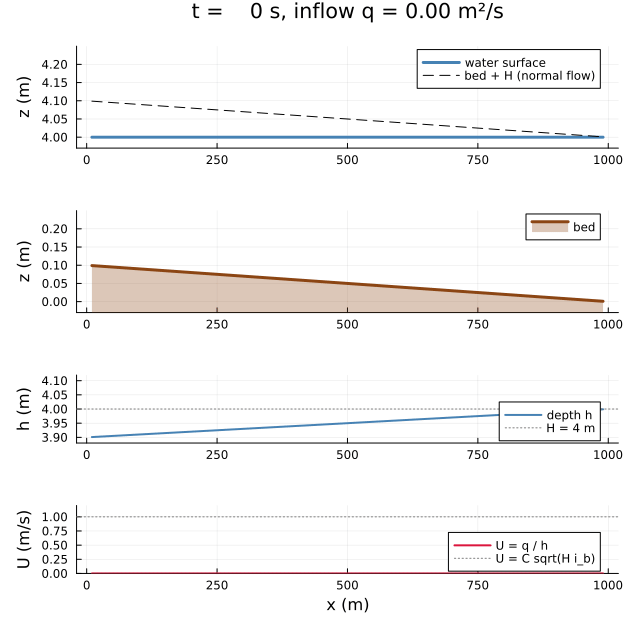
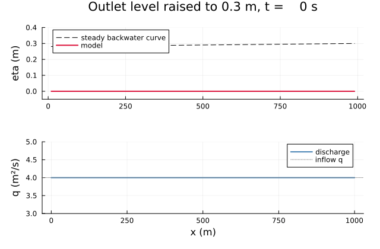

Sloped channel with Chezy friction (issue #14)
==============================================

Uniform and gradually varied flow in the channel of issue #14:

| Quantity | Value |
|---|---|
| length L | 1000 m |
| depth H | 4 m |
| bed slope i_b | 1e-4 (bed falls in +x) |
| discharge q | 4 m²/s |
| Chezy coefficient C | 50 m^(1/2)/s |
| vertical viscosity | 0.02 m²/s (constant, of the order kappa u_* H / 6 = 0.017 m²/s) |

The normal flow is U = C sqrt(H i_b) = 1 m/s, so q = U H = 4 m²/s: the data of the issue are consistent (Fr = 0.16).
Theory and implementation: [docs/TESTS_TECHNICAL_DOCUMENTATION.md](../../docs/TESTS_TECHNICAL_DOCUMENTATION.md),
section 21; tests in `test/test_sloped_channel.jl`.

Model features used:
- `ModelConfig(chezy_coefficient=C)`: bed stress g |U| U / C² on the depth-averaged velocity, on the lowest layer.
- `set_x_inflow_outflow!(model, shape; left_discharge=q, right_level=eta_R)`: discharge at the inlet, water level at the
  outlet. The water level needs the hydrostatic mode with `implicit_vertical_terms=true`.
- The slope enters as the body force g i_b (`body_force_x`) on a flat bed, or (case 4) as a real bed in the
  wetting-drying step.

Run: `julia --project experiments/sloped_channel/run_cases.jl` (tables, about 30 s) and
`julia --project experiments/sloped_channel/plot_sloped_channel.jl` (figures and animation in `figures/`, about 30 s).

Figures
-------

Spin-up from rest against U_eq tanh(t/T), and the error against dt: explicit friction first order, implicit second order.

Steady velocity profiles. Left: Chezy friction with constant viscosity against the analytical parabola, which has the
Chezy velocity as its depth average. Right: k-epsilon with z0 = `chezy_roughness_length(50, 4)`. The profile follows
the log law near the bed and is faster above about 1 m, so the depth average is 5 % above the Chezy velocity (table 5).

Backwater (M1) and drawdown (M2) curves against the gradually-varied-flow equation, and the difference (below 0.04 mm).

Real bed slope in the wetting-drying step: velocity section (the bed falls 0.1 m over the channel), and the deviation
of depth and depth-averaged velocity from the normal flow (hundredths of a millimetre).

Longitudinal section of the uniform flow on the real slope. The bed falls only 0.1 m under 4 m of water, so the water
surface (with the energy line z + U²/2g, 0.05 m above it) and the bed are shown on two zoomed axes with the same
vertical span of 0.2 m. All three run parallel with the slope i_b = 1e-4, the surface lies on bed + H, and depth and
velocity are the normal values along the whole channel.

Animation of the same channel from a lake at rest at the outlet level, with the inflow raised linearly from 0 to
q = 4 m²/s within 1000 s. The surface first tilts more steeply than the bed (the inlet depth overshoots to 4.12 m at
t ≈ 1000 s), then relaxes. Within 1 mm it is parallel to the bed at normal depth after about 2500 s, and exactly after
about 4500 s.

Animation: the outlet level of the normal flow is raised from 0 to 0.3 m within 600 s. The surface rises along the whole
channel, with long waves of about 1 cm sloshing between the discharge inlet and the outlet. Within 1 mm it lies on the
backwater curve (dashed) after about 2500 s, and within 0.1 mm after 3600 s. The discharge returns to the inflow q.

Results
-------

**1. Spin-up of the periodic channel from rest.** Depth-averaged velocity at t = 1000 s against U_eq tanh(t/T),
T = 1019 s (0.753498 m/s). The explicit friction is first order in time; the implicit one, c_f |U^n| U^(n+1), is second
order (the product is the geometric mean of the two time levels).

| friction | dt (s) | error (m/s) | order |
|---|---|---|---|
| explicit | 2 | 3.56e-04 |  |
| explicit | 1 | 1.78e-04 | 1.00 |
| explicit | 0.5 | 8.89e-05 | 1.00 |
| implicit | 20 | 5.44e-05 |  |
| implicit | 10 | 1.36e-05 | 2.00 |
| implicit | 5 | 3.40e-06 | 2.00 |

**2. Open channel**, q at the inlet and eta = 0 at the outlet, started at 0.8 times the normal flow (nx = 50, nz = 10,
dt = 10 s). Maximum deviation from the normal flow (m/s):

| grid | t = 5000 s | 10000 s | 15000 s | 20000 s |
|---|---|---|---|---|
| variable top layer | 2.0e-06 | 3.7e-11 | 1.6e-15 | 1.6e-15 |
| wetting-drying step | 2.0e-06 | 3.5e-11 | 5.0e-13 | 6.0e-13 |

**3. Backwater (M1) and drawdown (M2) curves.** Outlet level 0.3 m above or below the normal depth, nz = 8. Steady
depth against the gradually-varied-flow equation (`chezy_backwater_depth`, RK4). The differences of 1e-5 to 5e-5 m
(0.003-0.02 % of the level change) include the momentum-flux coefficient of the sheared velocity profile, which the
reference (depth-uniform velocity) neglects.

| outlet level eta_R (m) | grid | nx | h(0) model (m) | h(0) reference (m) | max abs(h - h_ref) (m) |
|---|---|---|---|---|---|
| +0.3 | variable top layer | 25 | 4.28105 | 4.28102 | 2.7e-05 |
| +0.3 | variable top layer | 50 | 4.28086 | 4.28084 | 2.9e-05 |
| +0.3 | variable top layer | 100 | 4.28076 | 4.28074 | 3.0e-05 |
| +0.3 | wetting-drying | 25 | 4.28108 | 4.28102 | 5.1e-05 |
| +0.3 | wetting-drying | 50 | 4.28087 | 4.28084 | 3.8e-05 |
| +0.3 | wetting-drying | 100 | 4.28077 | 4.28074 | 3.4e-05 |
| -0.3 | variable top layer | 25 | 3.72534 | 3.72535 | 1.2e-05 |
| -0.3 | variable top layer | 50 | 3.72559 | 3.72559 | 1.0e-05 |
| -0.3 | variable top layer | 100 | 3.72572 | 3.72572 | 1.0e-05 |
| -0.3 | wetting-drying | 25 | 3.72527 | 3.72535 | 7.5e-05 |
| -0.3 | wetting-drying | 50 | 3.72556 | 3.72559 | 3.3e-05 |
| -0.3 | wetting-drying | 100 | 3.72570 | 3.72572 | 2.2e-05 |

Before this issue the variable top layer was 3.3e-4 m off (5.9e-4 m with 16 layers). The cause was the vertical part
of the explicit top-row correction, which used dz where the implicit column uses the top-layer thickness
(docs section 21).

**4. Real bed slope**, wetting-drying cut cells, no body force. The bed falls by i_b L = 0.1 m, a quarter of a layer;
the inlet shape is the steady parabola; the outlet has the normal depth. Deviation from the normal flow:

| nx | max abs(depth - H) (m) | U(L/2) - U_eq (m/s) | q(L/2) (m²/s) |
|---|---|---|---|
| 25 | 3.4e-05 | -5.3e-06 | 4.000000 |
| 50 | 1.3e-05 | -2.2e-06 | 4.000000 |
| 100 | 6.3e-06 | -7.3e-07 | 4.000000 |

**5. Log-law friction with the roughness length of the Chezy coefficient.** Here
z0 = `chezy_roughness_length(50, 4)` = 2.1 mm, with k-epsilon (periodic, 20000 s). The converted roughness gives a flow
4-5 % faster than the Chezy equilibrium. The conversion assumes a logarithmic velocity profile over the whole depth,
which the k-epsilon profile follows only approximately; within a few percent it is the equivalent roughness.

| nz | U (m/s) | U / U_eq - 1 |
|---|---|---|
| 10 | 1.0427 | +0.043 |
| 20 | 1.0478 | +0.048 |
| 40 | 1.0503 | +0.050 |

Limits
------

- The variable top layer is accurate for abs(eta) up to about dz. A level step of 0.5 m at the outlet of the normal
  flow (nz = 10, dz = 0.4 m) sends a bore that reflects at the discharge inlet and reaches 0.8 m, and the run fails.
  For such cases use the fixed grid or the wetting-drying step. The backwater cases above start from the reference
  profile.
- The water-level boundary needs `implicit_vertical_terms=true` (also in the non-hydrostatic mode; issue #49).
