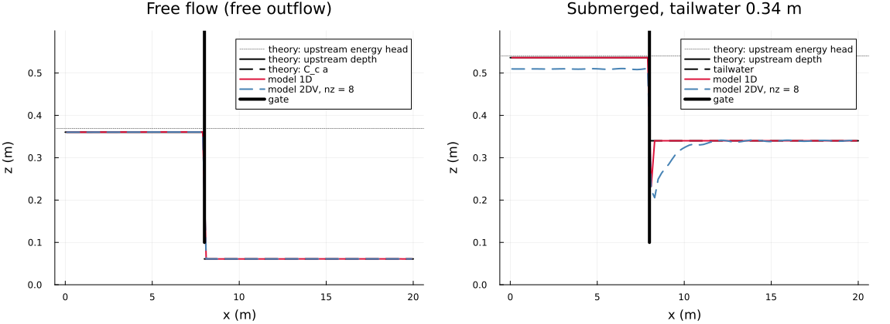
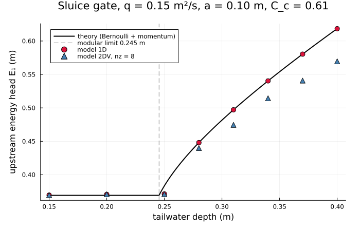
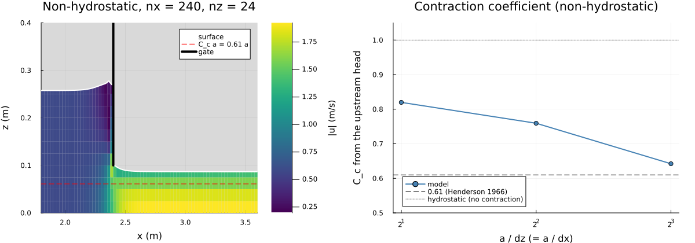
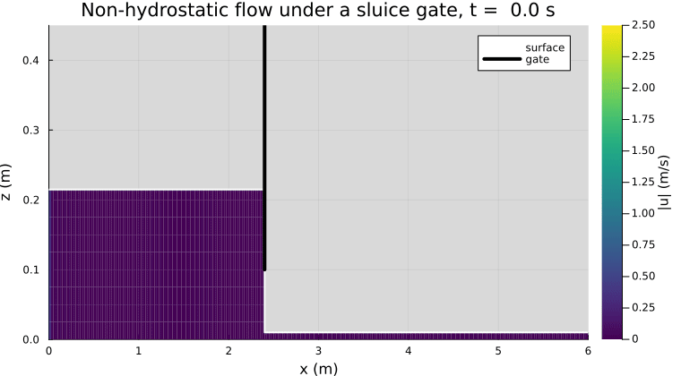

Sluice gate (issue #48)
=======================

Steady, frictionless flow under a vertical sluice gate (`set_sluice_gate!`, wetting-drying step):
- hydrostatic, in 1D (one layer) and 2DV (8 layers), with the contraction coefficient C_c = 0.61;
- non-hydrostatic, where the jet contracts by itself (`contraction=1`).

Theory and implementation: [docs/TESTS_TECHNICAL_DOCUMENTATION.md](../../docs/TESTS_TECHNICAL_DOCUMENTATION.md),
section 26; tests in `test/test_sluice_gate.jl`.

Run: `julia --project experiments/sluice_gate/plot_sluice_gate.jl [product ...]` (products: `profiles modular
contraction animation`, default all; about 30 min for all, most of it the finest non-hydrostatic run).

Case
----

A 20 m channel with a flat bed, q = 0.15 m²/s from a discharge inlet, a gate at x = 8 m with the opening a = 0.1 m,
and a free outflow or an outlet level (tailwater) at the right. Theory (`src/reference_solutions.jl`):
- free flow: upstream energy head E₁ = C_c a + q²/(2 g (C_c a)²), i.e. q = C_c a √(2 g (E₁ − C_c a))
  (`sluice_gate_free_head`);
- free flow lasts up to the modular limit, the conjugate depth of C_c a: 0.245 m here (`sluice_gate_modular_limit`);
- submerged flow: Bernoulli up to the vena contracta, and the momentum balance from there to the tailwater
  (`sluice_gate_submerged_head`; Henderson 1966, ch. 6).

Results
-------

Water level in free flow (left) and with a 0.34 m tailwater (right):
- Free flow: upstream, 1D and 2DV lie on the theoretical depth. Downstream, the jet runs at C_c a.
- Submerged, 1D: the depth just behind the gate is the vena-contracta depth y_s ≈ 0.23 m of the momentum theory.
- Submerged, 2DV: the jet under the dead water forms a roller, and the upstream level lies below the theory.

Upstream energy head against the tailwater depth:
- 1D follows the theory across the modular limit: within 0.04 % in free flow and 0.012 % when submerged (tests).
- 2DV agrees in free flow.
- Submerged 2DV runs 2 % (0.28 m) to 8 % (0.4 m) low. That case is a hydrostatic wall jet under a recirculating
  roller (with ν = 3·10⁻³ m²/s; recirculation is issue #50).

Non-hydrostatic, `contraction=1`, in a 6 m channel. Left: speed at 240 × 24 cells. Right: the contraction coefficient
derived from the upstream head, against the number of layers in the opening. It falls from 0.82 to 0.76 and 0.64,
towards the classical 0.61. On the coarse grids it also includes energy lost at the gate: the jet runs deeper than
C_c a (0.09 m on the left). On the finest grid the head and the smallest jet depth (0.65 a) agree. The hydrostatic step
gives 1.00.

The jet under the gate forms from a lake at the free-flow head (non-hydrostatic, 240 × 24).

Limits
------

- **Wetting-drying step only.** The fixed grid has whole-cell masks; a gate there would have to stay below the variable
  top layer.
- **Hydrostatic contraction.** The contraction coefficient is an input. It depends on the gate shape and on a/E₁; 0.61
  holds for a vertical sharp-edged gate with a small opening.
- **Non-hydrostatic convergence.** The contraction is not yet grid-converged, and on the finest grid the discharge
  still varies by 4 % after 40 s.
- **No hydraulic jump case.** A frictionless channel has no stable jump position between the gate and the outlet: below
  the modular limit the jump is washed to the outlet. A jump behind the gate needs bed friction (Chezy, section 21).
