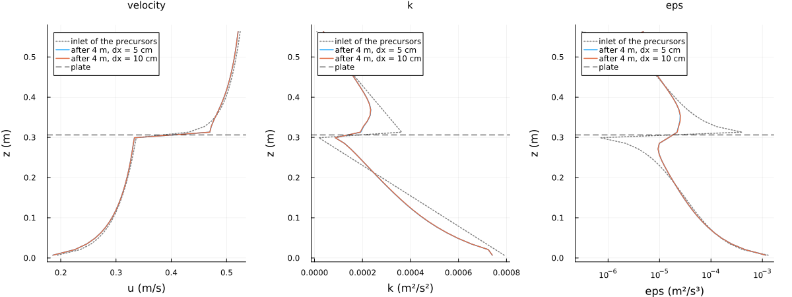
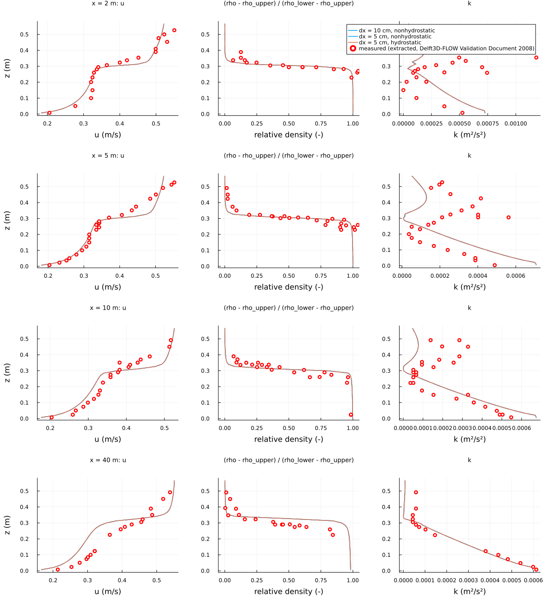
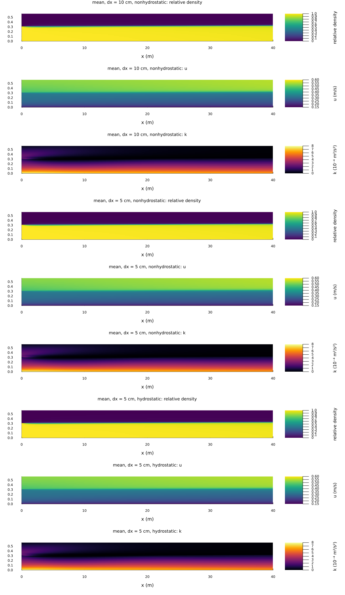
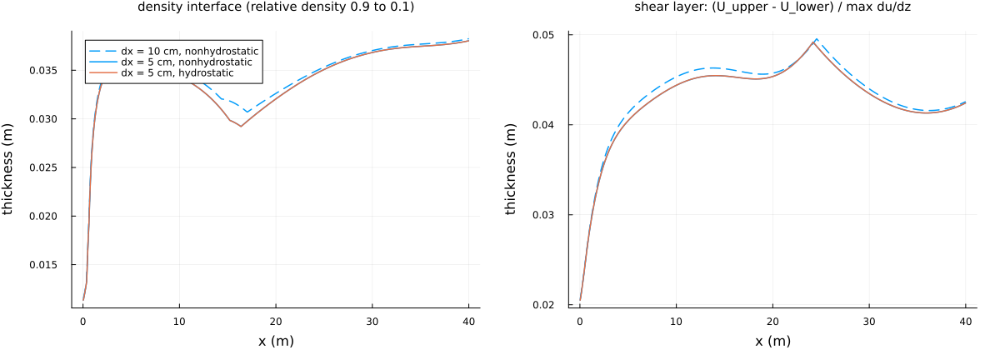
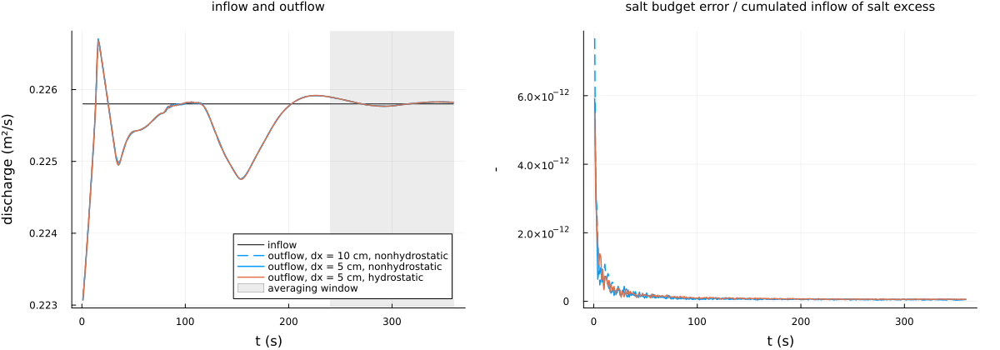
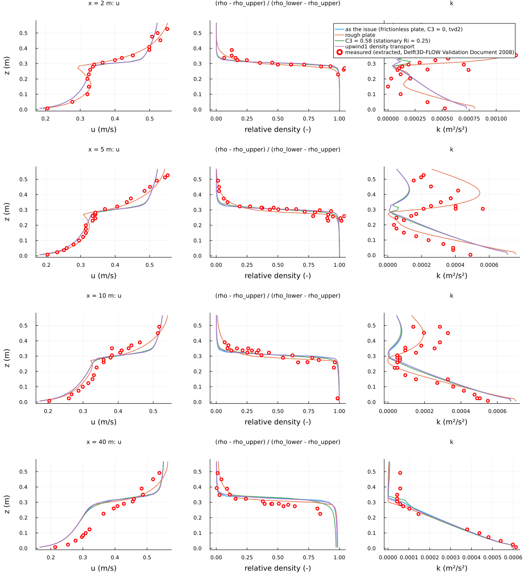

Splitter plate: stratified mixing layer (issue #42)
==================================================

Two streams of different velocity and salinity meet at the end of a horizontal splitter plate, after the splitter plate
test of the Delft3D-FLOW Validation Document (2008). This is option B of the issue: the plate is not in the domain; the
inlet at its end gets the profiles of two precursor channels. Theory and tables: section 30 of
[docs/TESTS_TECHNICAL_DOCUMENTATION.md](../../docs/TESTS_TECHNICAL_DOCUMENTATION.md).

Set-up
------

| | value |
|---|---|
| reach behind the plate | 40 m, flat bed, Chézy 65 m^½/s at the bed only (k-epsilon: z0 = 4.3e-5 m) |
| lower stream | 0.306 m thick, 43.3 ppt (1031.2 kg/m³), mean velocity 0.30 m/s |
| upper stream | 0.268 m thick, 22.6 ppt (1015.3 kg/m³), mean velocity 0.50 m/s |
| water level | 0.574 m at the plate, relaxed outflow to 0.570 m (τ = 20 s) |
| grid | dx = 5 cm and 10 cm, 41 layers of 13.9 mm (22 below the plate) |
| time step | advective Courant number 0.6 (0.055 s at dx = 5 cm) |
| closure | k-epsilon with buoyancy terms, 6 min, means over the last 2 min |

Deviations from the issue:

- **Plate height.** The issue estimated the streams as 0.250 m (lower) and 0.324 m (upper). The measured profiles put
  the density interface at 0.307 and 0.305 m at 2 and 5 m behind the plate, and the measured velocity integrates to
  mean velocities of 0.31 / 0.30 m/s below and 0.50 / 0.49 m/s above it. The streams are therefore 0.306 and 0.268 m
  thick, with the velocities of the issue.
- **Density.** Eckart (1958) at 20 °C (the temperature is not given); between 15 and 20 °C the densities move by less
  than 1 kg/m³.
- **Precursors.** The inlet of each 4 m precursor channel carries the log profile with k and eps in equilibrium with it
  (from the zero-gradient default the turbulence reached only 0.18 m into the stream in 4 m). The plate has no friction,
  as in the issue: the lower stream is an open channel under a free-slip plate, the upper stream has a free-slip bed and
  its profile starts at 0.3 m/s.

Measurements
------------

[data/velocity.csv](data/velocity.csv), [data/relative_density.csv](data/relative_density.csv) and
[data/tke.csv](data/tke.csv) hold the measured profiles at 2, 5, 10 and 40 m. **They were extracted visually from the
profile figures of the Delft3D-FLOW Validation Document (2008)**, not taken from the original data: the red circles of
the figures, located by matching a ring template to the red pixels and checked panel by panel. Accuracy about one pixel
(0.004 m/s, 0.008 in relative density, 1.5e-5 m²/s² in k and 1.4 mm in height); overlapping circles may be merged into
one point. [digitize_measurements.py](digitize_measurements.py) repeats the extraction from screenshots of the figures in
`measurements/`, which are kept local and not in the repository.

Results
-------



Inlet profiles: the log profiles of the precursor inlets (dotted) and the profiles after 4 m. In the lower stream the
turbulence stays close to equilibrium; in the upper stream, without a shear stress at the plate, k decays but stays at
1-2e-4 m²/s².



Mean profiles against the measurements. At 2, 5 and 10 m the model follows the measured velocity, the density interface
(model 0.305, 0.306, 0.309 m; measured 0.307, 0.305, 0.305 m) and k in the lower stream. Two differences:

- **k in the mixing layer.** The measured k has a maximum of 2-5e-4 m²/s² around the interface (up to 1e-3 at 2 m); the
  model k collapses there (2e-6 m²/s² at 10 m).
- **40 m.** The model's lower stream slows down along the reach (mean velocity below 0.2 m: 0.278, 0.274, 0.269 and
  0.253 m/s at 2, 5, 10 and 40 m), while the measured one keeps 0.28-0.29 m/s; to carry its discharge it thickens, and
  the interface rises to 0.327 m against the measured 0.287 m.

The three runs agree: dx = 5 and 10 cm within 1e-3 m/s and 0.011 in relative density; hydrostatic and non-hydrostatic
within 1e-4 m/s. The flow has no vertical dynamics that the non-hydrostatic pressure could act on.





The density interface (relative density 0.1 to 0.9) is 11 mm thick at the inlet and 34-38 mm from 2 m on; the shear layer
grows from 21 to 42-45 mm.



Outflow and inflow agree within 1e-4 over the last 2 min (the swing of 0.5 % is the reach mode, damped by the relaxed
outflow); the salt budget closes with the boundary fluxes to below 1e-11 of the salt inflow.

Why the lower stream slows down
-------------------------------

At the interface the gradient Richardson number is 0.16-0.36. With C3 = 0 in stable stratification, k-epsilon keeps
turbulence only below Ri = 0.175 (the stationary Richardson number σ_ρ (C2 - C1)/C2 of homogeneous stratified shear),
so the turbulence decays in the interface and the eddy viscosity there falls to 1e-7 m²/s. To keep the lower stream
moving against its bed friction (about 2e-4 m²/s²), the upper stream has to pass that stress through the interface,
which needs about 1e-4 m²/s at a shear of 2 1/s. The measurements show this momentum exchange while the density stays
stratified: at high Ri momentum is exchanged more efficiently than mass (internal waves), which a closure with one
constant turbulent Schmidt number cannot represent.



Sensitivity runs at dx = 10 cm (`sensitivity`):

| run | interface at 40 m | lower stream (mean u below 0.2 m) at 40 m | interface thickness at 40 m |
|---|---|---|---|
| measured | 0.287 m | 0.287 m/s | |
| as the issue | 0.327 m | 0.253 m/s | 38 mm |
| rough plate (z0 on both sides; the lower precursor is a duct, mirrored from a half channel) | 0.309 m | 0.253 m/s | 79 mm |
| C3 = 0.58 in stable stratification (stationary Ri = 0.25) | 0.330 m | 0.253 m/s | 71 mm |
| first-order (upwind1) density transport | 0.324 m | 0.253 m/s | 49 mm |

- The rough plate gives the upper stream the measured turbulence level (k up to 5e-4 m²/s² at 5 m) and the closest
  interface at 40 m, but its wake (zero shear at the plate, where the densities meet) is too deep at 2 m.
- C3 = 0.58 and upwind1 thicken the density interface but leave the velocity unchanged.
- None changes the lower stream at 40 m: the missing process is the momentum flux through a strongly stratified
  interface. Candidates are a background (internal-wave) viscosity and diffusivity or Richardson-dependent stability
  functions; both change the closure for every stratified case and are left to a separate issue.

Limitations
-----------

- Option B: the end of the plate is a prescribed inlet; nothing downstream acts on the streams above it.
- The level drop over the reach is 2.2 mm, against the 4 mm of the test; bed friction alone (Chézy 65, depth-mean 0.40 m/s)
  gives about 2.6 mm. The relaxed outflow keeps the outflow level 2.9 mm above its target of 0.570 m in the steady state.
- The measurements are extracted from figures (above).

Running
-------

```
julia --project experiments/splitter_plate/splitter_plate.jl precursors      # inlet profiles, a few minutes
julia --project experiments/splitter_plate/splitter_plate.jl runs            # three runs, about 25 min
julia --project experiments/splitter_plate/splitter_plate.jl sensitivity     # sensitivity runs, about 10 min
julia --project experiments/splitter_plate/splitter_plate.jl figures
```

Single runs: `run <dx_cm> <nonhydrostatic|hydrostatic> [frictionless|rough [c3]]`; `SP_TRANSPORT=upwind1` for
first-order density transport. Output in `output_barotropic/splitter_plate/` and `output_barotropic/splitter_plate_figures/`.
