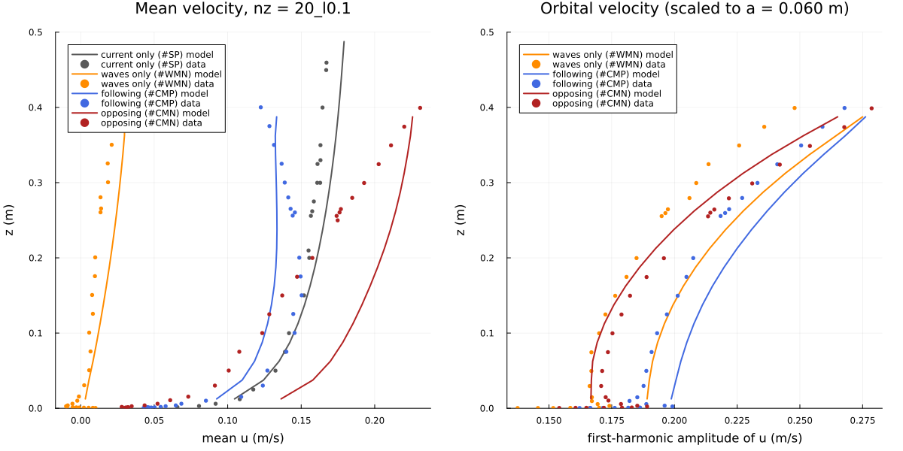

Klopman's flume: waves following and opposing a current (2DV-13, issue #85)
===========================================================================

Regular waves on a current in the "Scheldegoot" of Delft Hydraulics (Klopman 1994, report H840.30 Part II): how waves
change the mean current profile. Waves following the current reduce the shear in the upper half of the water column
(it turns negative); waves against the current increase it. Plan, measurements and all results so far:
[docs/plan_issue_85_klopman_flume.md](../../../docs/plan_issue_85_klopman_flume.md).

Case
----

- Flat test section of the flume (x = 6.4–40.6 m, 34.2 m), still-water depth 0.5 m, bed roughness z₀ = 0.04 mm.
- Current q = 0.0805 m²/s (total transport) from left to right; waves T = 1.44 s, amplitude 0.060 m at the LDV station
  (x = 22.5 m), entering through the face where the wave board stood.
- Tests: #SP current only, #WMN waves only (travelling −x), #CMP waves following, #CMN waves opposing the current.
- Model: wetting-drying step, non-hydrostatic; both ends free open faces with the radiation and relaxation of #86;
  k-ε with the stabilisation under waves (`ke_wave_stabilization = 0.1`, Larsen & Fuhrman 2018); merged top layer and
  limited face level (#88); θ = 0.6, Δt = T/400; 760 columns (Δx = 45 mm), nz = 20 or 40.

Files
-----

- `cases.jl`: constants with units and report sections, `klopman_model`, the station averages (`StationAverage`) and
  the reader of the reference profiles.
- `run_klopman_cases.jl`: runs #SP and the wave cases on one grid and writes the station profiles to `results/`.
- `validate_klopman_wave_current.jl`: compares the profiles with the measurements (RMS of the mean velocity, the shear
  criterion, the first-harmonic amplitudes) and writes `figures/klopman_profiles_nz<nz><tag>.png`.
- `probe_dt_split.jl`: Δt study (plan 3.6): CMP or CMN on 380 columns from the cached #SP state, optionally with the k-ε step frozen.
- `references/`: the profiles digitised from the report's figures (with the method and the 7 % calibration note in the
  file headers) and `digitize_klopman.py`. The report itself is not in the repository.

Run
---

```
julia --project=. experiments/validation/klopman/run_klopman_cases.jl 20 WMN,CMP,CMN 0.1      # nz, cases, lambda2 [, swart]
KL_TAG=_l0.1 julia --project=. experiments/validation/klopman/validate_klopman_wave_current.jl 20
```

A full run on 20 layers takes about 1.5–2 hours (24 ms per step; 73 % of it the non-hydrostatic pressure solve). The
steady #SP state and the tuned amplitudes are cached in `results/state/` and reused by later runs with the same
settings (`KL_FRESH=true` recomputes them).

Results (nz = 20, λ₂ = 0.1)
--------------------------

> **Under review (2026-11-15):** the wave effect on the mean profile depends on the time step (it shrinks as Δt → 0)
> and the mean discharge drifts away from the flume's value once waves are on. The numbers below are not reliable yet;
> see section 3.6 of the plan. Driver switches for the study: `KL_THETA_N=0.55:200` (θ and N of the wave runs) and
> `KL_NX=380` (columns); both add a tag to the result files.



| | #SP | #WMN | #CMP | #CMN |
|---|---|---|---|---|
| mean u, RMS / 0.16 m/s | 0.047 | 0.052 | 0.085 | 0.284 |
| upper-half shear, model (1/s) | +0.069 | +0.052 | −0.011 | +0.100 |
| upper-half shear, data (1/s) | +0.069 | +0.090 | −0.137 | +0.392 |

Both effects have the right sign; their size is about 40 % (following) and 10 % (opposing) of the measured change.
Without the stabilisation of k-ε the eddy viscosity under the waves was 5–7 times that of the current and mixed the
effect out (opposing waves then reduced the shear). Open: the wave friction of the log law at the first cell centre is
30–40 % of Swart's, so bed friction and streaming under the waves are too weak; a simple Swart-based friction
(`wave_bed_friction = "swart"`) did not help (plan section 3.4b).

References
----------

- Klopman, G. (1994). Vertical structure of the flow due to waves and currents. Delft Hydraulics, report H840.30 Part II.
- Groeneweg, J. & Klopman, G. (1998). Changes of the mean velocity profiles in the combined wave–current motion
  described in a GLM formulation. *J. Fluid Mech.* 370, 271–296.
- Larsen, B. E. & Fuhrman, D. R. (2018). On the over-production of turbulence beneath surface waves in Reynolds-averaged
  Navier–Stokes models. *J. Fluid Mech.* 853, 419–460.
