Vegetation
==========

Flow through and over aquatic vegetation: rigid and flexible stems, emergent and submerged canopies, described either as
patches with averaged quantities or as individual stems (issue #8; plan and decisions in
`docs/plan_issue_8_vegetation.md`). Step 1 of the plan: the vegetation model with its references in steady channel
flow. Step 2: wave damping and gravity currents through canopies.

Model
-----

- **Patch** (`VegetationPatch`): stem length h_v, diameter b, stem density n (stems/m²) and drag coefficient C_D over
  an x-range. The frontal area per unit volume is a = n b. A representative stem per u-face column carries the drag of
  its column, and the force per unit volume is the stem force times n. A rigid patch removes 1/2 C_D a u|u| per unit
  volume below the stem height.
- **Individual stem** (`VegetationStem`): base position, length, diameter, C_D. In the 2DV model (per metre width) a
  stem stands for a row of stems with lateral spacing Δy (`lateral_spacing`).
- **Rigid or flexible**: the bending stiffness EI is `Inf` (rigid) or finite. Flexible stems take the quasi-static
  posture of an inextensible beam (elastica) under the normal drag 1/2 ρ C_D b (u cos θ)² and their net buoyancy. This
  is the model behind the reconfiguration studies of Alben et al. (2002), Gosselin et al. (2010) and Luhar & Nepf
  (2011). The posture is solved with Newton's method every time step.
- **Momentum:** the drag is split exactly at the cell boundaries; the momentum removed from the fluid equals the stem
  drag (Newton's third law).
- **Time stepping:** explicit drag; `step_forward!` stops if dt times the linearised drag rate exceeds 1.
- **Not included (yet):** stem dynamics (mass, swaying under waves), vegetation-generated turbulence, porosity of dense
  canopies, the vertical drag component on w, and vegetation over a variable bed.

The old stem model was replaced. It passed only 0.35 times the stem force to the fluid, had no stem density, and used
tuning factors (a gain of 8, a per-stem `source_strength`) and a string-like bending term. In the configurations of the
old tests its stems changed the wave amplitude by about 10⁻¹⁵ and the lock-exchange front position by less than one
cell. Its uniform-flow, wave-damping and lock-exchange scripts are replaced by the experiments below, which have
quantitative references. The oscillating-flow script is ported to the new stem parameters (EI, lateral spacing). It has
no reference: a stem swaying under oscillating flow needs the dynamic stem model, which is not included.

Reference cases
---------------

**Single flexible stem in a uniform current** (`plot_vegetation_reconfiguration.jl`). The reconfiguration number
R = F / F_rigid (the effective length l_e/l of Luhar & Nepf 2011) depends only on the Cauchy number
Ca = ρ C_D b U² l³ / (2 EI) and the buoyancy number B = B_l l³ / EI.

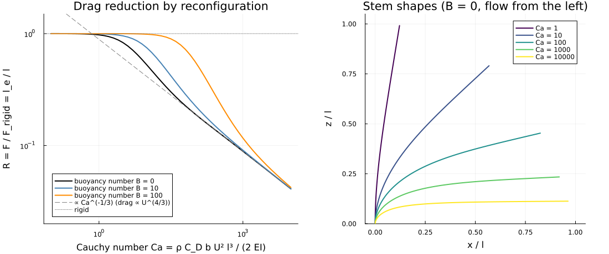

- **Rigid limit:** at small Ca the stem stays upright, R → 1 (R = 0.9997 at Ca = 0.1).
- **Small deflection:** against the cantilever under uniform load, tip deflection q l⁴/(8EI), the solver converges at
  exactly second order (relative errors 1.0·10⁻², 2.5·10⁻³ and 6.3·10⁻⁴ for 10, 20 and 40 segments).
- **Large deflection:** R ∝ Ca^(−1/3), i.e. drag ∝ U^(4/3) (Vogel exponent −2/3; Alben et al. 2002; Gosselin et al.
  2010). The slope between Ca = 300 and 3000 is −0.333, and R Ca^(1/3) = 0.89. This is consistent with the asymptotic
  effective length of about 0.9 Ca^(−1/3) in Luhar & Nepf (2011); the coefficient is still to be checked against the
  paper.
- **Independent reference** (points and dotted shapes in the figure): the continuous elastica, integrated from the free
  tip with RK4 and shooting on the tip angle (`elastica_reference_uniform` in `cases.jl`). This is a different method
  from the model's discrete segments and Newton solve. The model converges to it at second order in the number of
  segments for the drag and the tip position. With 80 segments it agrees within 0.9 % over Ca = 0.1-10⁴ (B ≤ 10), and
  within 0.4 % for B = 100 up to Ca = 3162; beyond that the shooting reference is badly conditioned. The reference gives
  R Ca^(1/3) = 0.890 at large Ca.
- **Robustness:** from an upright stem at Ca ≳ 3000 Newton alone did not converge. The posture solver now applies the
  load in stages when Newton fails, and counts postures that still fail (`VegetationModel.posture_failures`).
- **Buoyancy:** it keeps the stem upright until Ca exceeds roughly B and leaves the large-Ca asymptote unchanged, as
  described by Luhar & Nepf (2011).

**Canopies in a periodic channel** (`plot_vegetation_channel.jl`): the flow is driven by a body force G (a channel slope,
`body_force_x`), with constant viscosity ν = 10⁻³ m²/s and a = 4 1/m.

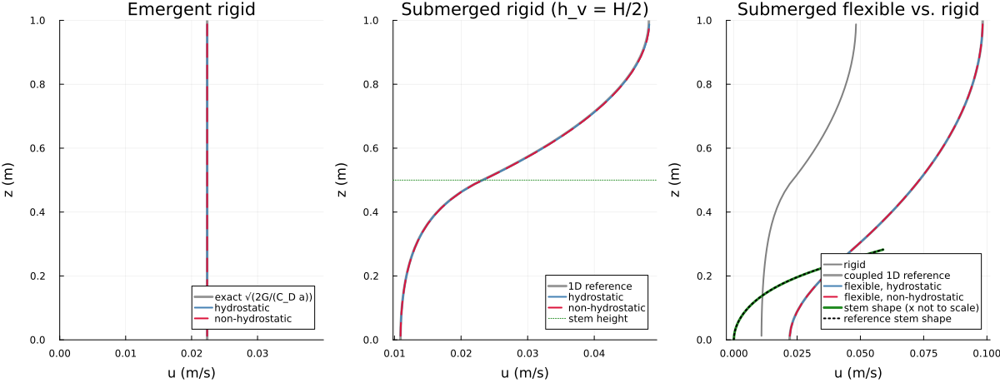

- **Emergent rigid canopy:** with a free-slip bed the velocity is uniform and 1/2 C_D a U² = G exactly. The model
  reproduces it to round-off in both modes.
- **Submerged rigid canopy** (h_v = H/2): compared with the steady 1D equation ν u″ = 1/2 C_D a u|u| − G, solved
  independently on 4000 cells. The flow is slow in the canopy and fast above it, with a shear layer at the canopy top
  (Nepf 2012). The model converges at second order to the reference, in both modes, which give identical results:

  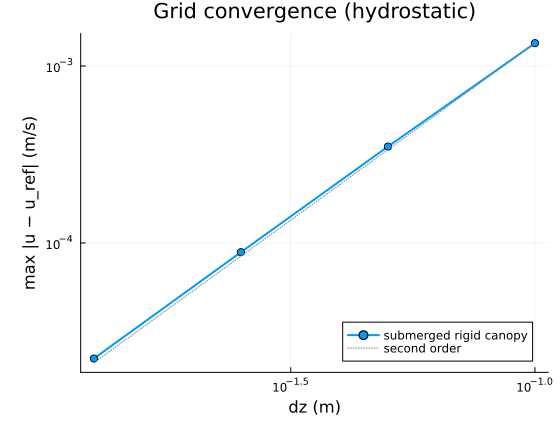

  The errors are 1.35·10⁻³, 3.51·10⁻⁴, 8.87·10⁻⁵ and 2.22·10⁻⁵ m/s for nz = 10, 20, 40 and 80.
- **Submerged flexible canopy** (EI = 2·10⁻⁵ N m², Ca about 170 at the canopy-top velocity): the stems bend to
  0.28 m of their 0.50 m length. The canopy offers less drag, so the depth-mean velocity is 0.067 m/s instead of
  0.027 m/s for the rigid canopy. In the steady state the total drag of a flexible patch balances the driving force
  (test `test_verify_flexible_patch_momentum_balance`: to 10⁻⁶ after 1400 s).
- **Flexible canopy against an independent coupled reference** (`flexible_canopy_reference` in `cases.jl`): the
  continuous elastica in the velocity along the stem, iterated with the 1D momentum equation, whose canopy drag is
  1/2 C_D a cos²θ(z) u|u| below the tip height, until posture and profile are steady. Run from rest to the steady
  state (7000 s; the posture-flow feedback makes the flexible canopy adjust about twice as slowly as the rigid one),
  the model matches it in both modes: velocity within 1.7·10⁻⁵ m/s (0.017 % of the surface velocity), stem tip at
  (0.3770, 0.2824) m against (0.3769, 0.2825) m. Started from the reference state, the errors converge with the grid:
  5.4·10⁻⁵ and 1.6·10⁻⁵ m/s, tip (0.67, 0.60) mm and (0.16, 0.13) mm for nz = 20 and 40
  (test `test_validate_flexible_canopy_against_coupled_reference`).
- **Individual stems vs. patch:** 25 rigid stems at random positions, with the lateral spacing of the patch density,
  give the patch velocity to 10⁻⁶ (test `test_verify_individual_stems_match_patch`).

**Patch in a channel with inflow and outflow** (`plot_vegetation_patch.jl`):

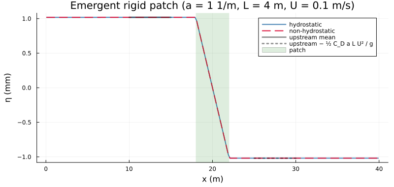

The water level drops across an emergent rigid patch (a = 1 1/m, length 4 m, U = 0.1 m/s) by the head loss of the
momentum balance, g Δη = 1/2 C_D a L U². The model gives 2.038·10⁻³ m against 2.039·10⁻³ m (−0.03 %; the depth change
across the patch is neglected in the balance), the same in both modes.

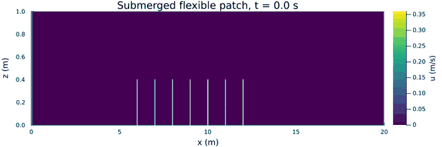

A submerged flexible patch (stems of 0.4 m, b = 5 mm, 1000 stems/m², EI = 10⁻⁴ N m²) in a 0.2 m/s channel flow is
run non-hydrostatic with mixing-length turbulence. The figure shows u, with every tenth representative stem in white.
The stems bend to about half their length, the flow inside the canopy slows down, and a fast layer skims over it.

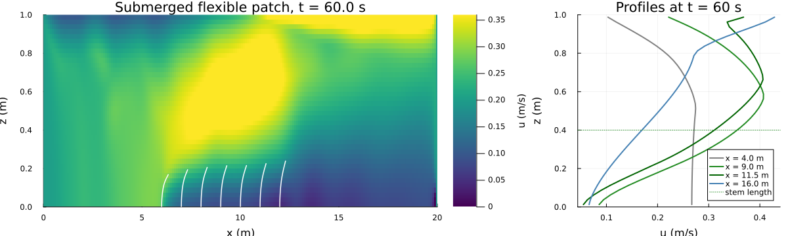

The profiles show the typical inflection near the canopy top. This case is qualitative; it has no reference solution.
After 60 s the flow is still adjusting, and near the outlet the prescribed uniform outflow distorts the flow.

**Wave damping by a rigid canopy** (`plot_vegetation_waves.jl`, step 2). Regular waves come from a wavemaker at the
left boundary (the linear-theory velocity profile) and are absorbed by a sponge layer at the right end (`sponge_length`,
`sponge_rate`). Over rigid vertical cylinders the wave height of a linear wave decays as H(x) = H0 / (1 + β x), with

    β = 4/(9π) C_D a H0 k (sinh³(kαh) + 3 sinh(kαh)) / ((sinh 2kh + 2kh) sinh kh)

(Dalrymple, Kirby & Hwang 1984; Mendez & Losada 2004). This follows from the wave energy balance with the
time-averaged drag dissipation; the shallow-water limit is β = C_D a α H0 / (3π h).

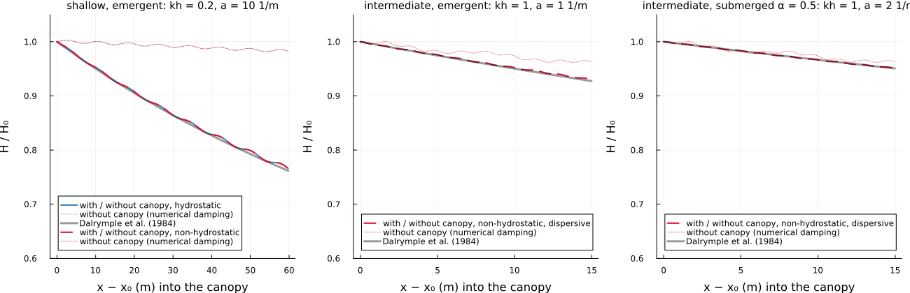

The curves show the decay with canopy divided by the decay of the same run without canopy. This removes the numerical
damping of the fully implicit free surface, about 2π²/N per period with N time steps per period (dotted curves). The
model follows Dalrymple's decay in all three cases:

| Case | Mode | Max deviation |
|---|---|---|
| shallow water, emergent: kh = 0.2, H0/h = 0.005, a = 10 1/m, 60 m | hydrostatic and non-hydrostatic | 0.94 % |
| intermediate depth, emergent: kh = 1, H0/h = 0.05, a = 1 1/m | non-hydrostatic, dispersive surface condition | 0.37 % |
| intermediate depth, submerged α = 0.5: kh = 1, a = 2 1/m | non-hydrostatic, dispersive surface condition | 0.11 % |

The intermediate-depth cases need the dispersive surface condition (`nonhydro_surface_dirichlet`, section 15 of the test
documentation); the hydrostatic mode has the shallow-water dispersion. The wave amplitude has to stay small. At
H0/h = 0.05 in shallow water (Ursell number about 50) the first harmonic loses about 7 % of its height over the canopy
length even without canopy, by nonlinear steepening into higher harmonics, which the linear theory does not describe.

**Lock exchange through emergent canopies** (`plot_vegetation_lock_exchange.jl`, step 2). Heavy and light water start
side by side in an 8 m tank (H = 0.2 m, g' = 0.02 m/s², stem diameter 6.4 mm, non-hydrostatic, 1 cm cells). The tank is
either free of vegetation or filled over its whole length with a rigid patch of a = 20 or 80 1/m. (These figures do not
draw the canopy, which fills the whole tank; the next case shows the vegetation explicitly.)

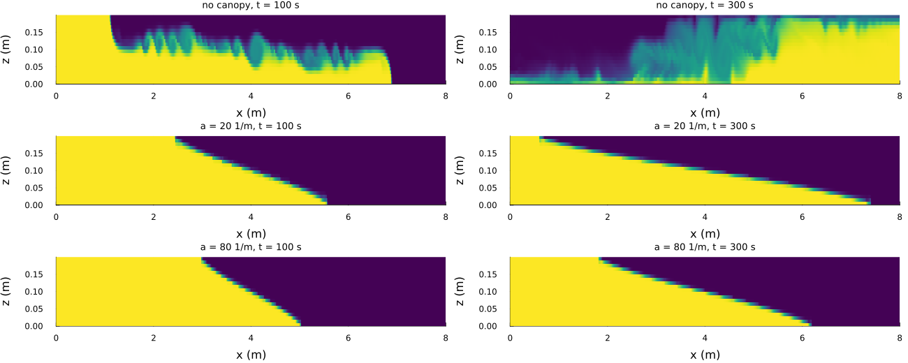

- **Without canopy:** the classical lock exchange, a block-shaped current with Kelvin-Helmholtz billows moving at a
  constant speed.
- **In the canopies:** the current becomes triangular. Its interface runs almost linearly from the gate to the toe, the
  shape Tanino, Nepf & Kulis (2005) observed in their flume experiments with emergent cylinder arrays.

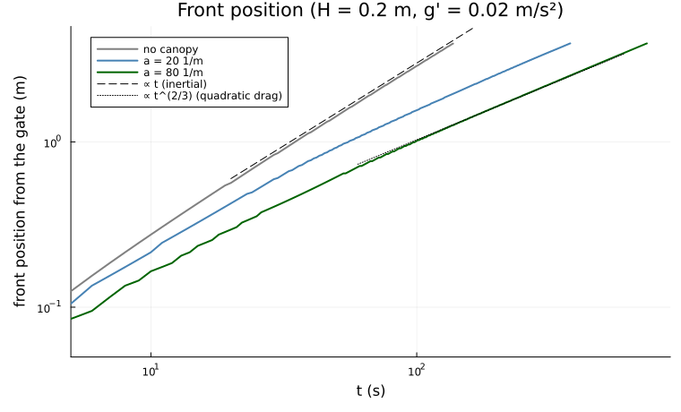

Without canopy the front moves as x_f ∝ t (exponent 1.02 for 10-50 s, 0.98 for 50-150 s). In the canopies it
decelerates. For a triangular current the pressure gradient is about g' H / x_f; balanced by the quadratic drag
1/2 C_D a u², it gives x_f ∝ t^(2/3). The model exponents fall towards this value as the drag takes over: a = 20 1/m:
0.89, 0.74, 0.68; a = 80 1/m: 0.82, 0.71, 0.68 (10-50 s, 50-150 s, 150-400 s).

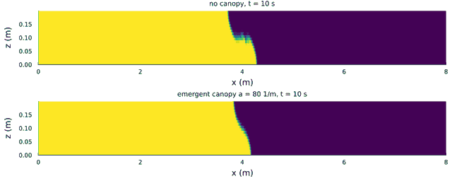

The scaling is derived here. Tanino et al. (2005) give a theoretical toe velocity and regime criteria (linear and
quadratic drag), which still have to be compared in detail: their open author manuscript (MIT DSpace) could not be
downloaded because of rate limiting.

**Lock exchange into vegetation: patches and individual stems** (`plot_vegetation_lock_exchange_canopies.jl`). The
same tank, with vegetation in the right half only (x = 4-8 m, starting at the gate). The canopy has the same frontal
area a = 20 1/m in five representations:
- no vegetation;
- a rigid patch with averaged quantities;
- individual rigid stems in rows every 10 cm, with the lateral spacing of the same stem density;
- the same rows as individual flexible stems (EI = 10⁻⁷ N m²);
- a flexible patch with the same stiffness.

The vegetation is drawn: patches as a shaded region with their representative stems, individual stems as lines with
their computed shapes.

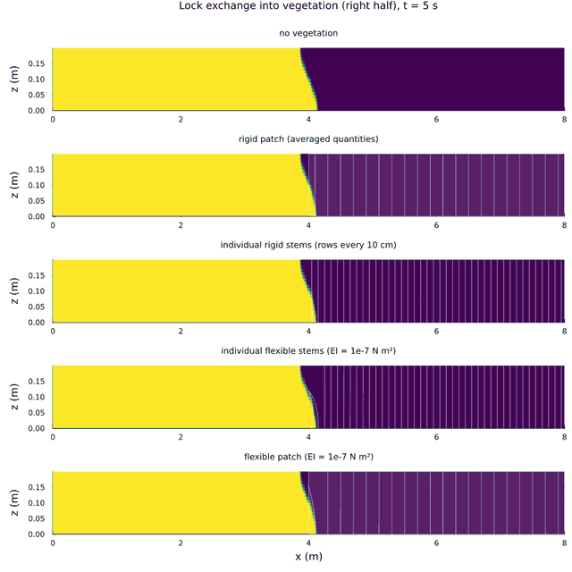

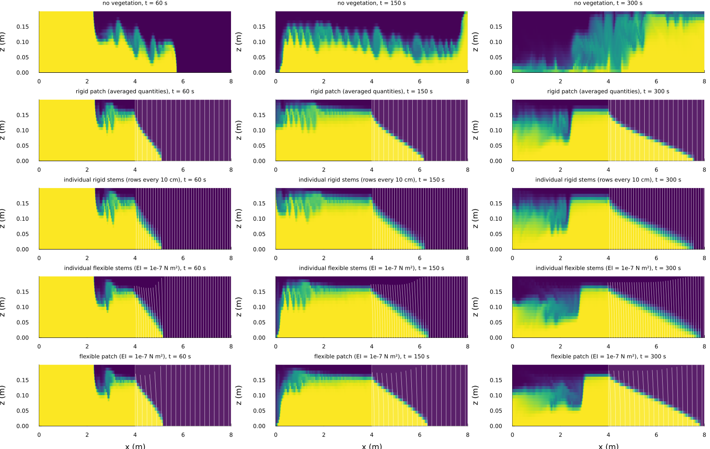

- **Without vegetation:** the current crosses the tank in about 140 s and is reflected at the end wall.
- **With vegetation:** the current turns triangular as soon as it enters the canopy, and it decelerates. Behind the
  gate, outside the canopy, the light water returns as an upper layer.
- **Rigid patch vs individual rigid stems:** practically the same front (3.55 m and 3.44 m after 300 s, 3 %), although
  the stems stand in discrete rows and the patch is a continuum.
- **Flexible stems:** they bend towards the gate in the light water that flows back over the dense current (mean tip
  displacement 6 cm). Bending reduces their drag, so the front moves faster than with rigid vegetation (3.75 m with
  individual flexible stems, 3.83 m with the flexible patch). Here too the two representations agree within 3 %.
- **Stiffness:** with EI = 10⁻⁶ N m² the stems bent by only about 1 cm. The current in the canopy is slow (about
  1 cm/s), and the Cauchy number Ca = ρ C_D b U² l³/(2 EI) was only about 3.

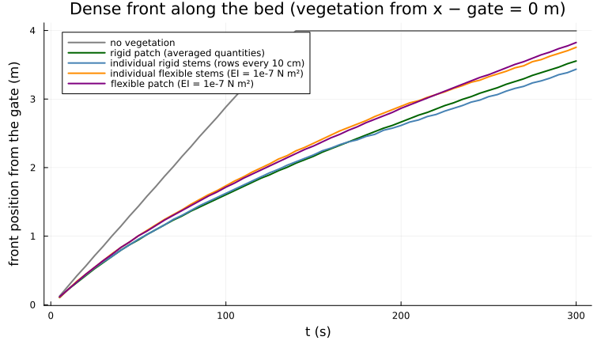

**Comparison with laboratory data: flexible blades of Luhar & Nepf (2011)** (`plot_vegetation_luhar_nepf.jl`). Luhar &
Nepf measured the drag and posture of flat model blades clamped in a uniform current. The blades were 1 cm wide and
5-25 cm long, the velocity 3.6-32 cm/s, and there were two materials:
- HDPE: stiffness-dominated, buoyancy parameter B = 0.005-0.62;
- silicone foam: buoyancy-dominated, B = 2.7-340.

Their model is the same as ours: normal drag with C_D = 1.95, bending stiffness and buoyancy, effective length
l_e/l = ∫cos³θ ds. We use their blade properties (Table 1) without any fitting. The measured forces of the 5 cm and
25 cm blades are read from their Fig. 4 (`LN2011_FORCES` in `cases.jl`; reading accuracy about 0.3 mN; load cell
accurate to 10 % and resolving 1 mN).

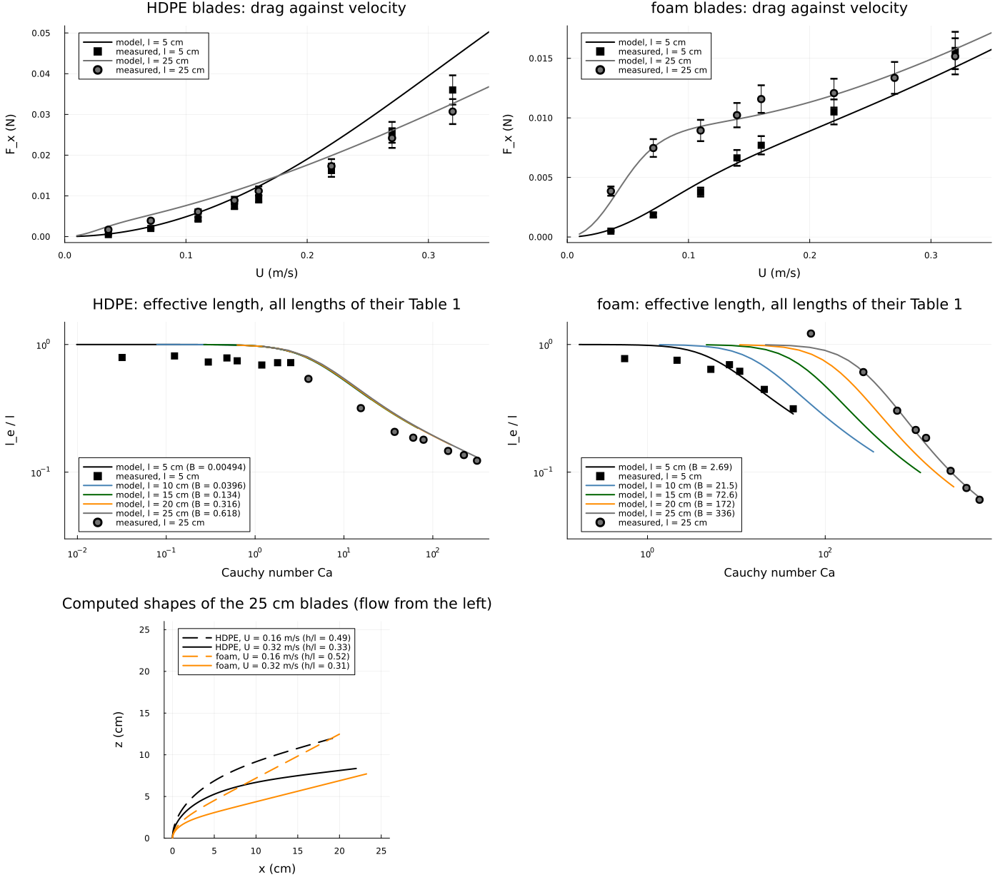

| Blade | Model / measured force |
|---|---|
| foam 25 cm | 0.89-1.04 (0.78 at 3.6 cm/s) |
| foam 5 cm | 0.91-0.93 for forces above 5 mN (1.23-1.28 below, near the load-cell resolution) |
| HDPE 25 cm | 1.06-1.18 above 14 cm/s, up to 1.48 at the lowest velocities |
| HDPE 5 cm | 1.22-1.40 |

- **The 5 cm HDPE blade** is overpredicted, as the authors report for their own model. They attribute it to a lower
  drag coefficient of short plates.
- **Our model reproduces theirs:** as far as they can be read, our values lie on the model curves of their Fig. 4
  (e.g. 0.044 N for the 5 cm HDPE blade at 32 cm/s). The deviations from the data are therefore those of the model
  itself.
- **Exponents:** exponents F ∝ U^a fitted to the points read from the figure reproduce the measured exponents of the
  paper:

| Blade | From the figure | Paper (measured) | Model |
|---|---|---|---|
| HDPE 25 cm | 1.33 | 1.31 ± 0.10 | 1.17 |
| foam 5 cm | 1.62 | 1.54 ± 0.20 | 1.39 |
| foam 25 cm | 0.52 | 0.69 ± 0.22 | 0.39 |

  The model exponents lie within about 1.5 standard deviations of the measurements.
- **Effective length:** like their Fig. 5, buoyancy delays reconfiguration length by length for the foam blades.
- **Shapes:** the computed shapes of the 25 cm blades match their photographs (Fig. 4e, f) qualitatively. The HDPE
  blade bends close to the base; the buoyant foam blade stays nearly straight at a nearly constant angle.

The test `test_validate_luhar_nepf_2011_blade_drag` checks the forces of at least 5 mN, except the 5 cm HDPE blade:
median deviation 7 %, largest 39 %. Their blade model is the same as ours, and `test_verify_luhar_nepf_2011_published_postures`
reproduces the values printed in the paper: l_e/l = 0.30 and h/l = 0.61 at Ca = 32 (ours 0.2995, 0.6079), and the
zero-stiffness solution (a straight blade at 59° for B⁻¹Ca = 3.2), which our model approaches as B grows (error about
B^(-1/2), 0.009 in h/l at B = 10⁴).

**Dunn, López & García (1996)** (flume runs with submerged rigid and flexible cylinders). The run data are transcribed
in `cases.jl` (`DUNN1996_RIGID`, `DUNN1996_FLEXIBLE`, `dunn1996_run`): conditions, depths, frontal areas, canopy
heights, bulk drag coefficients, for the flexible runs deflection angles and heights, and the measured profiles of
velocity, Reynolds stress and local drag coefficient of all 18 runs (Appendix C, `DUNN1996_PROFILES`). A run-by-run
comparison with the constant mixing length is not meaningful, for two reasons:
- **Turbulence model:** the depth-averaged velocity of a submerged canopy is set by the turbulent momentum exchange
  above and within the canopy, and our constant mixing length is not a canopy turbulence model. For rigid run 1, mixing
  lengths of 2, 4 and 8 cm give 0.78, 0.61 and 0.52 m/s against the measured 0.589 m/s. A comparison would test the
  chosen mixing length, not the vegetation drag.
- **Flexible straws:** they bend at a corrugated hinge near the bed, their flexural rigidity was not measured, and
  according to the report they softened over the runs and swayed strongly. That is outside a quasi-static beam model
  with a known stiffness.

**Dunn et al. (1996) with the k-epsilon closure** (`plot_vegetation_dunn_k_epsilon.jl`; `turbulence_closure =
"k_epsilon"`, section 17 of the test documentation). The vegetation terms and the free-surface condition for ε follow
López & García (1997, WES Technical Report WRP-CP-10, Eqs. 26-27): C_fk = 1.0, C_fε = 1.33, with C_1 multiplying the
vegetation term in the ε equation (without C_1, as the formula is often quoted, k grows without bound in an emergent
canopy). The closure reproduces open-channel flow (momentum balance exact, log law within 6 %). Each run is a periodic
channel with the measured bulk drag coefficient C_DB and a smooth bed (z0 = 5e-6 m from the flume's Manning
n = 0.011). The flexible runs are computed as rigid canopies of the measured deflected height, as López & García did.

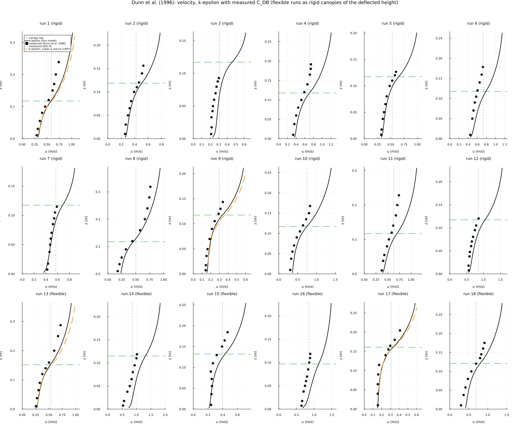

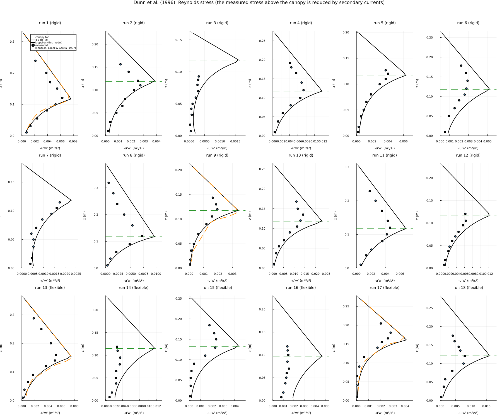

- **Against the k-epsilon results of López & García** (their Figs. 6.1, 6.2, 6.4, 6.5, runs 1, 9, 13, 17; digitized
  from the scanned report, `LG1997_PROFILES`): our velocity is 0.92-1.03 of theirs at every height (about 5 % lower above
  the canopy), the stress peak at the canopy top 0.97-1.05 of theirs, the stress in the lower canopy 0.68-1.35 (ours
  lower near the bed, higher in the middle of the canopy).
- **Against the measurements:** both 2D models overpredict the velocities. Depth mean against the measured Q/(b H):

  | Runs | Drag coefficient | Mean model/measured | Range |
  |---|---|---|---|
  | rigid 1-12 | C_D = 1 | 1.24 | 1.17-1.31 |
  | rigid 1-12 | measured C_DB | 1.19 | 1.09-1.28 |
  | flexible 13-18 | measured C_DB | 1.25 | 1.05-1.55 |

  The measured Reynolds stress at the canopy top is only 0.12-0.83 of the 2D momentum balance g S (H − h_p), which both
  models satisfy. López & García attribute both to secondary currents in the 0.91 m wide flume, which a 2DV model cannot
  represent. The shape of the velocity profile in the canopy, u(z)/u(h_p), agrees with the measurements in the rigid
  runs (median deviation 5 %, largest 21 %, in the sparse runs 6, 7, 12). The flexible runs scatter more (runs 14, 16:
  strongly bent straws, 51° and 65°).

**Flow resistance against plant density** (`plot_vegetation_manning.jl`): the numerical experiment of López & García
(1997, Figs. 6.16-6.18; S = 0.0036, h_p = 0.10 m, D = 6.4 mm, smooth bed, 0.16-1581 stems/m²), run at their computed
depths. The figures are labelled q = 1.21 m²/s; the text gives 1.12 m²/s, and so does n = H^(5/3) S^(1/2)/q with their
digitized H and n (1.13 ± 0.03 m²/s).

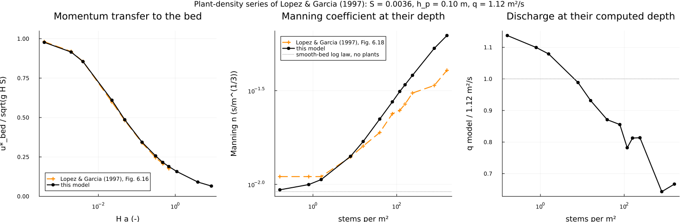

- The momentum transfer to the bed, u*_bed/sqrt(g H S), agrees with their Fig. 6.16 within a few per cent over three
  decades of H a.
- Manning's n: at low density ours follows the smooth-bed log law (0.0093 at their depth), theirs is 0.011. Above
  about 40 stems/m² ours is higher, up to 1.27 times theirs at 158 stems/m² and 1.5 times at 800-1600 stems/m². Over
  these dense canopies in deep water (H/h_p = 6-9) our velocity profile above the canopy corresponds to a roughness
  length of about h_p/2, theirs to about h_p/10. The difference is converged in time and grid and insensitive to C_D;
  switching off the vegetation terms increases the resistance further. Not resolved.

Tested in `test_turbulence.jl`: the four runs against López & García, the rigid-run profile shapes against the
measurements, and the bed shear and n of the density series (1.6-160 stems/m²).

Tests
-----

`test/test_vegetation.jl` checks:
- the patch drag per unit volume, including the canopy-top cell and the patch edges;
- Newton's third law for individual stems;
- the cantilever (order 2) and the reconfiguration law;
- the emergent canopy (exact);
- the submerged canopy against the 1D reference (order 2);
- individual stems against the patch;
- the momentum balance of a flexible patch;
- the head loss;
- the explicit-drag stability check;
- the wave-height decay over a rigid canopy against Dalrymple et al. (1984);
- the approach of a canopy lock exchange to x_f ∝ t^(2/3);
- damping of a standing wave and delay of a lock-exchange front by a patch.

Details: section 16 of `docs/TESTS_TECHNICAL_DOCUMENTATION.md`.

Published data
--------------

Transcribed or digitized in `cases.jl` from the PDFs in `docs/` (gitignored, not part of the repository):
- Dunn, López & García (1996), University of Illinois Hydraulic Engineering Series 51: run conditions (Tables 4.1,
  5.1-5.5) and the horizontally averaged profiles of all 18 runs (Appendix C);
- López & García (1997), WES Technical Report WRP-CP-10: model constants and boundary conditions, the computed
  k-epsilon profiles of runs 1, 9, 13, 17 (Figs. 6.1, 6.2, 6.4, 6.5) and the plant-density series (Figs. 6.16, 6.18),
  digitized from the scan;
- Luhar & Nepf (2011): blade parameters (Table 1), forces (Fig. 4) and the published model values.

The compilation of Huthoff, Augustijn & Hulscher (2007) is not available here.

Scripts
-------

- `plot_vegetation_reconfiguration.jl`: single flexible stem, R(Ca); a few seconds.
- `plot_vegetation_channel.jl`: periodic channel references (rigid and flexible) and grid convergence; about 12 min.
- `plot_vegetation_patch.jl`: head loss and the flexible-patch animation; about 1 min.
- `plot_vegetation_waves.jl`: wave damping against Dalrymple et al. (1984); about 20 min.
- `plot_vegetation_luhar_nepf.jl`: flexible blades against the laboratory data of Luhar & Nepf (2011); a few seconds.
- `plot_vegetation_dunn_k_epsilon.jl`: the 18 runs of Dunn et al. (1996) with k-epsilon against the measured profiles and
  the results of López & García (1997); about 6 min.
- `plot_vegetation_manning.jl`: flow resistance against plant density, after López & García (1997); about 8 min.
- `plot_vegetation_lock_exchange.jl`: lock exchange through canopies over the whole tank, front scaling; about 10 min.
- `plot_vegetation_lock_exchange_canopies.jl`: lock exchange into vegetation in the right half, patches and individual
  rigid and flexible stems, vegetation drawn; about 35 min.
- `cases.jl`: shared settings and references (also used by the tests):
  - the rigid 1D canopy profile and the coupled flexible canopy reference;
  - the reconfiguration helper and the independent elastica reference;
  - the wave flume with Dalrymple's decay coefficient;
  - the canopy lock exchange;
  - laboratory data of Luhar & Nepf (2011) and Dunn et al. (1996).
- `run_oscillating_flow_with_flexible_vegetation.jl`: ported to the new model; qualitative (no reference).

Output goes to `output_barotropic/vegetation_figures/`; the figures here are copies, the GIF reduced to every second
frame and 640 px width.

    julia --project=. experiments/vegetation/plot_vegetation_reconfiguration.jl
    julia --project=. experiments/vegetation/plot_vegetation_channel.jl
    julia --project=. experiments/vegetation/plot_vegetation_patch.jl
    julia --project=. experiments/vegetation/plot_vegetation_waves.jl
    julia --project=. experiments/vegetation/plot_vegetation_luhar_nepf.jl
    julia --project=. experiments/vegetation/plot_vegetation_dunn_k_epsilon.jl
    julia --project=. experiments/vegetation/plot_vegetation_manning.jl
    julia --project=. experiments/vegetation/plot_vegetation_lock_exchange.jl
    julia --project=. experiments/vegetation/plot_vegetation_lock_exchange_canopies.jl

References
----------

- Alben, Shelley & Zhang (2002), Nature 420, 479-481
- Gosselin, de Langre & Machado-Almeida (2010), J. Fluid Mech. 650, 319-341
- Gosselin (2019), Mechanics of a plant in fluid flow, arXiv:1905.08055
- Luhar & Nepf (2011), Limnol. Oceanogr. 56(6), 2003-2017
- Nepf (2012), Annu. Rev. Fluid Mech. 44, 123-142
- Dunn, López & García (1996), Hydraulic Engineering Series 51, University of Illinois
- Huthoff, Augustijn & Hulscher (2007), Water Resour. Res. 43, W06413
- Timoshenko & Gere, Mechanics of Materials (cantilever deflection)
- Dalrymple, Kirby & Hwang (1984), J. Waterway, Port, Coastal, Ocean Eng. 110(1), 67-79
- Mendez & Losada (2004), Coastal Eng. 51, 103-118
- Tanino, Nepf & Kulis (2005), Water Resour. Res. 41, W12402
- Benjamin (1968), J. Fluid Mech. 31, 209-248
