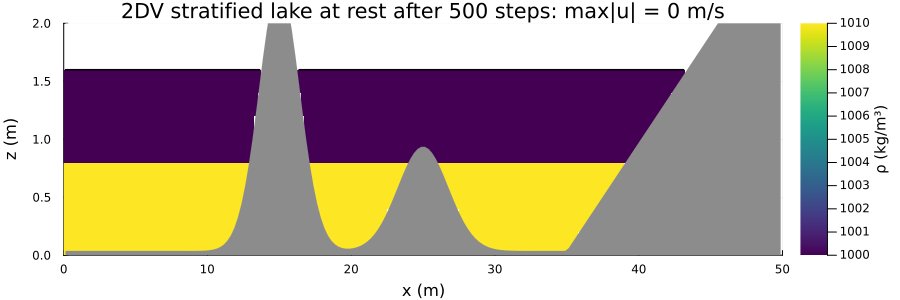
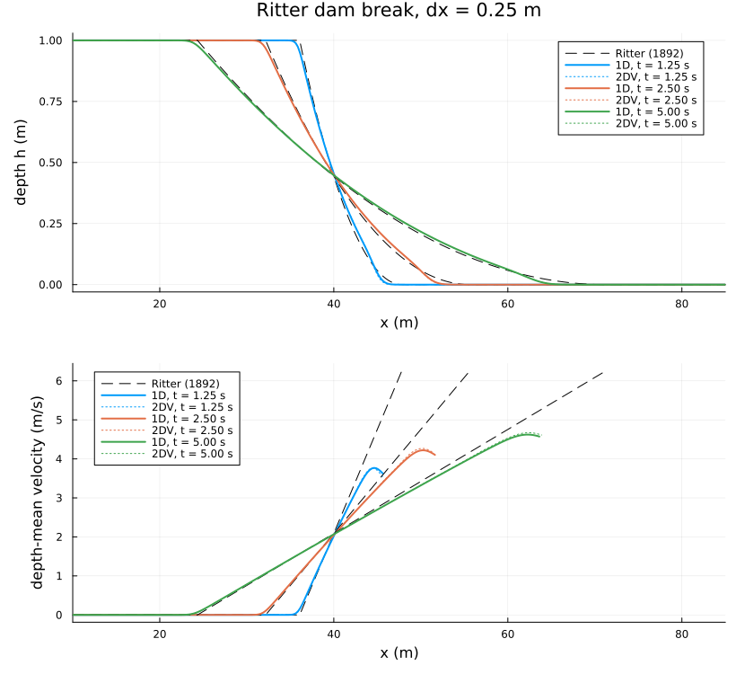
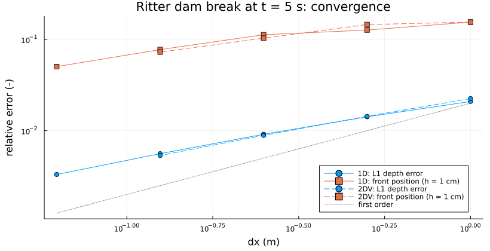
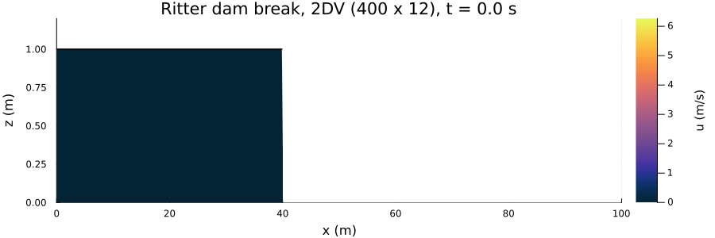
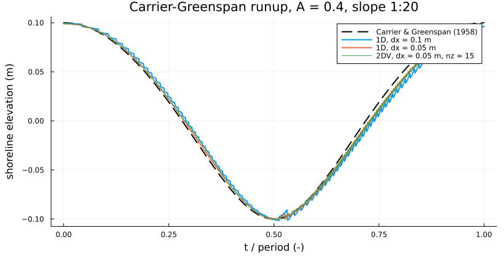
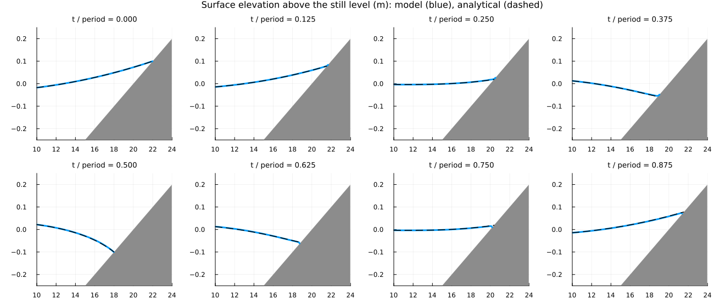
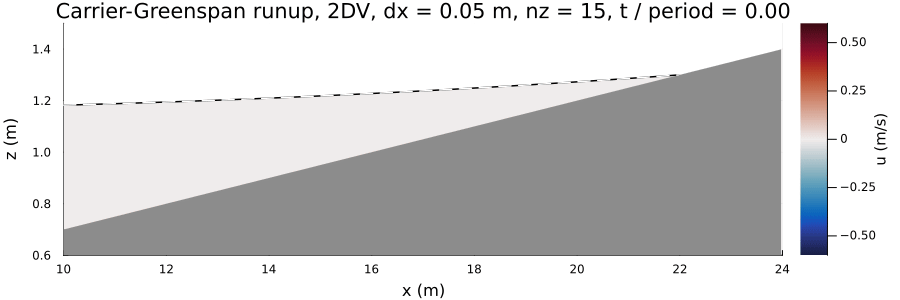
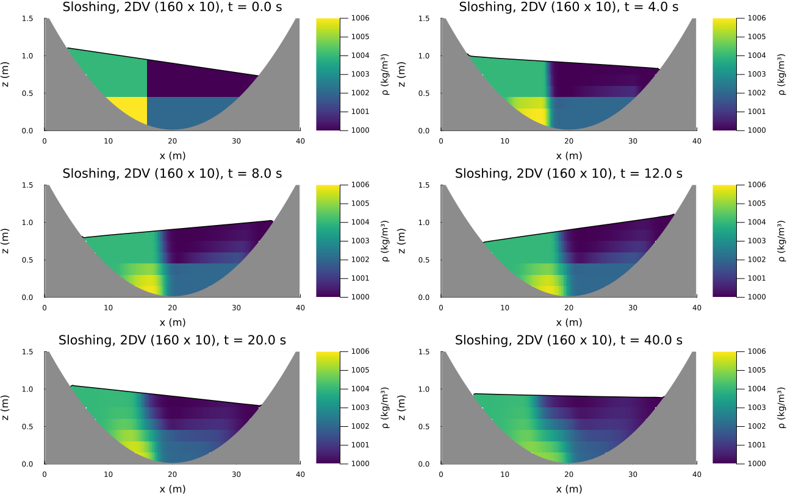
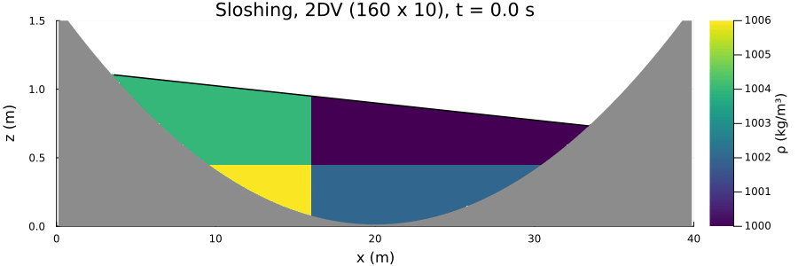
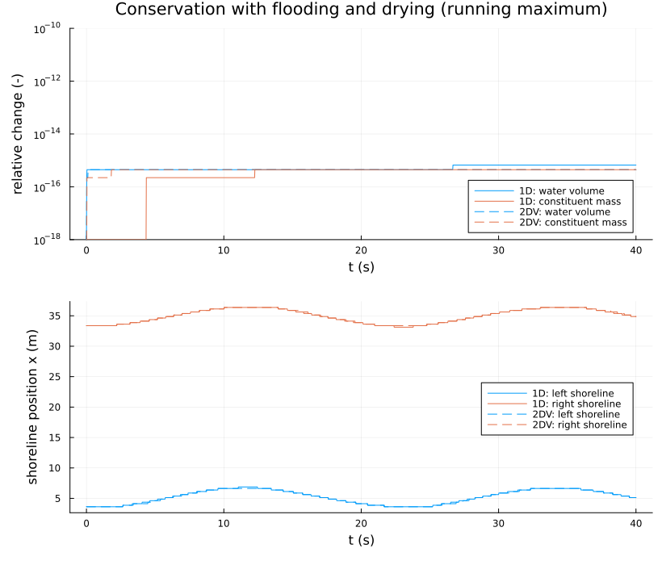

Wetting and drying
==================

Issue #31: flows in which the water leaves cells, columns fall dry and dry beaches flood. The model option
`ModelConfig(wetting_drying=true)` uses a hydrostatic time step on z-level cells cut by the bed and by the free surface
(`src/wetting_drying.jl`). The bed may take any level, columns may be dry, and `nz = 1` gives the 1D (depth-averaged)
model on the same code path. Method, decisions and status: [docs/plan_issue_31_wetting_drying.md](../../docs/plan_issue_31_wetting_drying.md).

Four cases, each against an exact property or an analytical solution, in 1D and 2DV:

| Case | Reference | Result |
|---|---|---|
| Lake at rest over a beach, an island and a bump | stagnant water stays stagnant | u = 0 and level unchanged exactly (500 steps), also stratified |
| Ritter dam break on a dry bed | Ritter (1892) | L1 depth error 0.9 % at dx = 0.25 m, first-order convergence |
| Standing wave on a planar beach | Carrier & Greenspan (1958) | shoreline within 9 % of the runup amplitude at dx = 0.05 m |
| Sloshing over two beaches, two water masses | conservation | water volume and constituent mass to 7e-16, density within its bounds |

Run all cases and write the figures (about 1 min):

```pwsh
julia --project=. experiments/wetting_drying/plot_wetting_drying.jl            # all cases
julia --project=. experiments/wetting_drying/plot_wetting_drying.jl ritter     # one case: lake, ritter, runup, sloshing
```

Output goes to `output_barotropic/wetting_drying_figures/`; the figures below are copies in `figures/`. The cases are
defined in `cases.jl` and mirrored by `test/test_wetting_drying.jl`.

Method in brief
---------------

- Layer k of a column holds h_k = max(0, min(z_{k+1}, zeta) - max(z_k, z_b)); the top layer is open above.
- Faces take the bed of the higher neighbour and the upwind water level (Stelling & Duinmeijer 2003); a face with less
  than `dry_depth_threshold` (1e-6 m) of water is closed.
- Semi-implicit free surface (Casulli & Cheng 1992) solved for the increment of eta, so that a lake at rest gives an
  exactly zero right-hand side.
- Momentum-conservative first-order upwind advection (Stelling & Duinmeijer 2003), capped so that thin layers at the front
  stay stable.
- A positivity limiter scales the outflow of a column that would otherwise run dry below zero; eta follows from the flux
  divergence, so the water volume is conserved to round-off.
- The constituent (density) is transported with the same fluxes and cell volumes, conservatively, without the global
  mass correction of the other modes.

Lake at rest
------------

A 50 m basin, still water at z = 1.6 m, a beach rising out of the water on the right, an island and a submerged bump;
no bed level is a whole number of cells (dz = 0.2 m). After 500 steps of 0.05 s, the largest velocity and the largest
change of the water level are exactly zero in 1D, in 2DV and in 2DV with a two-layer stratification; the dry cells
stay dry. The stratified case needs the baroclinic pressure at the nominal layer centres (identical in neighbouring
columns whatever their bed) and a density update that is exactly zero without flow (see the plan, section 5).



Ritter dam break on a dry bed
-----------------------------

Water of depth h0 = 1 m behind a dam at x0 = 40 m, a dry, flat and frictionless bed in front of it. The exact solution
(Ritter 1892) is a rarefaction from x0 - c0 t to the front at x0 + 2 c0 t (c0 = sqrt(g h0)), with h = 4/9 h0 and
u = 2/3 c0 at the dam. 2DV uses 12 layers of 0.1 m; the top two are dry from the start and the layers fall dry one by one.
The time step is dt = 0.01 s/m * dx (Courant number about 0.06).



The depth converges at first order (L1 error 2.1 %, 1.4 %, 0.9 %, 0.6 %, 0.3 % from dx = 1 m to 1/16 m). The thin tip of
the rarefaction (h proportional to (x_f - x)^2) lags by numerical diffusion: the position of h = 1 cm is 11 % of the
travelled distance behind at dx = 0.25 m and 5 % at dx = 1/16 m. 2DV and 1D agree within 1 %.



Velocity in 2DV (400 x 12 cells). Hydrostatic theory keeps u uniform over the depth; the model does so where the surface
has not crossed a layer interface, but where it has dropped through several layers the upper layers lag (at t = 5 s up to
0.29 m/s, 6 % of the largest velocity; e.g. 3.40 m/s at the bed and 3.20 m/s in the top layer at x = 50 m). The depth is
hardly affected (within 1 % of 1D). This is an open point of the momentum advection in the draining surface layer (see
the plan):



Carrier-Greenspan standing wave on a planar beach
--------------------------------------------------

The periodic solution of Carrier & Greenspan (1958) on a 1:20 beach, amplitude A = 0.4 (non-breaking for A < 1), length
scale L = 20 m, period pi sqrt(L / (g slope)) = 20.1 s, runup amplitude A/4 * slope * L = 0.1 m. The reference is
computed from the hodograph transformation by Newton's method (`carrier_greenspan_solution`); a test checks that it
satisfies the nonlinear shallow-water equations. The model starts at maximum runup, where u = 0 everywhere, and is
forced by the analytical velocity at the offshore boundary (20 m from the still shoreline, depth 1 m).



The shoreline (the last cell deeper than 1 mm) follows the analytical one within 14.6 mm at dx = 0.1 m and 9.2 mm
at dx = 0.05 m (first order); 2DV (15 layers) gives 9.4 mm. The largest error occurs during the rundown, when the thin film
on the beach drains; the steps at dx = 0.1 m are the cells of the beach becoming wet one by one.





Sloshing over two beaches with two water masses
-----------------------------------------------

A closed 40 m basin with a parabolic bed rising out of the water on both sides. The surface is tilted up to the left, a
heavier water mass (1004 kg/m³) lies left of a lighter one, with a weak stratification. The water sloshes, both
shorelines move by about 3 m, and the heavy water undercuts the light water. Over 40 s the water volume and the constituent
mass change by at most 7e-16 relative (round-off), the depth never becomes negative and the density stays within its
initial bounds, in 1D and 2DV.







Limitations (current step)
--------------------------

- Hydrostatic only; first-order momentum advection and density transport. Non-hydrostatic wetting and drying and the
  `tvd2` schemes are the next step of issue #31.
- Not supported together with wetting and drying: periodic x, vegetation, k-epsilon, bed roughness, wind stress.

References
----------

- Ritter (1892), Z. Ver. Deutsch. Ing. 36, 947-954
- Carrier & Greenspan (1958), J. Fluid Mech. 4, 97-109
- Casulli & Cheng (1992), Int. J. Numer. Methods Fluids 15, 629-648
- Stelling & Duinmeijer (2003), Int. J. Numer. Methods Fluids 43, 1329-1354
- Delestre et al. (2013), SWASHES, Int. J. Numer. Methods Fluids 72, 269-300
