Wetting and drying
==================

Issue #31: flows in which the water leaves cells, columns fall dry and dry beaches flood. The model option
`ModelConfig(wetting_drying=true)` uses a time step on z-level cells cut by the bed and by the free surface
(`src/wetting_drying.jl`). The bed may take any level, columns may be dry, and `nz = 1` gives the 1D (depth-averaged)
model on the same code path. Method, decisions and status: [docs/plan_issue_31_wetting_drying.md](../../docs/plan_issue_31_wetting_drying.md).

Cases against exact properties or analytical solutions, in 1D and 2DV:

| Case | Reference | Result |
|---|---|---|
| Lake at rest over a beach, an island and a bump | stagnant water stays stagnant | u = 0 and level unchanged exactly (500 steps), also stratified |
| Ritter dam break on a dry bed | Ritter (1892) | L1 depth error 0.9 % at dx = 0.25 m, first-order convergence |
| Standing wave on a planar beach | Carrier & Greenspan (1958) | shoreline within 9 % of the runup amplitude at dx = 0.05 m |
| Sloshing over two beaches, two water masses | conservation | water volume and constituent mass to 9e-16, density within its bounds |
| Standing waves, non-hydrostatic | omega² = g k tanh(k H) | phase speed within 1.9 % up to k H = 3 |
| Solitary wave on a plane beach | Synolakis (1987) | maximum runup converges to the law (94 % at dx = 0.05 m, 100 % at 0.0125 m) |

Run all cases and write the figures (about 1 min):

```pwsh
julia --project=. experiments/wetting_drying/plot_wetting_drying.jl            # all cases
julia --project=. experiments/wetting_drying/plot_wetting_drying.jl ritter     # one case: lake, ritter, runup, sloshing
```

Output goes to `output_barotropic/wetting_drying_figures/`; the figures below are copies in `figures/`. The cases are
defined in `cases.jl` and mirrored by `test/test_wetting_drying.jl`.

Method in brief
---------------

- Layer k of a column holds h_k = max(0, min(z_{k+1}, zeta) - max(z_k, z_b)); the top layer is open above.
- Faces take the bed of the higher neighbour and the upwind water level (Stelling & Duinmeijer 2003); a face with less
  than `dry_depth_threshold` (1e-6 m) of water is closed.
- Semi-implicit free surface (Casulli & Cheng 1992) in the volume formulation of Casulli (2009): the column volume
  max(0, H + eta - z_b) is the unknown of a mildly nonlinear system, solved by Newton's method (Brugnano & Casulli 2008).
  Every depth stays >= 0 for any time step, without correcting the solution afterwards (proof:
  [docs/depth_positivity.md](../../docs/depth_positivity.md)); a lake at rest has a zero residual and does not change.
  In these cases the solve takes one Newton iteration per step (no column is drained within a step).
- Momentum-conservative upwind advection (Stelling & Duinmeijer 2003), first order (`upwind1`) or with limited MUSCL
  values (`tvd2`), capped so that thin layers at the front stay stable.
- eta follows from the flux divergence, so the water volume is conserved to round-off.
- The constituent (density) is transported with the same fluxes and cell volumes, conservatively, without the global
  mass correction of the other modes.

Lake at rest
------------

A 50 m basin, still water at z = 1.6 m, a beach rising out of the water on the right, an island and a submerged bump;
no bed level is a whole number of cells (dz = 0.2 m). After 500 steps of 0.05 s, the largest velocity and the largest
change of the water level are exactly zero in 1D, in 2DV and in 2DV with a two-layer stratification; the dry cells
stay dry. The stratified case needs the baroclinic pressure at the nominal layer centres (identical in neighbouring
columns whatever their bed) and a density update that is exactly zero without flow (see the plan, section 5).


Ritter dam break on a dry bed
-----------------------------

Water of depth h0 = 1 m behind a dam at x0 = 40 m, a dry, flat and frictionless bed in front of it. The exact solution
(Ritter 1892) is a rarefaction from x0 - c0 t to the front at x0 + 2 c0 t (c0 = sqrt(g h0)), with h = 4/9 h0 and
u = 2/3 c0 at the dam. 2DV uses 12 layers of 0.1 m; the top two are dry from the start and the layers fall dry one by one.
The time step is dt = 0.01 s/m * dx (Courant number about 0.06).


The depth converges at first order (L1 error 2.1 %, 1.4 %, 0.9 %, 0.6 %, 0.3 % from dx = 1 m to 1/16 m). The thin tip of
the rarefaction (h proportional to (x_f - x)^2) lags by numerical diffusion: the position of h = 1 cm is 11 % of the
travelled distance behind at dx = 0.25 m and 5 % at dx = 1/16 m. 2DV and 1D give the same depth to the printed digits
(the 2DV front differs by one cell at dx = 0.125 m).


Velocity in 2DV (400 x 12 cells). Hydrostatic theory keeps u uniform over the depth; the layer velocities differ by at
most 0.0013 m/s at t = 5 s (first-order convergent; a first version had 0.29 m/s, see "Depth-uniform velocity" below):


Carrier-Greenspan standing wave on a planar beach
--------------------------------------------------

The periodic solution of Carrier & Greenspan (1958) on a 1:20 beach, amplitude A = 0.4 (non-breaking for A < 1), length
scale L = 20 m, period pi sqrt(L / (g slope)) = 20.1 s, runup amplitude A/4 * slope * L = 0.1 m. The reference is
computed from the hodograph transformation by Newton's method (`carrier_greenspan_solution`); a test checks that it
satisfies the nonlinear shallow-water equations. The model starts at maximum runup, where u = 0 everywhere, and is
forced by the analytical velocity at the offshore boundary (20 m from the still shoreline, depth 1 m).


The shoreline (the last cell deeper than 1 mm) follows the analytical one within 14.6 mm at dx = 0.1 m and 9.2 mm
at dx = 0.05 m (first order); 2DV (15 layers) gives the same 9.2 mm. The largest error occurs during the rundown, when the
thin film on the beach drains; the steps at dx = 0.1 m are the cells of the beach becoming wet one by one.


Sloshing over two beaches with two water masses
-----------------------------------------------

A closed 40 m basin with a parabolic bed rising out of the water on both sides. The surface is tilted up to the left, a
heavier water mass (1004 kg/m³) lies left of a lighter one, with a weak stratification. The water sloshes, both
shorelines move by about 3 m, and the heavy water undercuts the light water. Over 40 s the water volume and the constituent
mass change by at most 7e-16 relative (round-off), the depth never becomes negative and the density stays within its
initial bounds, in 1D and 2DV.


Depth-uniform velocity: manufactured solution of the momentum advection
----------------------------------------------------------------------

`plot_wetting_drying.jl mms`. In hydrostatic flow an initially depth-uniform velocity stays depth-uniform, so the
advection must give every layer the same tendency, -u du/dx. The figure evaluates the advection operator alone for a
prescribed depth-uniform u(x) (changing sign) under a surface that drops through six layer interfaces (dz = 0.1 m), with
the vertical fluxes from the discrete continuity. A first version, the direct layer-wise transcription of the 1D
momentum-conservative scheme, erred by about dx |d zeta/dx| / h_k in the layer that the surface cuts thinly: up to five
times the exact tendency, and not convergent (top panel; 0.17-0.87 m/s² on all grids). The present scheme gives each layer
its own velocity times the column factor of the 1D scheme, takes the inflow of a layer that ends at the far face from the
layer below, and uses second order only on complete stencils (analysis: section 18 of
[docs/TESTS_TECHNICAL_DOCUMENTATION.md](../../docs/TESTS_TECHNICAL_DOCUMENTATION.md)). Its error converges at first order
in every layer, as in 1D. The 2DV `tvd2` curve coincides with 2DV `upwind1`: at faces where a layer ends, tvd2 falls
back to first order, and these faces set the maximum.

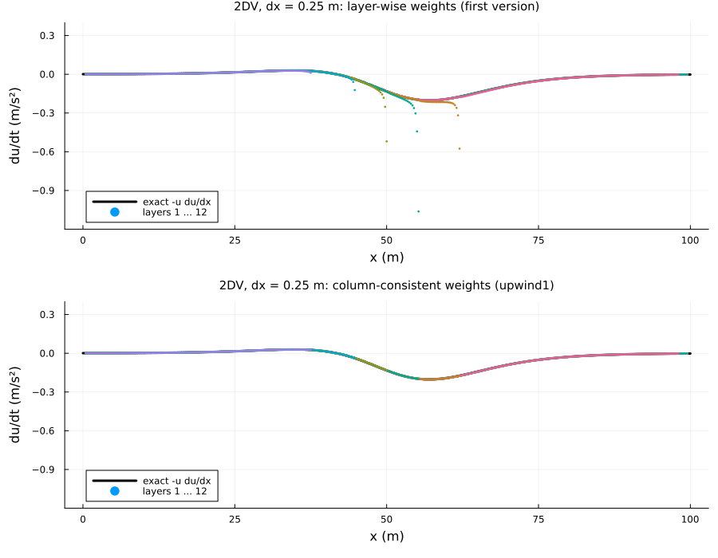

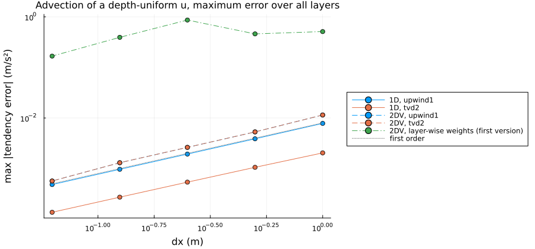

upwind1 against tvd2
--------------------

`plot_wetting_drying.jl schemes`. `tvd2` uses limited MUSCL values (MC limiter) in the momentum advection and the
flux-limited Lax-Wendroff scheme for the density, falling back to first order next to dry faces.

Ritter dam break at t = 5 s, dx = 0.25 m: tvd2 halves the depth error (L1 0.51 % against 0.91 % in 1D, 0.54 % against
0.91 % in 2DV) and the front lag (5.6 % against 11.3 % in 1D, 6.6 % against 11.3 % in 2DV), and converges faster at the
front (1.8 % at dx = 1/16 m in 1D).

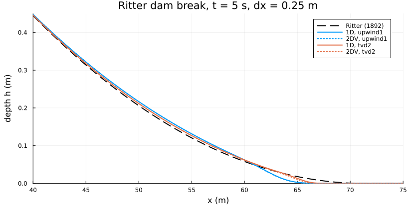

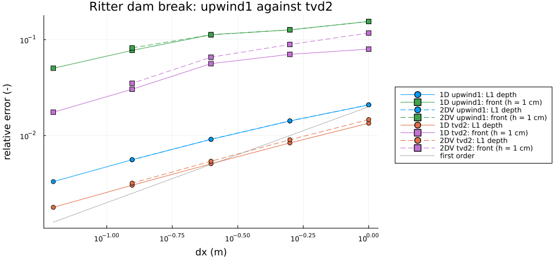

The layer velocities of both schemes (2DV): all twelve layers lie on one curve.

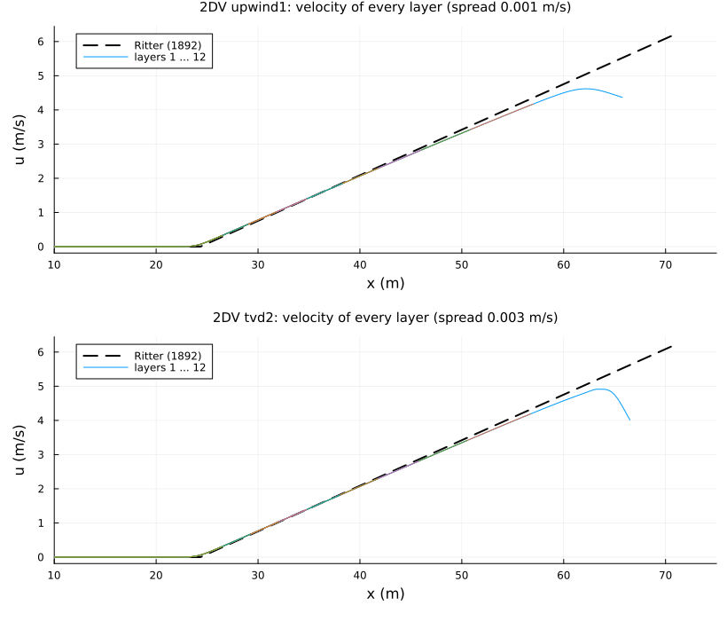

Carrier-Greenspan runup at dx = 0.05 m: the shoreline error is set by the wet/dry front, where both schemes are first
order; tvd2 reduces it slightly (8.6 against 9.2 mm). The fast oscillation is the numerical shoreline jumping from cell to
cell (the last cell deeper than 1 mm).

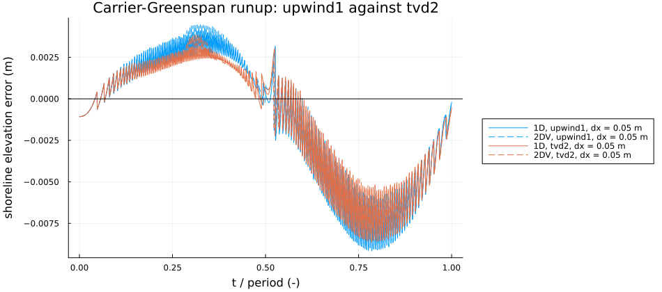

Sloshing basin (2DV, 160 x 10 cells): tvd2 keeps the front between the two water masses and the stratification visibly
sharper; both stay within the initial density bounds and conserve the mass to round-off.

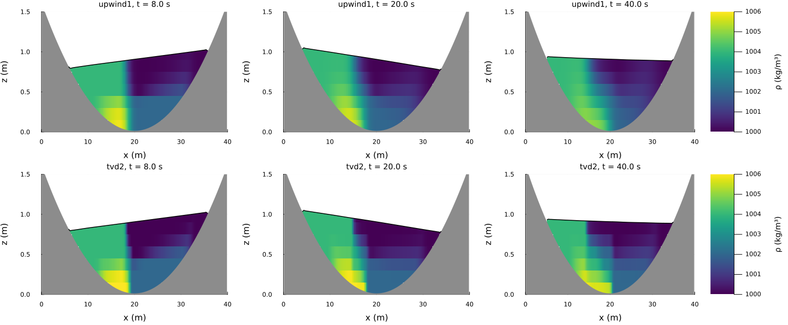

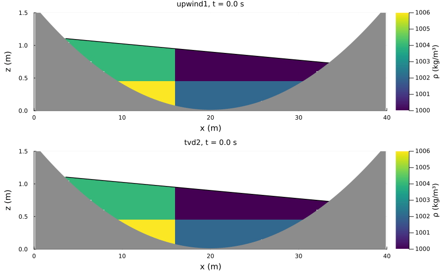

Non-hydrostatic mode
--------------------

`use_hydrostatic=false`: the non-hydrostatic pressure is solved on the wet cells below the surface cell of each column,
its gradient enters the momentum predictor, and the positive free-surface solve is repeated (method: section 18 of
[docs/TESTS_TECHNICAL_DOCUMENTATION.md](../../docs/TESTS_TECHNICAL_DOCUMENTATION.md)).

**Dispersion** (`plot_wetting_drying.jl dispersion`). Standing waves in a closed basin of depth 1 m, one half wavelength
long, 40 cells and 40 layers. The non-hydrostatic phase speed follows the full relation omega² = g k tanh(k H) within
0.0-1.9 % from k H = 0.25 to 3; the hydrostatic mode keeps the shallow-water speed (42 % error in the period at k H = 3).
At k H = pi/2 the period error converges at first order (3.4, 1.75, 0.89, 0.45 % for 20 x 10 ... 160 x 80 cells): the
condition q = 0 in the surface cell is first order in its thickness. The amplitude decays by about 5 % per period at 400
steps per period, the damping of the fully implicit free surface (about 2 pi² / N per period with N steps; not specific
to wetting and drying).

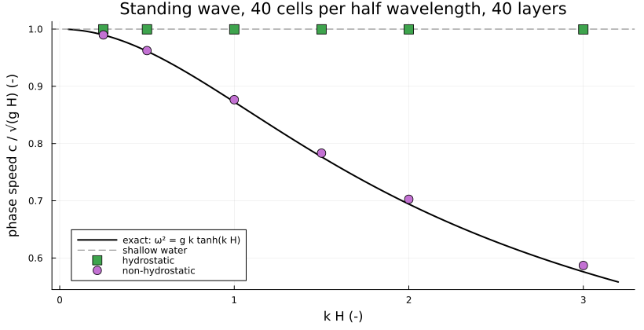

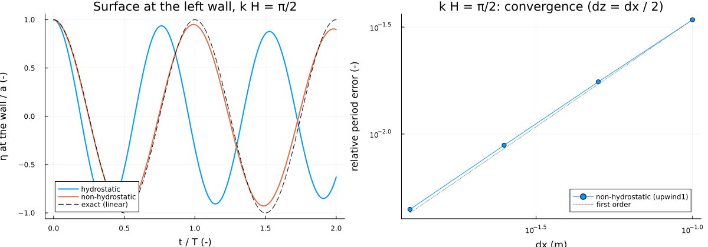

**Solitary wave runup** (`plot_wetting_drying.jl solitary`). The canonical non-breaking case of Synolakis (1987): a
solitary wave of height H/d = 0.019 over a depth d = 1 m runs up a 1:19.85 beach; the maximum runup of the nonlinear
shallow-water theory is R/d = 2.831 sqrt(cot beta) (H/d)^(5/4), i.e. 0.0890 m, which his laboratory data confirm for
non-breaking waves. The wave starts as eta = H sech²(gamma (x - x1)) with u = c eta/(d + eta) (12 layers of 0.1 m in
2DV). The runup converges at first order to the law (0.80, 0.89, 0.94, 0.98, 1.00 for dx = 0.2 ... 0.0125 m, 1D); 2DV
hydrostatic equals 1D, the non-hydrostatic runup is 1.5-2 % lower on the same grid (dispersion reduces the steepening).
upwind1 and tvd2 give the same runup: it is set by the wet/dry front, where both are first order.

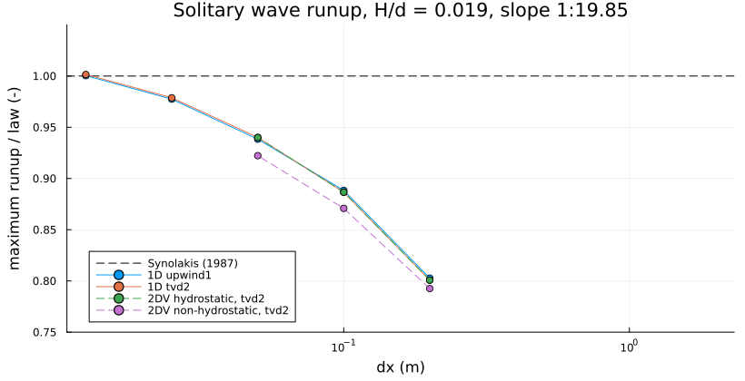

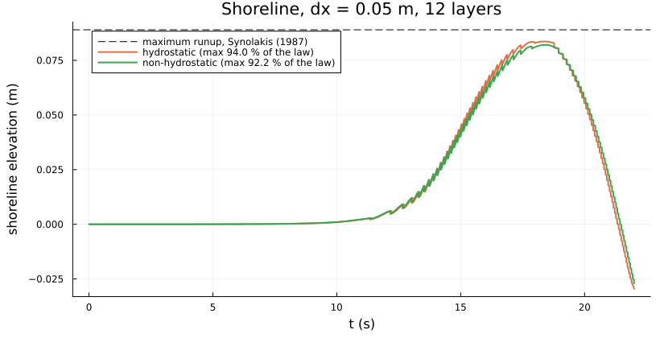

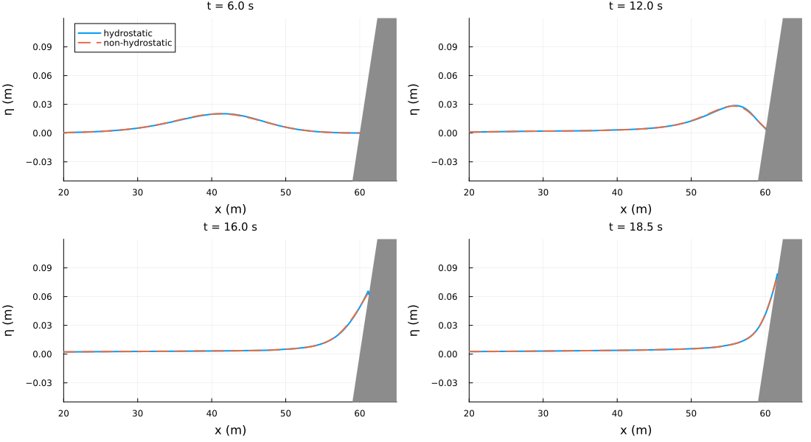

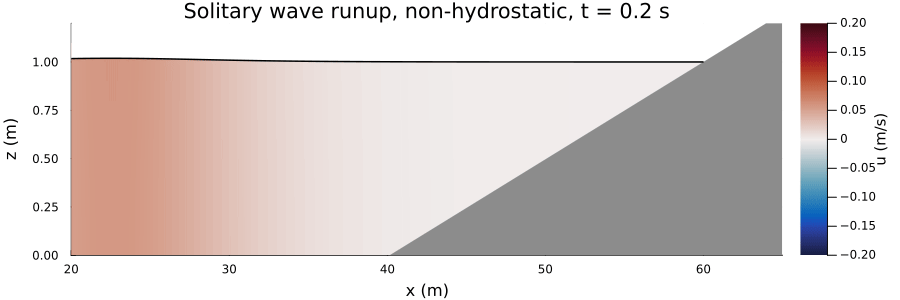

Limitations
-----------

- The wet/dry front is first order with both schemes: the depth has a kink there, the flow reverses at maximum runup and
  rundown (the limiter clips), and each column has one bed level, so the shoreline moves cell by cell (the staircase
  error dominates the runup cases). A sloping bed within each column (sub-grid bathymetry, Casulli 2009) is the
  candidate to improve the shoreline; see the plan.
- Not supported together with wetting and drying: periodic x, vegetation, k-epsilon, bed roughness, wind stress.

References
----------

- Ritter (1892), Z. Ver. Deutsch. Ing. 36, 947-954
- Carrier & Greenspan (1958), J. Fluid Mech. 4, 97-109
- Casulli & Cheng (1992), Int. J. Numer. Methods Fluids 15, 629-648
- Stelling & Duinmeijer (2003), Int. J. Numer. Methods Fluids 43, 1329-1354
- Casulli (2009), Int. J. Numer. Methods Fluids 60, 391-408
- Brugnano & Casulli (2008), SIAM J. Sci. Comput. 30, 463-472
- van Leer (1977), J. Comput. Phys. 23, 276-299 (MC limiter)
- Synolakis (1987), The runup of solitary waves, J. Fluid Mech. 185, 523-545
- Casulli (1999), Int. J. Numer. Methods Fluids 30, 425-440 (non-hydrostatic pressure)
- Delestre et al. (2013), SWASHES, Int. J. Numer. Methods Fluids 72, 269-300
