Wind-driven double gyre
=======================

A wind stress that builds up over a closed, stratified basin drives the light surface water downwind. The closed walls
force a return flow, and two counter-rotating cells form (issue #4):

- a **clockwise cell in the light upper layer**: downwind at the surface, upwind just above the interface;
- a **counter-clockwise cell in the heavy lower layer**, driven by the shear stress across the interface: upwind just
  below the interface, downwind along the bed.

The wind also tilts the interface (it rises at the upwind end) and excites an internal seiche, which oscillates on top
of the steady circulation (Spigel & Imberger 1980; Monismith 1986). The ratio of stratification to wind forcing is the
Wedderburn number W = g' h1² / (u*² L), here about 20 (g' = 0.0196 m/s², upper-layer thickness h1 = 2 m, friction
velocity squared u*² = τ/ρ0 = 2·10⁻⁴ m²/s², L = 20 m). With W >> 1 the interface tilts only slightly, by about
L u*² / (g' h1) = 0.1 m, and the interface does not upwell to the surface.

Setup
-----

- closed 20 m x 4 m basin of uniform depth, free surface on top;
- two layers at rest: 999 kg/m³ above 1001 kg/m³, interface at mid-depth;
- wind stress ramped linearly from zero to 0.2 Pa (about a 12 m/s wind) over the first 60 s, constant afterwards;
- 400 x 160 cells (dx = 0.05 m, dz = 0.025 m), dt = 0.02 s, 1800 s;
- hydrostatic and non-hydrostatic mode, `tvd2` momentum and density advection, spectral pressure solver;
- mixing-length eddy viscosity ν_t = l² |∂u/∂z| with l = 0.2 m, capped at 5·10⁻³ m²/s;
- no Rayleigh damping and no Froude limiter: both would damp or scale down the steady wind-driven circulation.

The eddy viscosity is essential. With the molecular viscosity alone (10⁻⁶ m²/s) the wind momentum stays at the surface
and no stress acts across the interface: the lower layer then only sloshes with the internal seiche, and no lower cell
forms.

The CFL number |u| dt/dx + |w| dt/dz stays below 0.24 (hydrostatic) and 0.07 (non-hydrostatic), below the `tvd2`
monotonicity limit 0.5. The density stays within the two layer values, and the water volume is conserved to round-off.

Results
-------

Density (colour) and streamlines: white for the clockwise upper cell, orange for the counter-clockwise lower cell.
Streamline spacing: 0.005 m²/s in the upper cell, 0.0025 m²/s in the lower cell.
The hydrostatic run looks nearly the same: [wind_shear_hydro.gif](figures/wind_shear_hydro.gif),
[snapshots](figures/wind_shear_hydro_snapshots.png).

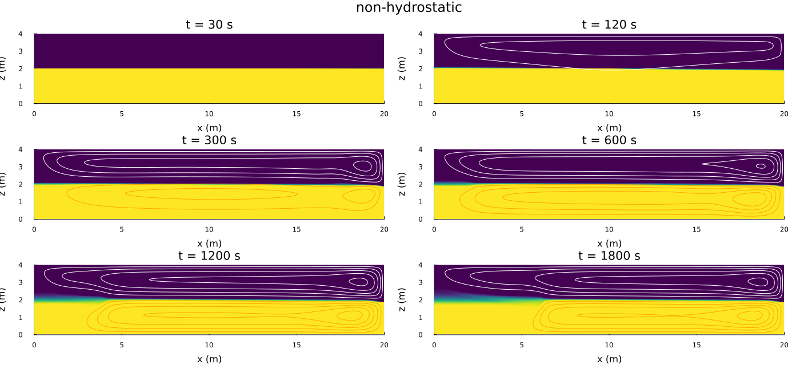

- **0-60 s (wind ramp):** the surface water accelerates downwind and the upper cell forms.
- **120 s:** a single cell fills the upper layer; the lower layer is still nearly at rest.
- **after about 170 s:** the lower, counter-rotating cell appears and strengthens.
- **600-1800 s:** both cells are fully developed. Each has its centre near the downwind wall, where the surface water
  sinks and turns back. At the upwind end the interface is thickened over the first 4-6 m. The model has no density
  diffusivity, so this thickening is numerical diffusion of the advection scheme where the interface rises and is
  sheared, not a physical entrainment rate.

**Strength of the two cells.** ψ is the streamfunction of the mean u over the middle half of the basin, with ψ = 0 at
the bed; ψ < 0 marks a clockwise cell and ψ > 0 a counter-clockwise cell.

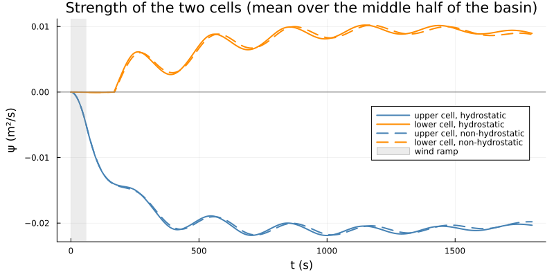

The upper cell reaches about −0.021 m²/s and the lower cell about +0.009 m²/s. Both oscillate with the internal seiche;
the peaks are about 295 s apart. The two-layer mode-1 seiche period is 2L/c = 286 s, with
c = √(g' h1 h2 / H) = 0.140 m/s.

**Mean velocity profile** (middle half of the basin, averaged over 900-1800 s):

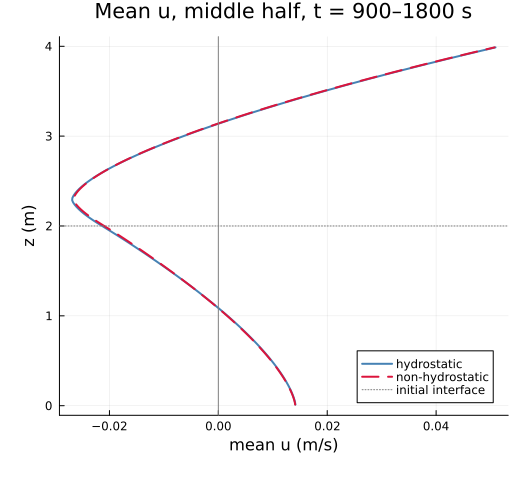

The flow is downwind at the surface (0.05 m/s) and upwind around the interface (−0.027 m/s at z ≈ 2.3 m), with zero
crossings at z ≈ 3.15 m and z ≈ 1.1 m. Along the bed it is downwind again (+0.014 m/s): this is the lower cell.

**Velocity profiles along the basin** at x = 2.5, 5, 10, 15 and 17.5 m: hydrostatic solid, non-hydrostatic dashed,
one frame per 20 s.

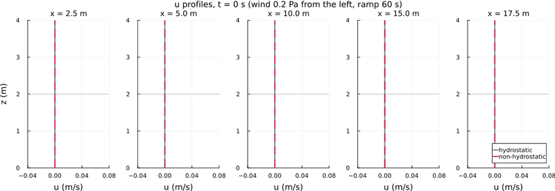

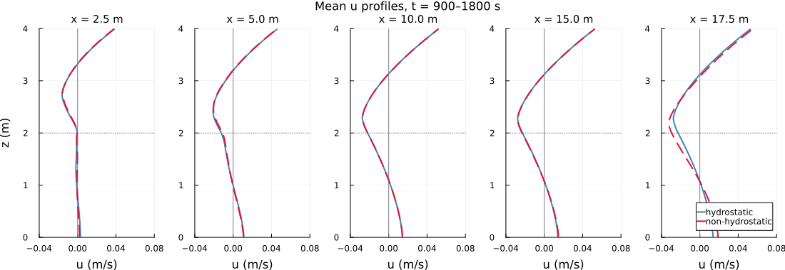

- **During the ramp** only a surface layer moves downwind. By about 120 s the upwind return flow fills the rest of the
  upper layer, while the lower layer is still at rest.
- **The lower cell** appears almost at once along most of the basin. The downwind bed flow exceeds 2 mm/s at
  206-212 s at x = 5-17.5 m, and only at 240 s at the upwind end.
- **Mean profiles** (900-1800 s): in mid-basin (x = 5-15 m) they have the four-part shape of the double gyre. At the
  upwind end (x = 2.5 m) the return flow lies higher (around z ≈ 2.7 m), and the lower layer is nearly at rest. There
  the interface has risen and thickened, and the lower cell turns before it reaches the wall.
- **Near the downwind wall** (x = 17.5 m) the two modes differ most. This is where the surface water sinks. In
  hydrostatic mode the sinking is confined to the last column of cells, so the flow just upstream of it is more
  horizontal, and the return flow peaks slightly higher than in non-hydrostatic mode.

**Time-depth diagram** of the mid-basin u (mean over the middle half of the basin; dashed: end of the wind ramp,
dotted: initial interface):

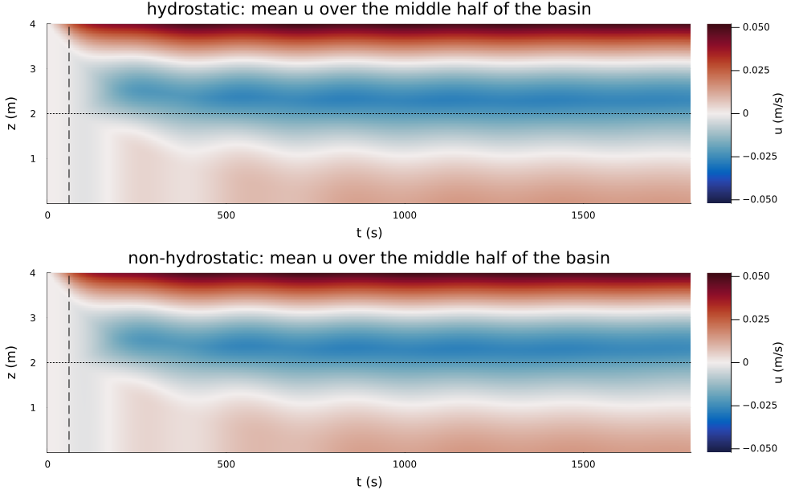

The surface jet (red) and the upper-layer return flow (blue) are established within about 200 s. The downwind bed flow
of the lower cell (light red) builds up more slowly. The zero line between the return flow and the bed flow
(z ≈ 1.1-1.5 m) oscillates with the internal-seiche period, and the lower cell reaches its full strength after
about 800 s.

**Mean streamlines** (averaged over 900-1800 s) and final density:

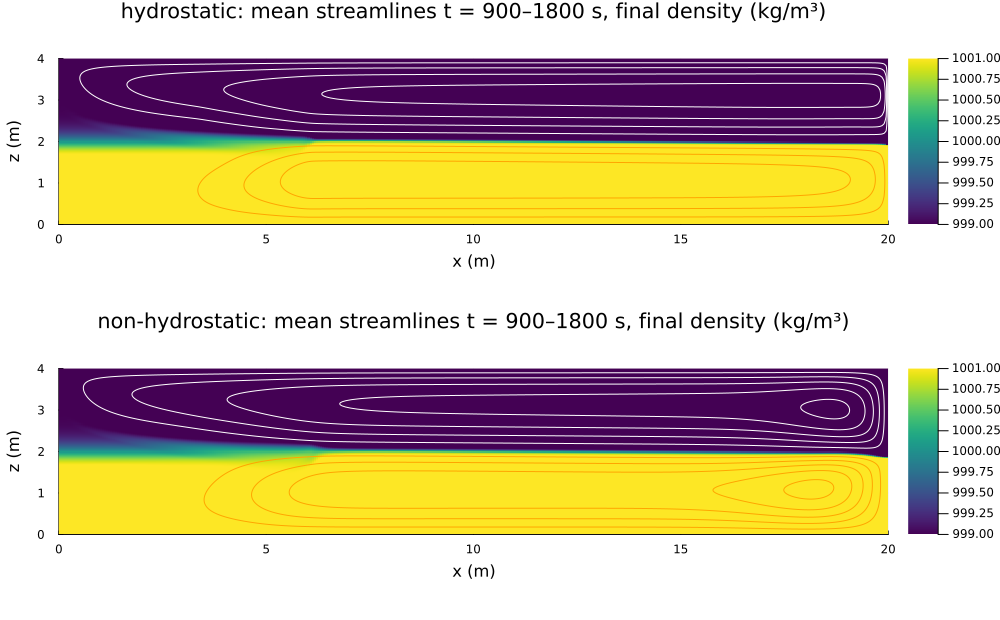

Hydrostatic and non-hydrostatic results agree closely: the cell strengths differ by less than 5 %, and the mean
profiles coincide. This is expected for a basin much longer than deep, where the horizontal scale of the circulation is
large. The only clear difference is at the downwind wall. In hydrostatic mode the sinking surface water is concentrated
in the last column of cells, with |w| up to 0.26 m/s. Without a vertical momentum equation nothing spreads it, so its
width is set by the grid. In non-hydrostatic mode the downwelling spreads over a wider wall region (|w| ≤ 0.055 m/s),
and the cell centres sit slightly further from the wall.

Comparison with exact solutions (constant viscosity)
-----------------------------------------------------

With the mixing-length viscosity there is no exact solution. With a constant viscosity there is one: far from the end
walls the steady flow is horizontally uniform and obeys, in each layer, ν ∂²u/∂z² = G, with G the pressure gradient
divided by ρ0. The conditions are no stress at the bed (the model's free-slip bed), the wind stress at the surface,
and zero net flux through each layer of the closed basin. With s = τ/(ρ0 ν):

- **uniform density:** u = s/(2H) (z² − H²/3), surface slope ∂η/∂x = τ/(ρ0 g H);
- **two layers** (thickness a below, b above the interface; velocity and stress continuous at the interface):
  - lower layer: u = g1 (z² − a²/3)/2;
  - upper layer: u = g2 ζ²/2 + g1 a ζ + g1 a²/3, with ζ = z − a;
  - coefficients: g1 = −s b/(2aH) and g2 = s (2H + b)/(2bH);
  - slopes: surface ∂η/∂x = ν g2/g, interface ∂ζ/∂x = ν (g1 − g2)/g'.

Since g1 < 0, the exact solution itself contains the double gyre: upwind flow just below the interface and downwind
flow along the bed. The steady velocity does not depend on the density difference; only the interface tilt does. The
derivation is given in the docstrings of `wind_steady_uniform` and `wind_steady_two_layer` in `cases.jl`.

`plot_wind_shear_analytic.jl` runs the 20 m basin from rest with ν = 0.01 m²/s and the same wind ramp. The grid is
200 x 80 cells, dt = 0.05 s, and the run lasts 3600 s; the viscous time H²/ν is 1600 s. It runs uniform density and
two layers, each in both modes. The exact velocities are small for this large viscosity: the surface velocity is
0.027 m/s (uniform) and 0.012 m/s (two layers).

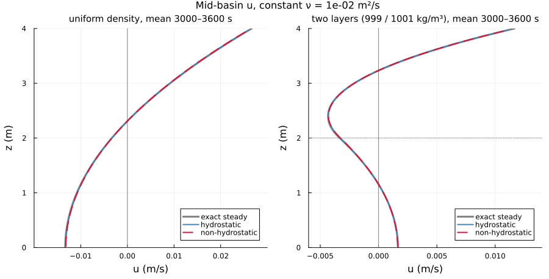

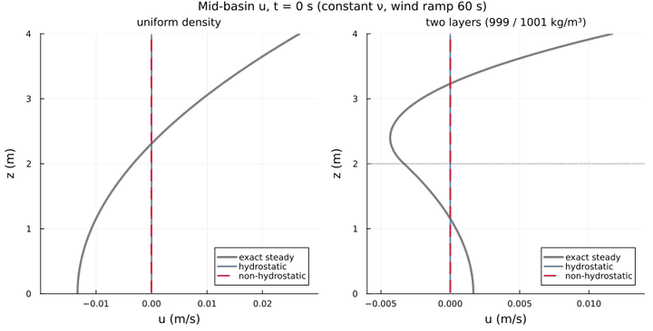

The model profiles (mean u over x = 7.5-12.5 m, averaged over 3000-3600 s) lie on the exact profiles in both cases
and both modes.

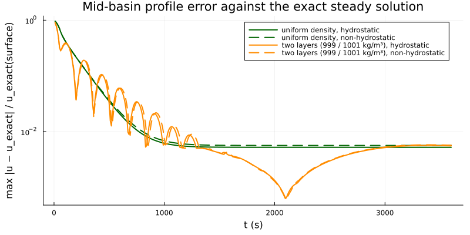

- **Error (uniform density):** the error decays on the viscous time scale. It settles at 0.52 % (hydrostatic) and
  0.56 % (non-hydrostatic) of the exact surface velocity.
- **Error (two layers):** the internal seiche oscillates on top of this decay; the error minima recur about every
  165 s (the inviscid half period is 143 s). The seiche is damped after about 1500 s. The error then passes slowly through zero (around
  2100 s) and settles at 0.55 % and 0.57 %, the same level as for uniform density.
- **Origin of the remaining 0.5 %:** most likely the finite basin. The middle quarter is only 1.9 depths from the end
  walls, where the flow turns. Started from the exact state in a 40 m basin with the same dz, the error is 0.015 %
  (below).

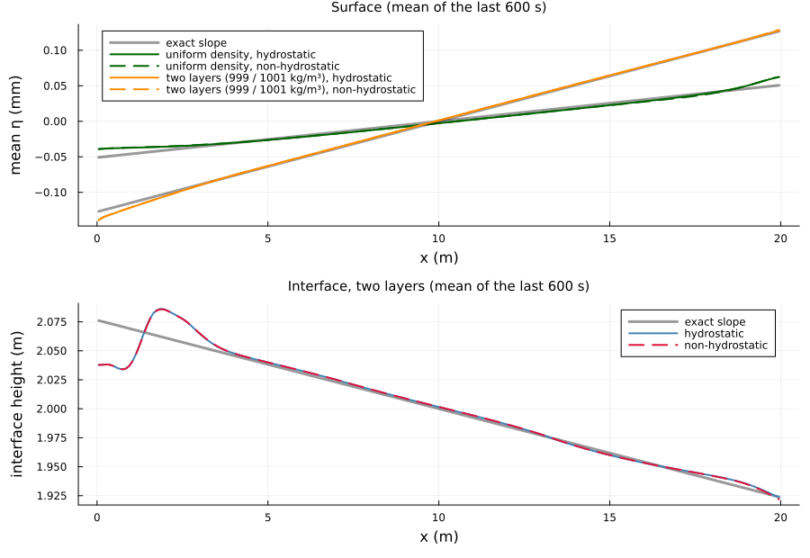

The surface follows the exact slopes away from the end walls; near the walls it bends, where the flow turns. The
interface follows the exact tilt (−7.6·10⁻³, i.e. 0.15 m over the basin) except over the first 3 m at the upwind end.
There the tilt spans only a few cells, so the interface is a staircase of whole cells.

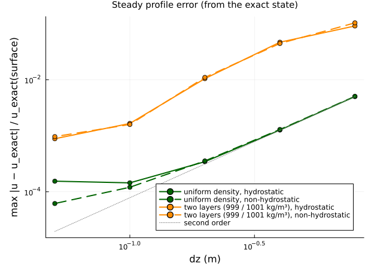

**Grid convergence**, starting from the exact steady state in a 40 m basin (40 columns):

- **Uniform density:** the error converges at second order, from 0.50 % (nz = 5) to 0.034 % (nz = 20). This matches
  the discrete zero-flux condition exactly: its midpoint-rule error is a uniform offset s dz²/(24H). Below about
  10⁻⁴ of the surface velocity the hydrostatic error stops decreasing, independent of the run length (not investigated
  further).
- **Two layers:** the error falls from about 10 % (nz = 5, where the 0.3 m interface tilt over 40 m is smaller than one
  cell) to 0.09 % (nz = 80). It converges less regularly, because the tilted interface is a staircase of whole cells.

The regression tests `test_verify_steady_wind_profile_uniform_density_second_order` and
`test_validate_steady_two_layer_wind_double_gyre` (`test/test_model.jl`) check these solutions in both modes.

Model corrections found with this case
--------------------------------------

Setting up the case exposed three defects; all are fixed and covered by tests:

- **Vertical viscous coupling of the top and bottom rows:** the diffusion of u skipped the top and bottom rows. A wind
  stress therefore stayed in the top cell. At dz = 0.025 m the resulting surface jet kept accelerating, and the
  hydrostatic run broke down at the downwind wall. The viscous term is now in flux form with zero flux through the bed
  and the surface (`test_verify_diffusion_flux_form_*`).
- **Wind stress in the predictor:** the wind increment was added to u after the free-surface solve and the
  non-hydrostatic projection. The volume and kinematic budgets therefore did not close in the two wall columns. It is
  now part of the provisional velocity, as in the semi-implicit scheme of Casulli & Cheng (1992)
  (`test_verify_wind_forcing_closes_volume_and_kinematic_budgets`).
- **Wall flux in the fixed-grid free-surface solve:** in non-hydrostatic mode the water volume drifted under wind,
  because the predictor's wall faces entered the barotropic solve. The wall boundary values are now enforced before
  the solve in all modes (same test).

Details: sections 5, 9 and 10 of `test/TESTS_TECHNICAL_DOCUMENTATION.md`. The regression test
`test_validate_wind_driven_double_gyre` (`test/test_model.jl`) checks the double gyre in a smaller 10 m basin in both
modes.

Scripts
-------

- `plot_wind_shear.jl`: runs both modes and writes the figures above, plus an `.npz` file per mode with the cell
  strengths, the time-averaged u, the u profiles at the five stations and in mid-basin (every 2 s) and the final
  density. Output goes to `output_barotropic/wind_shear_figures/`; the
  figures here are copies, with the GIFs reduced to every second frame and 640 px (profiles: 800 px) width. Run time about 20 min
  (7 min hydrostatic, 10 min non-hydrostatic, plus plotting). `figures` only redraws the comparison figures from the
  `.npz` files:

      julia --project=. experiments/wind_shear/plot_wind_shear.jl            # both modes
      julia --project=. experiments/wind_shear/plot_wind_shear.jl nonhydro   # one mode
      julia --project=. experiments/wind_shear/plot_wind_shear.jl figures

- `plot_wind_shear_analytic.jl`: the comparison with the exact solutions above. Part `runs` (from rest, about
  5 min) and part `convergence` (from the exact state, about 5 min). Output goes to
  `output_barotropic/wind_shear_analytic_figures/`; the GIF here is reduced to every second frame and 720 px width:

      julia --project=. experiments/wind_shear/plot_wind_shear_analytic.jl            # runs, convergence, figures
      julia --project=. experiments/wind_shear/plot_wind_shear_analytic.jl figures    # redraw from the .npz files

- `cases.jl`: case parameters, model settings, wind ramp, streamfunction diagnostics, and the exact steady solutions
  for a constant viscosity.

The former 30 s preview `run_wind_shear_dt001_30s_anim.jl` (constant wind, first-order upwind momentum, Froude limiter)
has been removed. `experiments/validation/validate_wind_shear_transport_mixing.jl` still checks the early surface
acceleration, u ≈ τ t / (ρ0 dz).

References
----------

- Spigel & Imberger (1980), J. Phys. Oceanogr. 10, 1104-1121 (wind-induced mixing in a two-layer lake)
- Monismith (1986), J. Fluid Mech. 171, 407-439 (wind-forced motions in stratified lakes)
- Large & Pond (1981), J. Phys. Oceanogr. 11, 324-336 (wind stress)
- Casulli & Cheng (1992), Int. J. Numer. Methods Fluids 15, 629-648 (semi-implicit free-surface scheme)
